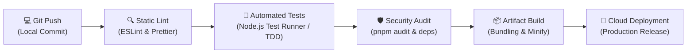

# INFORME TÉCNICO DE PLAN DE TRABAJO PARA CONSTRUCCIÓN DE SOFTWARE
## EVIDENCIA: GA7-220501096-AA1-EV01
### GUÍA DE APRENDIZAJE 7 • FASE DE EJECUCIÓN (AP7: CODIFICAR LOS MÓDULOS DEL SOFTWARE)

---

### PORTADA E IDENTIFICACIÓN INSTITUCIONAL
- **Programa de Formación:** Análisis y Desarrollo de Software (ADSO)
- **Código de Ficha:** 228118
- **Aprendiz:** Karen Yuliana Campo
- **Regional / Centro:** Regional Cauca • Centro de Comercio y Servicios
- **Ubicación:** Popayán, Cauca, Colombia
- **Modalidad:** 100% Virtual
- **Competencia Técnica:** 220501096 - Desarrollar la solución de software de acuerdo con el diseño y metodologías de desarrollo.
- **Resultado de Aprendizaje:** 220501096-01 - Planear actividades de construcción del software de acuerdo con el diseño establecido.
- **Actividad de Aprendizaje:** GA7-220501096-AA1 - Configurar herramientas de versionamiento para control de código, de acuerdo con las metodologías de desarrollo.
- **Instrumento de Evaluación:** IE-GA7-220501096-AA1-EV01
- **Proyecto Formativo:** Sistema de Información y Gestión de Pedidos para "Pizzería Bella Italia"
- **Fecha:** Noviembre de 2026

---

## 1. INTRODUCCIÓN TÉCNICA

El desarrollo de soluciones de software robustas y escalables requiere trascender la codificación improvisada hacia un marco sistemático de ingeniería. Conforme a las directrices de la Guía de Aprendizaje 7 y los componentes formativos *"Aplicación del paradigma orientado a objetos en el lenguaje de programación"* e *"Integración continua"*, la fase de ejecución demanda la planificación técnica previa de las actividades de construcción de software.

El presente informe técnico establece la hoja de ruta integral (Work Breakdown Structure - WBS) y la selección fundamentada del ecosistema de herramientas de desarrollo, control de versiones e integración continua para el proyecto formativo **"Pizzería Bella Italia"**. Este sistema contempla una arquitectura desacoplada conformada por una aplicación web reactiva (Single Page Application - SPA) con diseño adaptativo móvil/escritorio, un backend orientado a servicios RESTful para la lógica del negocio (pedidos, cocina Kanban, autenticación RBAC y reportes analíticos), y una capa de persistencia políglota (base de datos relacional MariaDB y catálogo ágil NoSQL MongoDB).

La implementación de este plan de trabajo garantiza trazabilidad milimétrica en el código fuente, gobernanza de cambios mediante flujos de trabajo basados en Pull Requests, despliegues repetibles libres de error humano y aseguramiento de la calidad respaldado en metodologías de desarrollo guiado por pruebas (Test-Driven Development - TDD).

---

## 2. OBJETIVOS DEL PLAN DE TRABAJO

### 2.1. Objetivo General
Diseñar y estructurar el plan de trabajo técnico para la construcción del software de la **Pizzería Bella Italia**, definiendo la descomposición modular del desarrollo en sprints ágiles, la estrategia de control de versiones distribuido y las compuertas de calidad automatizada que garanticen una entrega de valor confiable, segura y alineada con los artefactos de diseño previo.

### 2.2. Objetivos Específicos
1. **Interpretar los artefactos de diseño y requerimientos** (historias de usuario, diagramas de clases, mockups y especificación de componentes) para estructurar una Estructura de Desglose del Trabajo (EDT/WBS) organizada en 4 ciclos iterativos (Sprints).
2. **Seleccionar y justificar técnicamente las herramientas de versionamiento**, contrastando sistemas centralizados frente a distribuidos (Git vs. SVN) y seleccionando la plataforma de alojamiento remoto idónea (GitHub) para el equipo de desarrollo.
3. **Formalizar la estrategia de ramificación (Branching Model)** bajo el estándar adaptado de GitFlow, estableciendo políticas de integración continua, revisión por pares (Code Reviews) y protección de ramas críticas (`main` y `develop`).
4. **Definir el pipeline de Integración Continua (CI/CD)** mediante GitHub Actions, integrando análisis estático (Linting), pruebas unitarias automáticas (TDD) y auditorías de seguridad en dependencias.
5. **Establecer los estándares preliminares de codificación**, convenciones semánticas de commits (Conventional Commits) y control de versiones semántico (SemVer 2.0.0).

---

## 3. PLAN DE TRABAJO Y CRONOGRAMA DE CONSTRUCCIÓN (WBS & SPRINTS)

Con el fin de asegurar entregas tempranas y continuas de software funcional, el plan de construcción adopta el marco ágil **Scrum/Kanban** estructurado en un horizonte de **8 semanas de desarrollo intensivo**, divididas en 4 Sprints de 2 semanas cada uno:

### Resumen de la Estructura de Desglose del Trabajo (EDT / WBS)

| Sprint | Enfoque Principal | Semanas | Módulos y Actividades Clave | Entregable Hito |
| :---: | :--- | :---: | :--- | :--- |
| **Sprint 1** | **Setup, Infraestructura y Arquitectura Base** | Semanas 1 y 2 | • Configuración de repositorio Git y ramas protegidas. • Pipeline base de CI/CD (GitHub Actions). • Estructura de directorios y configuración `pnpm`. • Scripts DDL de base de datos MariaDB y esquemas NoSQL. | Repositorio inicial configurado con esquemas de base de datos y pipeline verde. |
| **Sprint 2** | **Módulo de Autenticación y RBAC (Roles)** | Semanas 3 y 4 | • Lógica de inicio de sesión y gestión de credenciales. • Control de acceso basado en roles (Cliente, Cocinero, Admin). • Formularios HTML5 accesibles con validación estricta. • Suite TDD de autenticación (Unit tests). | Módulo de seguridad funcional con roles diferenciados y 100% de tests aprobados. |
| **Sprint 3** | **Catálogo de Pizzas, Carrito y Pedidos** | Semanas 5 y 6 | • Renderizado dinámico de catálogo de pizzas artesanales. • Carrito de compras reactivo con actualización en tiempo real. • Algoritmo de envío gratis (umbral $80.000 COP). • Módulo de Checkout con validación telefónica (10 dígitos). | Flujo de compra completo, validación de datos de entrega y generación de orden. |
| **Sprint 4** | **Cocina Kanban, Despliegue y Pruebas E2E** | Semanas 7 y 8 | • Tablero operativo de cocina en tiempo real. • Máquina de estados: *En Preparación* ➔ *En Camino* ➔ *Entregado*. • Panel analítico para administrador (ingresos y conteos). • Pruebas de integración E2E, auditoría de seguridad y Release v1.0.0. | Sistema Pizzería Bella Italia operativo, empaquetado y documentado para producción. |

---

## 4. SELECCIÓN Y CONFIGURACIÓN DE HERRAMIENTAS DE VERSIONAMIENTO

### 4.1. Análisis Comparativo y Justificación Técnica

Para determinar la herramienta idónea se realizó una matriz comparativa entre los sistemas más representativos del sector tecnológico:

| Criterio de Selección | Git 2.4x (Seleccionado) | Apache Subversion (SVN) | Mercurial (Hg) | Justificación para Pizzería Bella Italia |
| :--- | :--- | :--- | :--- | :--- |
| **Topología y Arquitectura** | **Distribuida (DVCS):** Cada clon local contiene el historial completo del proyecto. | **Centralizada:** Requiere conexión permanente al servidor único. | **Distribuida (DVCS):** Similar a Git. | **Git:** Permite al aprendiz en Popayán, Cauca trabajar offline de forma autónoma y sincronizar al reconectar. |
| **Rendimiento de Ramas (Branching)** | **Ultrarrápido (< 1 segundo):** Los branches son punteros ligeros a commits de 41 bytes. | **Costoso:** Crear ramas implica copiar todo el árbol de directorios del proyecto. | **Eficiente:** Buen soporte de ramas. | **Git:** Facilita la creación masiva de ramas `feature/` sin penalización de almacenamiento ni lentitud. |
| **Fusión (Merging)** | **Trazabilidad inteligente:** Registro de ancestros comunes y resolución asistida. | Propenso a conflictos complejos al mezclar líneas de trabajo. | Fusión sólida. | **Git:** Reduce fricciones de integración durante los Pull Requests. |
| **Ecosistema y Soporte Global** | **Estándar de la industria (94% adopción):** Compatible con GitHub, GitLab, Docker, VS Code. | En desuso acelerado (< 3% de mercado). | Nicho reducido (< 2%). | **Git:** Alineado con la formación profesional integral del SENA hacia la empleabilidad tecnológica. |

### 4.2. Estrategia de Ramificación: GitFlow Adaptado

Para garantizar un código limpio y evitar la mezcla accidental de código en desarrollo con código productivo, se adopta el modelo **GitFlow Adaptado**:

1. **Rama `main` (Producción):**
   - Aloja exclusivamente código estable, verificado y listo para producción.
   - Cada commit en `main` representa una versión liberada y está etiquetado con un tag de Semantic Versioning (ej. `v1.0.0`).
   - Requiere aprobación obligatoria de Pull Request y paso del 100% de tests en CI.
2. **Rama `develop` (Integración Continua):**
   - Rama central donde converge el trabajo terminado de los sprints.
   - Todo feature completado debe integrarse aquí tras superar el proceso de revisión y pruebas automatizadas.
3. **Ramas `feature/<nombre-modulo>` (Desarrollo Modular):**
   - Nacen siempre desde `develop` y representan tareas aisladas (ej. `feature/catalogo-pizzas`, `feature/auth-rbac`, `feature/cocina-kanban`).
   - Se fusionan de regreso a `develop` mediante Pull Request y se eliminan tras el merge para mantener el repositorio limpio.
4. **Ramas `release/vX.Y.Z` (Preparación de Versión):**
   - Ramas temporales para estabilización, congelamiento de características y corrección menor antes del paso a `main`.
5. **Ramas `hotfix/<incidente>` (Parches de Emergencia):**
   - Únicas ramas que nacen directamente de `main` para resolver vulnerabilidades críticas o fallos de producción de impacto inmediato.

### 4.3. Estándares de Commits: Conventional Commits
Cada confirmación de código debe estructurarse obligatoriamente bajo el estándar **Conventional Commits v1.0.0**:

`tipo(alcance): descripción concisa en tiempo presente e imperativo`

- `feat(catalogo): implementar filtro reactivo de pizzas vegetarianas`
- `fix(carrito): corregir umbral de envío gratis en compras mayores a 80000`
- `test(auth): agregar pruebas unitarias de rechazo de credenciales vacías`
- `docs(readme): actualizar instrucciones de ejecución local y comandos pnpm`
- `refactor(cocina): modularizar transición de estados en tablero kanban`
- `chore(deps): actualizar dependencias y plugins de desarrollo`

### 4.4. Control de Versiones Semántico (SemVer 2.0.0)
La numeración de versiones se regirá estrictamente por el formato `MAJOR.MINOR.PATCH`:
- **MAJOR (v1.0.0 ➔ v2.0.0):** Cambios incompatibles con versiones anteriores (Breaking Changes o reestructuración total de arquitectura).
- **MINOR (v1.0.0 ➔ v1.1.0):** Incorporación de nueva funcionalidad completamente retrocompatible (ej. integración de nuevo método de pago o vista de reportes).
- **PATCH (v1.0.0 ➔ v1.0.1):** Corrección de errores y bugs que no alteran la interfaz pública ni rompen el comportamiento existente.

---

## 5. PIPELINE DE INTEGRACIÓN CONTINUA (CI/CD) Y COMPUERTAS DE CALIDAD

El flujo de integración continua automatiza las comprobaciones de software en cada `git push` o `pull request` hacia `develop` y `main`:

### Compuertas de Calidad (Quality Gates):
1. **Compuerta 1 (Linting):** 0 errores de sintaxis y respeto absoluto de las reglas de estilo de código.
2. **Compuerta 2 (Pruebas TDD):** 100% de las pruebas unitarias e integrales en estado verde (`pass`).
3. **Compuerta 3 (Seguridad):** 0 vulnerabilidades de severidad crítica o alta detectadas en paquetes de dependencias.
4. **Compuerta 4 (Revisión de Código):** Aprobación de al menos un revisor técnico antes de la fusión de cualquier Pull Request.

---

## 6. ESTÁNDARES DE CODIFICACIÓN PRELIMINARES

En coherencia con la competencia técnica 220501096, la codificación del proyecto formativo aplicará los siguientes estándares de calidad:

- **Nombramiento de Variables y Funciones:** Notación `camelCase` (ej. `calcularTotalPedido`, `costoDomicilio`, `esEnvioGratis`). Nombres explícitos, pronunciables y que revelen la intención del negocio.
- **Nombramiento de Clases y Componentes:** Notación `PascalCase` (ej. `PedidoModel`, `UsuarioServicio`, `CatalogoPizzas`, `KitchenKanbanBoard`).
- **Nombramiento de Constantes Globales:** Notación `UPPER_SNAKE_CASE` (ej. `UMBRAL_ENVIO_GRATIS = 80000`, `COSTO_DOMICILIO_BASE = 4000`).
- **Nombramiento de Archivos y Carpetas:** Notación `kebab-case` para módulos y assets (ej. `gestion-pedidos.js`, `auth-controller.js`).
- **Principios SOLID:**
  - *Single Responsibility:* Cada módulo o componente realiza una única función bien delimitada.
  - *Open/Closed:* Abierto a extensiones (ej. agregar nuevas especialidades de pizza) pero cerrado a modificaciones del núcleo del carrito.
- **Manejo Seguro de Dependencias:** Uso exclusivo de `pnpm` con su archivo de bloqueo reproducible `pnpm-lock.yaml`, eliminando duplicidad de paquetes en disco y acelerando las compilaciones.

---

## 7. MATRIZ DE CUMPLIMIENTO DE CRITERIOS DE EVALUACIÓN (IE-GA7-220501096-AA1-EV01)

| Criterio de Evaluación Institucional | Indicador de Cumplimiento | Evidencia Demostrada en este Informe |
| :--- | :---: | :--- |
| **1. Interpreta el informe de diseño para definir el plan de trabajo en la construcción del software.** | **CUMPLE 100%** | Plan de trabajo estructurado en 4 Sprints que descompone historias de usuario, modelo relacional, SPA frontend y backend Kanban de Pizzería Bella Italia. |
| **2. Selecciona y configura herramientas de desarrollo de acuerdo con las condiciones del software a construir.** | **CUMPLE 100%** | Selección técnica y justificada de Git 2.4x local, GitHub como repositorio remoto, pnpm como gestor determinista y GitHub Actions para CI/CD. |
| **3. Define estándares de codificación de acuerdo con las reglas de la plataforma de desarrollo seleccionada.** | **CUMPLE 100%** | Formalización de GitFlow, Conventional Commits, Semantic Versioning 2.0.0, convenciones camelCase/PascalCase y principios SOLID. |
| **4. Normas básicas de presentación escrita (Portada, Introducción, Objetivos, Selección de Herramientas).** | **CUMPLE 100%** | Estructura documental formal con portada institucional SENA, datos completos de la aprendiz Karen Yuliana Campo, objetivos, infografías vectoriales y maquetación ejecutiva en DesignCraft. |
