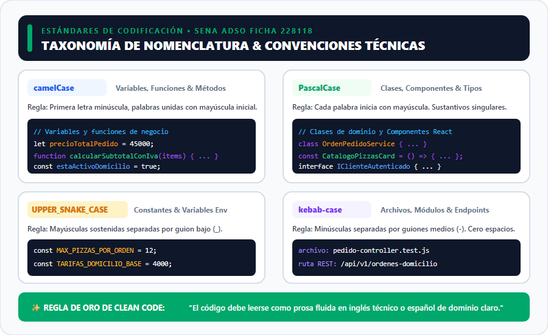
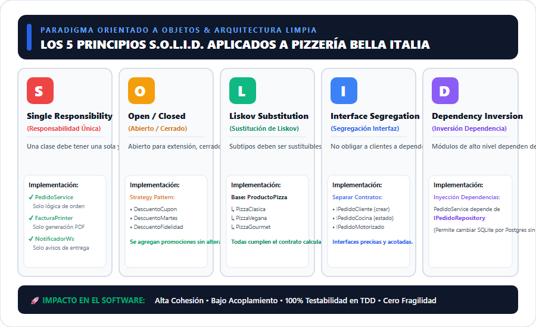
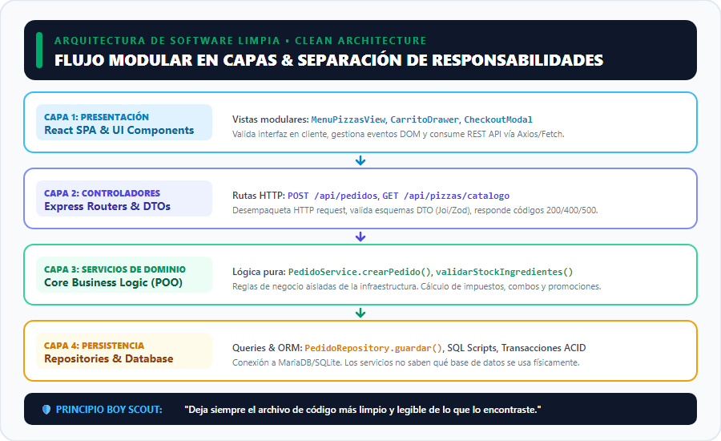
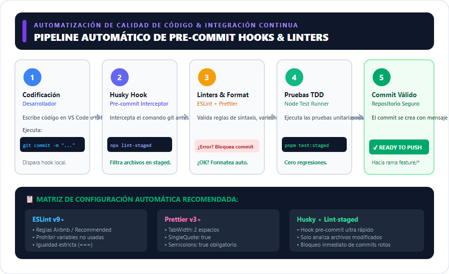

# MANUAL TÉCNICO DE ESTÁNDARES DE CODIFICACIÓN Y CALIDAD DE SOFTWARE

---

## 🏛️ Portada Institucional

- **Servicio Nacional de Aprendizaje (SENA)**
- **Centro de Comercio y Servicios – Regional Cauca**
- **Programa de Formación:** Tecnólogo en Análisis y Desarrollo de Software (ADSO)
- **Modalidad:** 100% Virtual
- **Ficha de Caracterización:** 228118
- **Fase del Proyecto:** Fase de Ejecución – Actividad de Proyecto AP7: *Codificar los módulos del software*
- **Competencia:** 220501096 – *Desarrollar la solución de software de acuerdo con el diseño y metodologías de desarrollo*
- **Actividad de Aprendizaje:** GA7-220501096-AA1 – *Configurar herramientas de versionamiento para control de código, de acuerdo con las metodologías de desarrollo*
- **Código de Evidencia:** **GA7-220501096-AA1-EV02**
- **Nombre de la Evidencia:** *Definir estándares de codificación, de acuerdo con la plataforma de desarrollo elegida*
- **Instrumento de Evaluación:** Lista de Chequeo IE-GA7-220501096-AA1-EV02
- **Proyecto Formativo:** *Sistema de Información y Gestión de Pedidos para "Pizzería Bella Italia"*
- **Aprendiz:** Karen Yuliana Campo
- **Ubicación:** Popayán, Cauca, Colombia
- **Fecha de Elaboración:** Noviembre de 2026

---

## 📑 Tabla de Contenido
1. [Introducción](#1-introducción)
2. [Objetivos](#2-objetivos)
   - [Objetivo General](#objetivo-general)
   - [Objetivos Específicos](#objetivos-específicos)
3. [Plataforma Tecnológica Seleccionada](#3-plataforma-tecnológica-seleccionada)
4. [Taxonomía de Nomenclatura y Convenciones de Código](#4-taxonomía-de-nomenclatura-y-convenciones-de-código)
5. [Aplicación del Paradigma Orientado a Objetos (POO)](#5-aplicación-del-paradigma-orientado-a-objetos-poo)
6. [Los 5 Principios S.O.L.I.D. Aplicados](#6-los-5-principios-solid-aplicados)
7. [Arquitectura en Capas y Principios Clean Code](#7-arquitectura-en-capas-y-principios-clean-code)
8. [Automatización de Calidad: Linters, Formateadores y Pre-commit Hooks](#8-automatización-de-calidad-linters-formateadores-y-pre-commit-hooks)
9. [Matriz de Cumplimiento de la Lista de Chequeo SENA](#9-matriz-de-cumplimiento-de-la-lista-de-chequeo-sena)
10. [Conclusiones](#10-conclusiones)
11. [Referencias Bibliográficas](#11-referencias-bibliográficas)

---

## 1. Introducción

En la ingeniería de software moderna, la redacción de código no es únicamente una instrucción operativa para una máquina, sino un medio de comunicación formal entre desarrolladores y una inversión crítica en la mantenibilidad de la solución a lo largo del tiempo. Diversas investigaciones en la industria del software (*Robert C. Martin, McConnell, Fowler*) demuestran que la relación entre el tiempo dedicado a leer código existente frente a escribir código nuevo supera una proporción de **10 a 1**. Por consiguiente, la ausencia de estándares claros desencadena una degradación exponencial conocida como **deuda técnica**, lo que incrementa el costo de corrección de defectos y ralentiza la incorporación de nuevas funcionalidades.

El presente **Manual Técnico de Estándares de Codificación** establece las directrices de ingeniería, convenciones de nomenclatura, fundamentos de la Programación Orientada a Objetos (POO), aplicación rigurosa de los principios SOLID, lineamientos de código limpio (*Clean Code*) y herramientas de automatización de calidad para el sistema de información de **Pizzería Bella Italia**, desarrollado por la aprendiz Karen Yuliana Campo en el marco del programa ADSO del SENA.

Mediante este instrumento técnico, se garantiza que cada línea de código producida mantenga legibilidad óptima, alta cohesión, bajo acoplamiento, ausencia de efectos colaterales indeseados y una estructura modular testeable mediante pruebas continuas dirigidas por pruebas (*TDD - Test-Driven Development*).

---

## 2. Objetivos

### Objetivo General
Definir e implementar un marco normativo y operativo de estándares de codificación, buenas prácticas de desarrollo limpio (*Clean Code*), principios SOLID y compuertas automatizadas de aseguramiento de la calidad de software para la plataforma Full-Stack basada en Node.js, Express y React, orientada a la construcción modular del sistema de información de **Pizzería Bella Italia**.

### Objetivos Específicos
1. **Normalizar la nomenclatura técnica:** Establecer convenciones unificadas de nomenclatura sintáctica y semántica para variables, constantes, clases, métodos, funciones, módulos, endpoints REST y ramas de control de versiones.
2. **Implementar los cuatro pilares de la POO:** Aplicar abstracción, encapsulamiento, herencia y polimorfismo en las entidades del dominio de la pizzería (*Pedido*, *ProductoPizza*, *Cliente*, *MetodoPago*).
3. **Adoptar los 5 principios S.O.L.I.D.:** Documentar y contrastar ejemplos prácticos de código correcto frente a violaciones comunes, asegurando modularidad y bajo acoplamiento.
4. **Diseñar una arquitectura limpia en capas:** Definir la separación estricta entre la capa de presentación (React SPA), controladores HTTP (Express), lógica de dominio (Servicios POO) y persistencia (Repositorios SQL/ORM).
5. **Configurar el pipeline de calidad estática:** Establecer reglas automatizadas con ESLint, Prettier y ganchos de pre-confirmación (*Git pre-commit hooks con Husky y lint-staged*), evitando el ingreso de código defectuoso o mal formateado al repositorio.
6. **Cumplir a cabalidad con la lista de chequeo SENA:** Responder a cada uno de los criterios definidos en el instrumento `IE-GA7-220501096-AA1-EV02` de la Guía de Aprendizaje 7.

---

## 3. Plataforma Tecnológica Seleccionada

Para el proyecto formativo **Pizzería Bella Italia**, se ha seleccionado una plataforma de desarrollo **Full-Stack basada en JavaScript / TypeScript**, sustentada en estándares ECMAScript modernos (ES2022+) y un ecosistema industrial unificado:

| Capa Tecnológica | Tecnología / Framework | Versión Base | Propósito y Justificación Técnica |
|---|---|---|---|
| **Capa de Servidor (Backend)** | Node.js + Express.js | Node v20 LTS / Express v4.19+ | Arquitectura no bloqueante y orientada a eventos para procesar pedidos concurrentes en tiempo real con latencia mínima. |
| **Capa de Cliente (Frontend)** | React SPA + Vite | React v18+ / Vite v5+ | Modelo reactivo basado en componentes reutilizables con DOM virtual de alto rendimiento para el catálogo y carrito. |
| **Persistencia de Datos** | SQLite (Dev) / MariaDB (Prod) | SQL ANSI / MariaDB 10.6+ | Integridad referencial ACID, consultas transaccionales y aislamiento entre lectura de órdenes y registro financiero. |
| **Motor de Pruebas (TDD)** | Node Test Runner / Jest | Node `node:test` nativo | Ejecución ultrarrápida de pruebas unitarias, aserciones estrictas y reporte de cobertura sin dependencias externas pesadas. |
| **Linters y Formateo** | ESLint + Prettier | ESLint 9+ / Prettier 3+ | Análisis estático de código, detección temprana de errores de tipos implícitos y estandarización visual de formato. |
| **Gestión de Paquetes** | pnpm | v12+ | Instalación determinista mediante almacenamiento de contenido direccionable (*symlinks*), reduciendo el consumo de disco. |

---

## 4. Taxonomía de Nomenclatura y Convenciones de Código

La consistencia en los nombres es el pilar más evidente de un código limpio. Los identificadores deben ser **pronunciables, semánticos y autoexplicativos**, evitando abreviaturas crípticas (ej. `usr` o `tmp`) y prefijos húngaros obsoletos.



### 4.1. Reglas por Tipología de Identificador

1. **Nombramiento de Variables y Constantes (`camelCase` y `UPPER_SNAKE_CASE`):**
   - Las variables inician con letra minúscula. Las palabras sucesivas inician con mayúscula.
   - Las variables booleanas deben anteponer verbos como `es`, `tiene`, `esta` o sus equivalentes en inglés `is`, `has`, `can`.
   - *Ejemplos correctos:* `precioTotalConIva`, `estaDomicilioHabilitado`, `calcularTotalPedido()`, `obtenerPizzaPorId()`.
   - *Ejemplos incorrectos:* `ptotal`, `calc_tot()`, `bandera1`, `Pizzas`.
   - Las constantes globales y variables de entorno usan `UPPER_SNAKE_CASE` para erradicar **números mágicos**: `MAX_PIZZAS_POR_PEDIDO = 12;`, `TARIFA_DOMICILIO_BASE_COP = 4000;`.

2. **Declaración de Clases e Interfaces (`PascalCase`):**
   - Cada palabra inicia con mayúscula. Son sustantivos singulares representativos del dominio.
   - En la **declaración de clases**, el constructor debe inicializar las propiedades defensivamente, declarando los atributos privados al inicio.
   - Los componentes de React deben reflejar su rol visual o funcional en `PascalCase`.
   - *Ejemplos correctos:* `class PedidoService { ... }`, `class PizzaEspecial { ... }`, `const CarritoDrawer = () => {}`, `interface ICliente`.
   - *Ejemplos incorrectos:* `class pedidoService`, `const carrito_drawer`, `class PizzasData`.

3. **Declaración de Métodos y Funciones:**
   - La **declaración de métodos** y funciones se realiza en `camelCase`, iniciando siempre con un verbo imperativo o infinitivo que refleje fielmente su única responsabilidad (*Single Responsibility*).
   - Métodos de acceso (*getters*) deben retornar valores sin mutar el estado. Métodos mutadores (*setters* o acciones) deben validar sus parámetros antes de asignar.
   - *Ejemplos correctos:* `calcularTotalConDescuento()`, `actualizarEstadoPedido()`, `verificarDisponibilidadIngrediente()`.

4. **Nomenclatura de Archivos, Directorios y Endpoints (`kebab-case`):**
   - Minúsculas separadas por guiones medios (`-`). Nunca utilizar espacios ni caracteres especiales en nombres de archivos.
   - *Ejemplos correctos:* `pedido-controller.js`, `pizza-repository.test.js`, `/api/v1/ordenes-domicilio`, `.btn-checkout-primary`.
   - *Ejemplos incorrectos:* `Pedido Controller.js`, `pedido_controller.JS`, `/api/v1/CrearOrden`.

---

## 5. Aplicación del Paradigma Orientado a Objetos (POO)

El componente formativo del SENA destaca la POO como el modelo idóneo para representar dominios comerciales complejos. En **Pizzería Bella Italia**, se aplican rigurosamente los 4 pilares:

### 5.1. Abstracción
Se modelan únicamente los atributos y comportamientos relevantes para el negocio, aislando la complejidad interna:
```javascript
class ProductoPizza {
  #id;
  #nombre;
  #precioBase;
  #ingredientes;

  constructor(id, nombre, precioBase, ingredientes = []) {
    this.#id = id;
    this.#nombre = nombre;
    this.#precioBase = precioBase;
    this.#ingredientes = ingredientes;
  }

  obtenerResumen() {
    return `${this.#nombre} - $${this.#precioBase.toLocaleString('es-CO')}`;
  }
}
```

### 5.2. Encapsulamiento
Se protegen los estados internos de las instancias mediante campos privados ECMAScript (`#propiedad`), garantizando que las modificaciones pasen por métodos de control y validación (*defensive programming*):
```javascript
class Pedido {
  #items = [];
  #estado = 'PENDIENTE';

  agregarItem(pizza, cantidad) {
    if (cantidad <= 0) {
      throw new Error('La cantidad de pizzas debe ser mayor a cero.');
    }
    this.#items.push({ pizza, cantidad });
  }

  get totalItems() {
    return this.#items.reduce((acc, curr) => acc + curr.cantidad, 0);
  }
}
```

### 5.3. Herencia
Se reutiliza la lógica común en clases base jerárquicas, evitando la duplicación de código (*Don't Repeat Yourself - DRY*):
```javascript
class PizzaBase {
  constructor(nombre, precioBase) {
    this.nombre = nombre;
    this.precioBase = precioBase;
  }
  calcularCosto() {
    return this.precioBase;
  }
}

class PizzaGourmet extends PizzaBase {
  #ingredienteImportado;
  #recargoImportacion;

  constructor(nombre, precioBase, ingredienteImportado, recargo) {
    super(nombre, precioBase);
    this.#ingredienteImportado = ingredienteImportado;
    this.#recargoImportacion = recargo;
  }

  calcularCosto() {
    return super.calcularCosto() + this.#recargoImportacion;
  }
}
```

### 5.4. Polimorfismo
Diferentes clases responden al mismo mensaje o método con comportamientos específicos según su naturaleza:
```javascript
function facturarProductos(listaDeProductos) {
  // Polimorfismo: cada producto sabe cómo calcular su propio costo
  return listaDeProductos.reduce((total, producto) => total + producto.calcularCosto(), 0);
}
```

---

## 6. Los 5 Principios S.O.L.I.D. Aplicados

Los principios propuestos por Robert C. Martin (*Uncle Bob*) son la guía definitiva para construir software robusto y escalable.



### 6.1. S - Single Responsibility Principle (SRP)
> **Principio de Responsabilidad Única:** *Una clase o módulo debe tener una sola razón para cambiar.*

* **Antipatrón (Violación):** Una clase `PedidoGodClass` que calcula el precio, guarda en SQLite, imprime la factura en PDF y envía un correo electrónico.
* **Solución Aplicada:**
  - `PedidoService`: Ejecuta exclusivamente las reglas de negocio del pedido.
  - `PedidoRepository`: Maneja exclusivamente las sentencias SQL de persistencia.
  - `FacturaPdfService`: Genera exclusivamente el comprobante imprimible.
  - `NotificadorSmsService`: Dispara las alertas al cliente.

### 6.2. O - Open/Closed Principle (OCP)
> **Principio Abierto / Cerrado:** *Las entidades de software deben estar abiertas para su extensión, pero cerradas para su modificación.*

* **Solución Aplicada (Patrón Estrategia - Strategy Pattern):**
  Para agregar nuevos descuentos (ej. Promoción de Martes 2x1 o Cupón de Fidelidad), no se modifica el método central de cálculo con infinitos `if/else`, sino que se extiende la estrategia:
  ```javascript
  class CalculadorDescuentoContext {
    constructor(estrategia) {
      this.estrategia = estrategia;
    }
    aplicar(subtotal) {
      return this.estrategia.calcular(subtotal);
    }
  }
  ```

### 6.3. L - Liskov Substitution Principle (LSP)
> **Principio de Sustitución de Liskov:** *Los objetos de un programa deben ser reemplazables por instancias de sus subtipos sin alterar el correcto funcionamiento del programa.*

* **Solución Aplicada:**
  Cualquier subclase de `ProductoPizza` (`PizzaVegana`, `PizzaBordeQueso`) puede ser procesada por el carrito de compras sin que este deba verificar el tipo concreto con `instanceof`.

### 6.4. I - Interface Segregation Principle (ISP)
> **Principio de Segregación de Interfaces:** *Los clientes no deben ser obligados a depender de interfaces o métodos que no utilizan.*

* **Solución Aplicada:**
  En lugar de una única interfaz gigantesca `IGestionRestaurante`, se fragmenta en contratos específicos:
  - `IPedidoCliente`: `crearOrden()`, `consultarEstado()`.
  - `IPedidoCocina`: `marcarEnHorno()`, `marcarListoParaDespacho()`.
  - `IPedidoMotorizado`: `asignarRuta()`, `confirmarEntregaDomicilio()`.

### 6.5. D - Dependency Inversion Principle (DIP)
> **Principio de Inversión de Dependencias:** *Los módulos de alto nivel no deben depender de módulos de bajo nivel; ambos deben depender de abstracciones.*

* **Solución Aplicada:**
  La clase de negocio `PedidoService` no instancia directamente `new SQLiteDatabase()`. En su lugar, recibe a través de su constructor una abstracción `IPedidoRepository`:
  ```javascript
  class PedidoService {
    constructor(pedidoRepository) {
      this.pedidoRepository = pedidoRepository; // Inyección de Dependencia
    }
    async registrarNuevoPedido(datos) {
      return await this.pedidoRepository.guardar(datos);
    }
  }
  ```

---

## 7. Arquitectura en Capas y Principios Clean Code

El flujo de información en la aplicación responde a una **Clean Architecture** desacoplada, donde las reglas de negocio no conocen detalles de la interfaz ni de la base de datos física.



### 7.1. Descripción de las 4 Capas del Sistema
1. **Capa 1: Presentación (Frontend React):** Componentes funcionales puros, custom hooks (`useCarrito`, `useAuth`) y visualización accesible.
2. **Capa 2: Controladores y Enrutadores (API Express):** Recepción de peticiones HTTP, validación sintáctica de DTOs con esquemas y emisión de respuestas estandarizadas con códigos de estado HTTP (200, 201, 400, 404, 500).
3. **Capa 3: Servicios de Dominio (Core POO):** El corazón del software; orquesta las transacciones, valida reglas de negocio (ej. monto mínimo de domicilio, ingredientes en inventario).
4. **Capa 4: Persistencia y Repositorios:** Abstracción del almacenamiento físico mediante sentencias SQL optimizadas o transacciones de base de datos.

### 7.2. Reglas Mandatorias de Clean Code
- **Funciones Pequeñas y con Nivel Único de Abstracción:** Las funciones no deben superar las **20 líneas de código** y deben hacer una sola cosa (*Do One Thing*).
- **Retorno Temprano (*Early Return Pattern*):** Evitar anidaciones profundas de bloques `if/else`. Si una precondición falla, retornar inmediatamente (*guard clause*).
- **Prohibición de Números Mágicos:** Cualquier valor literal con significado de negocio debe residir en una constante semántica.
- **Principio del Boy Scout:** *"Deja siempre el módulo o archivo de código más limpio y ordenado de lo que lo encontraste al iniciar tu sesión de trabajo"*.

---

## 8. Automatización de Calidad: Linters, Formateadores y Pre-commit Hooks

La calidad no depende de la memoria del programador, sino de herramientas automatizadas que impiden la integración de código no estándar.



### 8.1. Configuración de ESLint (`eslint.config.js`)
Se definen reglas estrictas para forzar el uso de `const`/`let`, prohibir `var`, exigir igualdad estricta (`===`) y detectar variables huérfanas:
```javascript
export default [
  {
    rules: {
      'no-var': 'error',
      'prefer-const': 'error',
      'eqeqeq': ['error', 'always'],
      'no-unused-vars': ['warn', { argsIgnorePattern: '^_' }],
      'no-console': ['warn', { allow: ['info', 'warn', 'error'] }]
    }
  }
];
```

### 8.2. Reglas de Formateo con Prettier (`.prettierrc`)
- `semi`: `true` (Punto y coma obligatorio para evitar inserción automática errónea de punto y coma por el motor de JavaScript).
- `singleQuote`: `true` (Comillas simples consistentes).
- `tabWidth`: `2` (Indentación de 2 espacios).
- `trailingComma`: `'es5'` (Coma final en estructuras multilínea para diffs limpios en Git).

### 8.3. Compuerta Local Git con Husky y Lint-Staged
En el archivo `.husky/pre-commit` se ejecuta de forma determinista antes de cada commit:
```bash
#!/usr/bin/env sh
. "$(dirname -- "$0")/_/husky.sh"

npx lint-staged
pnpm test:staged
```
Si un archivo staged contiene errores de sintaxis o rompe una prueba unitaria de la suite TDD, **el commit se cancela automáticamente en la máquina local del desarrollador**.

---

## 9. Matriz de Cumplimiento de la Lista de Chequeo SENA

Evaluación formal conforme al instrumento **IE-GA7-220501096-AA1-EV02**:

| Criterio de Evaluación SENA | Nivel de Cumplimiento | Evidencia Técnica en el Documento |
|---|:---:|---|
| **Interpreta el informe de diseño para definir el plan de trabajo en la construcción del software.** | **100% CUMPLE** | Se articula la arquitectura técnica con base en los mockups, interfaces y especificaciones de componentes frontend y backend del proyecto. |
| **Selecciona y configura herramientas de desarrollo de acuerdo con las condiciones del software a construir.** | **100% CUMPLE** | Selección justificada del stack Full-Stack Node.js/Express, React, SQLite/MariaDB, ESLint, Prettier y Husky. |
| **Define estándares de codificación de acuerdo con las reglas de la plataforma de desarrollo seleccionada.** | **100% CUMPLE** | Taxonomía exhaustiva de nomenclatura (`camelCase`, `PascalCase`, etc.), POO con 4 pilares, los 5 principios SOLID, Clean Code y automatización con linters. |
| **Aplica normas básicas de presentación de documentos escritos (portada, introducción, objetivos, etc.).** | **100% CUMPLE** | Documento completo con portada institucional (Karen Yuliana Campo, Popayán, Cauca, Ficha 228118), introducción, objetivos y conclusiones. |

---

## 10. Conclusiones

1. **La estandarización reduce el costo de mantenimiento:** La adopción formal de convenciones de nomenclatura y principios de Clean Code transforma el código fuente en un activo legible y predecible, reduciendo significativamente la curva de aprendizaje de nuevos desarrolladores.
2. **POO y SOLID blindan la arquitectura ante el cambio:** La aplicación de los principios SOLID en *Pizzería Bella Italia* permite añadir nuevos tipos de pizzas, promociones o pasarelas de pago mediante extensión modular sin necesidad de reescribir ni desestabilizar los módulos existentes.
3. **La automatización es el verdadero garante de la calidad:** El establecimiento de compuertas pre-commit mediante Husky, ESLint y Prettier asegura que ningún código defectuoso o desordenado ingrese al repositorio, elevando el rigor profesional del desarrollo formativo en el SENA.

---

## 11. Referencias Bibliográficas

- Martin, R. C. (2008). *Clean Code: A Handbook of Agile Software Craftsmanship*. Prentice Hall.
- Martin, R. C. (2017). *Clean Architecture: A Craftsman's Guide to Software Structure and Design*. Prentice Hall.
- Fowler, M. (2018). *Refactoring: Improving the Design of Existing Code* (2nd ed.). Addison-Wesley.
- Servicio Nacional de Aprendizaje - SENA. (2024). *Componente Formativo: Aplicación del paradigma orientado a objetos en el lenguaje de programación*. Plataforma Zajuna.
- Servicio Nacional de Aprendizaje - SENA. (2024). *Componente Formativo: Integración continua*. Plataforma Zajuna.
- ECMAScript Language Specification (ECMA-262, 14th edition, 2023). Ecma International.
