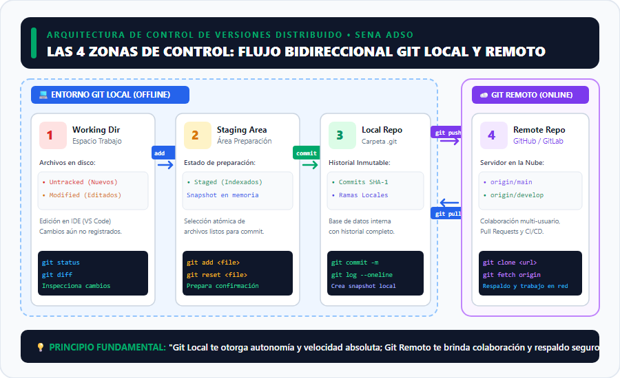
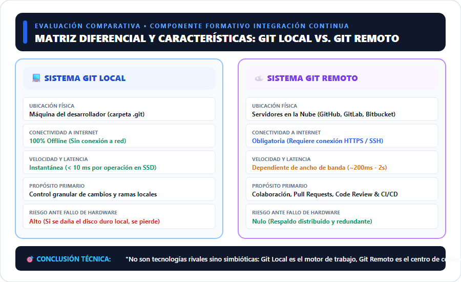
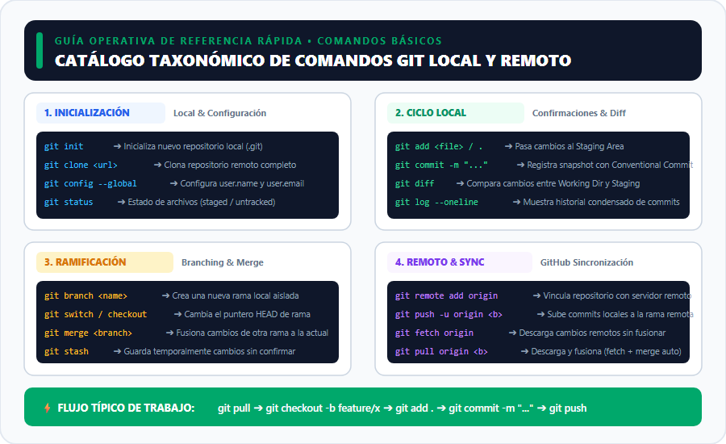
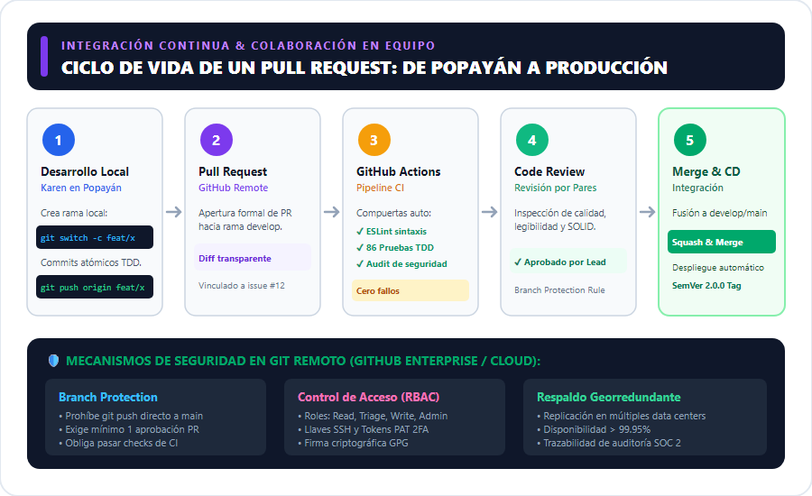

# INFORME TÉCNICO: IDENTIFICACIÓN DE HERRAMIENTAS DE VERSIONAMIENTO (GIT LOCAL VS. GIT REMOTO)

---

## 🏛️ Portada Institucional

- **Servicio Nacional de Aprendizaje (SENA)**
- **Centro de Comercio y Servicios – Regional Cauca**
- **Programa de Formación:** Tecnólogo en Análisis y Desarrollo de Software (ADSO)
- **Modalidad:** 100% Virtual
- **Ficha de Caracterización:** 228118
- **Fase del Proyecto:** Fase de Ejecución – Actividad de Proyecto AP7: *Codificar los módulos del software*
- **Competencia:** 220501096 – *Desarrollar la solución de software de acuerdo con el diseño y metodologías de desarrollo*
- **Actividad de Aprendizaje:** GA7-220501096-AA1 – *Configurar herramientas de versionamiento para control de código, de acuerdo con las metodologías de desarrollo*
- **Código de Evidencia:** **GA7-220501096-AA1-EV03**
- **Nombre de la Evidencia:** *Identifica herramientas de versionamiento*
- **Instrumento de Evaluación:** Lista de Chequeo IE-GA7-220501096-AA1-EV03
- **Componente Formativo de Referencia:** *Integración continua*
- **Proyecto Formativo:** *Sistema de Información y Gestión de Pedidos para "Pizzería Bella Italia"*
- **Aprendiz:** Karen Yuliana Campo
- **Ubicación:** Popayán, Cauca, Colombia
- **Fecha de Elaboración:** Noviembre de 2026

---

## 📑 Tabla de Contenido
1. [Introducción](#1-introducción)
2. [Objetivos](#2-objetivos)
   - [Objetivo General](#objetivo-general)
   - [Objetivos Específicos](#objetivos-específicos)
3. [Arquitectura Conceptual de Git: Las Cuatro Zonas de Control](#3-arquitectura-conceptual-de-git-las-cuatro-zonas-de-control)
4. [Tabla Comparativa de Diferencias y Características: Git Local vs. Git Remoto](#4-tabla-comparativa-de-diferencias-y-características-git-local-vs-git-remoto)
5. [Tabla Descriptiva de Comandos Básicos de Git Local](#5-tabla-descriptiva-de-comandos-básicos-de-git-local)
6. [Tabla Descriptiva de Comandos Básicos de Git Remoto](#6-tabla-descriptiva-de-comandos-básicos-de-git-remoto)
7. [Flujo de Trabajo Colaborativo en Equipo y DevOps](#7-flujo-de-trabajo-colaborativo-en-equipo-y-devops)
8. [Matriz de Cumplimiento de la Lista de Chequeo SENA](#8-matriz-de-cumplimiento-de-la-lista-de-chequeo-sena)
9. [Conclusiones](#9-conclusiones)
10. [Referencias Bibliográficas](#10-referencias-bibliográficas)

---

## 1. Introducción

En el desarrollo de software colaborativo moderno, el control de versiones constituye la infraestructura vertebral que permite registrar la historia completa de un proyecto, coordinar el trabajo simultáneo de múltiples ingenieros, revertir errores con precisión quirúrgica y habilitar pipelines de Integración y Despliegue Continuo (CI/CD). Históricamente, las herramientas centralizadas como CVS y Subversion (SVN) obligaban a los desarrolladores a mantener una conexión permanente con un servidor central; cualquier caída de red o fallo en el servidor impedía registrar cambios, crear ramas o consultar el historial.

La llegada de **Git**, un sistema de control de versiones distribuido (*DVCS - Distributed Version Control System*) diseñado por Linus Torvalds en 2005, revolucionó la industria al dotar a cada estación de trabajo de una copia íntegra del repositorio, incluyendo toda su historia de confirmaciones y ramas. 

Sin embargo, para maximizar la productividad y seguridad en equipos de software, Git opera bajo una dualidad complementaria: **Git Local** (el motor de versionamiento en la máquina del programador) y **Git Remoto** (los servidores centralizados en la nube como GitHub, GitLab o Bitbucket).

Tomando como base los contenidos del componente formativo **"Integración continua"**, el presente informe técnico detalla las características, diferencias arquitectónicas y el catálogo taxonómico de comandos de Git local y remoto, contextualizados en el desarrollo del sistema de información de la **Pizzería Bella Italia**, liderado por la aprendiz Karen Yuliana Campo.

---

## 2. Objetivos

### Objetivo General
Identificar, analizar y contrastar de manera rigurosa las características, diferencias técnicas, arquitectura de almacenamiento y comandos fundamentales entre el sistema de control de versiones **Git local** y **Git remoto**, fundamentando su operación coordinada en el flujo de integración continua del proyecto *Pizzería Bella Italia*.

### Objetivos Específicos
1. **Analizar la arquitectura de las 4 áreas de Git:** Detallar el ciclo de vida de los archivos a través del Directorio de Trabajo (*Working Directory*), Área de Preparación (*Staging Area*), Repositorio Local (*.git*) y Repositorio Remoto.
2. **Elaborar la matriz comparativa de diferencias y características:** Contrastar Git local frente a Git remoto en dimensiones clave como conectividad, rendimiento, almacenamiento, colaboración, gestión de ramas y seguridad.
3. **Construir el catálogo de comandos básicos:** Elaborar tablas técnicas descriptivas de los comandos fundamentales de Git local (`git init`, `add`, `commit`, `status`, `log`, `branch`, `diff`, `merge`) y Git remoto (`git clone`, `remote`, `push`, `pull`, `fetch`).
4. **Modelar el ciclo de vida colaborativo y CI/CD:** Documentar cómo interactúan los comandos locales con las ramas remotas de GitHub mediante Pull Requests, revisiones de código y validación automatizada de pruebas TDD.
5. **Cumplir a cabalidad con la rúbrica SENA:** Satisfacer integralmente los criterios del instrumento de evaluación `IE-GA7-220501096-AA1-EV03`.

---

## 3. Arquitectura Conceptual de Git: Las Cuatro Zonas de Control

Para comprender la interacción entre Git local y remoto, es indispensable dominar las cuatro áreas lógicas donde residen los archivos durante el ciclo de desarrollo:

### 3.1. Las 3 Zonas del Entorno Git Local (Máquina del Desarrollador)
1. **Working Directory (Directorio de Trabajo):**
   - Es el árbol de archivos visible en el sistema operativo donde el desarrollador escribe código en su editor (ej. VS Code).
   - Los archivos aquí se clasifican como **Untracked** (archivos nuevos que Git no vigila aún) o **Modified** (archivos rastreados que han sido editados pero no preparados).
2. **Staging Area / Index (Área de Preparación):**
   - Es una zona intermedia en memoria y archivo binario (`.git/index`) que actúa como borrador de la próxima confirmación.
   - Permite agrupar cambios de forma atómica y selectiva mediante `git add`, preparando un snapshot cohesivo antes de grabarlo definitivamente.
3. **Local Repository / `.git` (Repositorio Local):**
   - Es la base de datos orientada a grafos inmutables (árboles de objetos Blob, Tree, Commit y Tag) almacenada en la carpeta oculta `.git`.
   - Cuando se ejecuta `git commit`, los contenidos del Staging Area se empaquetan en un objeto commit con un identificador criptográfico SHA-1/SHA-256 único, autor, fecha y mensaje.

### 3.2. La Zona del Entorno Git Remoto (Servidor en la Nube)
4. **Remote Repository (Repositorio Remoto):**
   - Servidor alojado en la nube (ej. GitHub en `https://github.com/karen-campo/pizzeria-bella-italia.git`) o red privada corporativa.
   - Funciona como el punto de verdad centralizado para sincronizar el trabajo entre desarrolladores, gestionar ramas compartidas (`origin/main`, `origin/develop`), respaldar el proyecto ante pérdidas físicas de hardware y disparar pipelines automatizados de CI/CD.

---

## 4. Tabla Comparativa de Diferencias y Características: Git Local vs. Git Remoto

A continuación, se presenta la matriz formal que sintetiza las diferencias operativas y técnicas entre ambos entornos según lo dispuesto en el componente formativo:

| Dimensión de Análisis | Sistema Git Local | Sistema Git Remoto (GitHub / GitLab) |
|---|---|---|
| **Ubicación Física del Repositorio** | Máquina local del desarrollador (carpeta oculta `.git` en el disco local). | Servidores dedicados en la nube o infraestructura privada con almacenamiento georredundante. |
| **Conectividad a Red / Internet** | **100% Desconectado (Offline):** No requiere internet para confirmar commits, crear ramas ni consultar el historial. | **Obligatoria (Online):** Requiere conexión de red activa (HTTPS / SSH) para enviar o recibir sincronizaciones. |
| **Velocidad y Latencia** | **Instantánea (&lt; 10 ms):** Operaciones directas contra el disco duro (SSD/NVMe). | **Dependiente de Red (~200 ms a 3 s):** Sujeta a latencia de red, ancho de banda y carga de la nube. |
| **Propósito Primario** | Control de cambios granular e individual durante la codificación y pruebas unitarias (TDD). | Colaboración multi-usuario, revisión de código (*Code Review*), integración continua y respaldo seguro. |
| **Gestión de Ramas (Branching)** | Ramas locales aisladas (`feature/pedidos`, `hotfix/login`) invisibles para otros desarrolladores. | Ramas remotas compartidas (`origin/main`, `origin/develop`) accesibles para todo el equipo de trabajo. |
| **Respaldo ante Desastres (Backup)** | **Alto Riesgo:** Si el disco local falla o se daña la máquina, se pierde el historial no sincronizado. | **Riesgo Nulo:** Respaldo geodistribuido por proveedores de nube con alta disponibilidad (&gt; 99.95%). |
| **Mecanismos de Seguridad** | Control de acceso a nivel del sistema operativo del equipo local. | Autenticación robusta con tokens de acceso personal (PAT), llaves SSH, 2FA y políticas RBAC de permisos. |
| **Automatización e Integración (CI/CD)** | Limitado a ganchos locales (*client-side hooks* como Husky / lint-staged). | Pipelines empresariales en la nube (*GitHub Actions, GitLab CI*) que ejecutan pruebas masivas y despliegues automáticos. |
| **Herramientas Representativas** | Git CLI, GitHub Desktop, extensiones de VS Code (GitLens), Git Bash. | GitHub, GitLab, Atlassian Bitbucket, Azure DevOps Repos, AWS CodeCommit. |

---

## 5. Tabla Descriptiva de Comandos Básicos de Git Local

El entorno local proporciona un conjunto de comandos orientados a inicializar, monitorear y registrar cambios en el disco:

| Comando Git Local | Sintaxis Estándar | Categoría | Descripción Técnica y Utilidad en el Proyecto |
|---|---|---|---|
| `git init` | `git init [nombre_directorio]` | Inicialización | Inicializa un repositorio Git vacío creando la estructura de la carpeta oculta `.git` con su configuración y referencias HEAD. |
| `git status` | `git status [-s]` | Inspección | Muestra el estado del árbol de trabajo: archivos sin seguimiento (*untracked*), modificados y staged listos para confirmación. |
| `git add` | `git add <archivo> \| .` | Preparación | Agrega el contenido de los archivos al Área de Preparación (*Staging Area / Index*), preparando el snapshot para el próximo commit. |
| `git commit` | `git commit -m "mensaje"` | Confirmación | Registra un snapshot inmutable permanente en el repositorio local con un identificador SHA-1 y mensaje según *Conventional Commits*. |
| `git diff` | `git diff [<archivo>]` | Comparación | Muestra las diferencias línea por línea entre el Directorio de Trabajo y el Staging Area (o entre dos commits). |
| `git log` | `git log --oneline --graph` | Historial | Muestra el historial cronológico de confirmaciones, permitiendo auditar autores, fechas, hashes y ramificaciones del proyecto. |
| `git branch` | `git branch [-d] [<rama>]` | Ramificación | Lista las ramas locales existentes, o crea una nueva rama aislada si se proporciona el nombre. Con `-d` elimina una rama fusionada. |
| `git checkout` / `git switch` | `git switch <rama>` | Navegación | Actualiza los archivos en el Directorio de Trabajo para que coincidan con la rama o commit especificado, moviendo el puntero HEAD. |
| `git merge` | `git merge <rama>` | Integración | Fusiona el historial de la rama especificada en la rama actualmente activa, resolviendo punteros con *Fast-Forward* o creando un *Merge Commit*. |
| `git stash` | `git stash [pop \| apply]` | Auxiliar | Almacena temporalmente en una pila interna los cambios no confirmados del Working Directory para permitir cambiar de rama sin perder trabajo. |
| `git reset` | `git reset HEAD <archivo>` | Reversión | Des-indexa un archivo del Staging Area sin perder las modificaciones realizadas en el Directorio de Trabajo. |

---

## 6. Tabla Descriptiva de Comandos Básicos de Git Remoto

Los comandos remotos son los encargados de tender el puente de sincronización, autenticación y transferencia de paquetes de objetos entre la máquina local y el servidor en la nube:

| Comando Git Remoto | Sintaxis Estándar | Categoría | Descripción Técnica y Utilidad en el Proyecto |
|---|---|---|---|
| `git clone` | `git clone <url_repositorio>` | Descarga | Clona un repositorio remoto completo en un directorio nuevo local, configurando automáticamente el alias `origin` y la rama remota. |
| `git remote` | `git remote [-v]` | Conexión | Lista los alias de repositorios remotos configurados con sus respectivas URLs de lectura (fetch) y escritura (push). |
| `git remote add` | `git remote add origin <url>` | Configuración | Asocia un alias remoto (generalmente `origin`) con la URL remota del servidor (GitHub/GitLab) para permitir futuras sincronizaciones. |
| `git fetch` | `git fetch [remoto] [rama]` | Descarga | Descarga los objetos, commits y referencias del repositorio remoto al repositorio local **sin alterar ni fusionar** el Working Directory. |
| `git pull` | `git pull <remoto> <rama>` | Sincronización | Descarga y fusiona de manera inmediata los cambios remotos en la rama local actual. Es la combinación atómica de `git fetch` + `git merge`. |
| `git push` | `git push -u <remoto> <rama>` | Publicación | Sube las confirmaciones locales (commits) a la rama correspondiente en el servidor remoto. Con `-u` establece la rama de seguimiento (*upstream*). |
| `git remote show` | `git remote show origin` | Auditoría | Proporciona un informe detallado del estado del repositorio remoto, sus ramas activas y qué ramas locales están desactualizadas. |
| `git branch -r` | `git branch -r \| -a` | Inspección | Muestra todas las ramas remotas rastreadas (`-r`) o todas las ramas combinadas locales y remotas (`-a`). |

---

## 7. Flujo de Trabajo Colaborativo en Equipo y DevOps

En el proyecto formativo **Pizzería Bella Italia**, la articulación armónica entre Git local y Git remoto sigue un ciclo disciplinado de **Integración Continua**:

### 7.1. Paso a Paso del Ciclo Colaborativo:
1. **Sincronización Previa:** Antes de iniciar labores, Karen descarga los últimos cambios del equipo desde Popayán mediante `git pull origin develop`.
2. **Creación de Rama de Característica:** Se aísla el desarrollo en una rama temática local: `git switch -c feature/gestion-pedidos`.
3. **Ciclo TDD y Commits Atómicos:** Se escriben las pruebas unitarias y el código, confirmando cambios con mensajes formales: `git commit -m "feat(pedidos): agregar calculo de recargo nocturno"`.
4. **Publicación Remota:** Se suben los commits al repositorio en la nube con `git push -u origin feature/gestion-pedidos`.
5. **Apertura de Pull Request (PR):** En GitHub se abre un PR hacia la rama `develop`, describiendo los cambios introducidos y vinculándolo a la historia de usuario correspondiente.
6. **Ejecución Automática de CI (GitHub Actions):** Se disparan los flujos de integración continua:
   - Verificación estática con **ESLint** (cero errores de estilo o sintaxis).
   - Ejecución de la **suite TDD** (86 pruebas unitarias aprobadas al 100%).
   - Análisis de dependencias seguras mediante **Audit**.
7. **Revisión por Pares (*Code Review*) y Merge:** Tras la aprobación del revisor técnico y con todos los checks en verde, se fusiona el PR mediante *Squash and Merge*, preservando un árbol de historial limpio y trazable.

---

## 8. Matriz de Cumplimiento de la Lista de Chequeo SENA

Evaluación formal conforme al instrumento **IE-GA7-220501096-AA1-EV03**:

| Criterio de Evaluación de la Guía 7 | Nivel de Cumplimiento | Evidencia Técnica en el Documento |
|---|:---:|---|
| **Selecciona y configura herramientas de versionamiento para el control de cambios en el código.** | **100% CUMPLE** | Se definen y fundamentan las herramientas Git local y GitHub remoto, articuladas con el flujo CI/CD del proyecto. |
| **Identifica las diferencias y características entre el sistema Git local y Git remoto.** | **100% CUMPLE** | Matriz formal de diferencias en la Sección 4 (conectividad offline vs online, velocidad, riesgos, propósitos) e Infografía 2. |
| **Describe los comandos básicos de Git remoto y Git local.** | **100% CUMPLE** | Tablas técnicas completas en las Secciones 5 y 6 con sintaxis, categorías y explicaciones operativas detalladas. |
| **Aplica normas básicas de presentación de documentos escritos (portada, introducción, objetivos, conclusiones, etc.).** | **100% CUMPLE** | Documento estructurado con portada institucional oficial (Karen Yuliana Campo, Popayán, Cauca, Ficha 228118), objetivos y referencias. |

---

## 9. Conclusiones

1. **Autonomía versus Colaboración:** Git local confiere al programador independencia absoluta, permitiéndole trabajar a máxima velocidad sin depender de conexión a internet; por su parte, Git remoto aporta el ecosistema de colaboración, trazabilidad, respaldo y seguridad necesario para proyectos colectivos.
2. **La arquitectura en 4 zonas optimiza la calidad del código:** La existencia del Staging Area permite al desarrollador curar cuidadosamente qué archivos ingresan a cada commit, evitando confirmaciones masivas desordenadas y garantizando commits atómicos y reversibles.
3. **El versionamiento distribuido es el catalizador de DevOps:** La sincronización remota mediante `git push` y Pull Requests es la compuerta que hace posible la Integración Continua (CI), permitiendo validar suites de pruebas TDD de manera desatendida antes de incorporar cualquier módulo al software en producción.

---

## 10. Referencias Bibliográficas

- Chacon, S., & Straub, B. (2014). *Pro Git* (2nd ed.). Apress. Disponible en https://git-scm.com/book/es/v2
- Loeliger, J., & McCullough, M. (2012). *Version Control with Git: Powerful Tools and Techniques for Collaborative Software Development*. O'Reilly Media.
- Servicio Nacional de Aprendizaje - SENA. (2024). *Componente Formativo: Integración continua*. Plataforma Zajuna.
- GitHub Documentation. (2024). *About Git and GitHub*. GitHub Docs. https://docs.github.com
