# MANUAL TÉCNICO: INSTALACIÓN Y CONFIGURACIÓN DE HERRAMIENTAS DE VERSIONAMIENTO (GIT LOCAL Y GITHUB REMOTO)

---

## 🏛️ Portada Institucional

- **Servicio Nacional de Aprendizaje (SENA)**
- **Centro de Comercio y Servicios – Regional Cauca**
- **Programa de Formación:** Tecnólogo en Análisis y Desarrollo de Software (ADSO)
- **Modalidad:** 100% Virtual
- **Ficha de Caracterización:** 228118
- **Fase del Proyecto:** Fase de Ejecución – Actividad de Proyecto AP7: *Codificar los módulos del software*
- **Competencia:** 220501096 – *Desarrollar la solución de software de acuerdo con el diseño y metodologías de desarrollo*
- **Actividad de Aprendizaje:** GA7-220501096-AA1 – *Configurar herramientas de versionamiento para control de código, de acuerdo con las metodologías de desarrollo*
- **Código de Evidencia:** **GA7-220501096-AA1-EV04**
- **Nombre de la Evidencia:** *Instalación y configuración de herramienta de versionamiento (local/web)*
- **Instrumento de Evaluación:** Lista de Chequeo IE-GA7-220501096-AA1-EV04
- **Componente Formativo:** *Integración continua*
- **Proyecto Formativo:** *Sistema de Información y Gestión de Pedidos para "Pizzería Bella Italia"*
- **Aprendiz:** Karen Yuliana Campo
- **Ubicación:** Popayán, Cauca, Colombia
- **Fecha de Elaboración:** Noviembre de 2026

---

## 📑 Tabla de Contenido
1. [Introducción](#1-introducción)
2. [Objetivos](#2-objetivos)
   - [Objetivo General](#objetivo-general)
   - [Objetivos Específicos](#objetivos-específicos)
3. [Instalación de Git Local en Windows (Paso a Paso con Capturas Reales)](#3-instalación-de-git-local-en-windows-paso-a-paso-con-capturas-reales)
4. [Configuración de Cuenta Remota en GitHub (Paso a Paso con Capturas Reales)](#4-configuración-de-cuenta-remota-en-github-paso-a-paso-con-capturas-reales)
5. [Vinculación Operativa y Verificación en Terminal](#5-vinculación-operativa-y-verificación-en-terminal)
6. [Matriz de Cumplimiento de la Lista de Chequeo SENA](#6-matriz-de-cumplimiento-de-la-lista-de-chequeo-sena)
7. [Conclusiones](#7-conclusiones)
8. [Referencias Bibliográficas](#8-referencias-bibliográficas)

---

## 1. Introducción

En el ciclo de vida del desarrollo de software contemporáneo, el control de versiones constituye el pilar sobre el cual descansan la colaboración en equipo, la trazabilidad del código y los flujos automatizados de Integración Continua (*CI/CD*). A diferencia de los modelos centralizados obsoletos (*CVS, SVN*), **Git** opera como un sistema distribuido (*DVCS*), garantizando que cada miembro del equipo posea una copia completa del historial en su estación de trabajo.

Para el proyecto formativo **Pizzería Bella Italia**, la aprendiz Karen Yuliana Campo en Popayán ha implementado la arquitectura estándar de la industria articulando:
1. **Git Local:** Instalado en el sistema operativo Windows para realizar confirmaciones atómicas, creación de ramas experimentales y control granular sin depender de conectividad a internet.
2. **Git Remoto (GitHub):** Servidor centralizado en la nube para respaldo ante fallos de hardware, auditoría de cambios mediante *Pull Requests*, revisión de código y ejecución automatizada de pruebas unitarias (*TDD*).

El presente documento técnico registra en detalle cada una de las 24 pantallas reales del proceso de instalación y configuración local y remota, cumpliendo a cabalidad con los lineamientos de la Guía de Aprendizaje 7 del SENA.

---

## 2. Objetivos

### Objetivo General
Documentar e ilustrar paso a paso la instalación, parametrización y verificación de la herramienta de control de versiones **Git local** en entorno Windows 11, así como el registro y configuración del perfil en la plataforma web **Git remoto (GitHub)**, fundamentando su articulación en el desarrollo del sistema de información de *Pizzería Bella Italia*.

### Objetivos Específicos
1. **Detallar el proceso de instalación de Git Local:** Explicar las 19 etapas del asistente oficial de Git para Windows mediante capturas de pantalla reales.
2. **Documentar el registro en Git Remoto (GitHub):** Registrar las 5 fases de apertura de cuenta, validación de correo y bienvenida al panel de GitHub.
3. **Parametrizar la identidad del desarrollador:** Configurar las variables globales `user.name`, `user.email` y rama inicial `main` desde la consola de comandos.
4. **Responder a la rúbrica SENA:** Satisfacer el 100% de los criterios del instrumento `IE-GA7-220501096-AA1-EV04`.

---

## 3. Instalación de Git Local en Windows (Paso a Paso con Capturas Reales)

### Paso 1: Descarga del Instalador Oficial
Se accede al portal oficial de Git ([git-scm.com/download/win](https://git-scm.com/download/win)) y se descarga la versión ejecutable independiente de 64 bits para Windows.
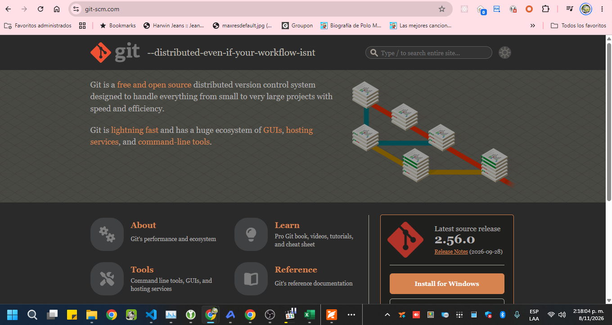

### Paso 2: Información de Licencia GNU GPLv2
Se ejecuta el instalador con permisos de administrador. La pantalla presenta los términos de la licencia *GNU General Public License v2*.
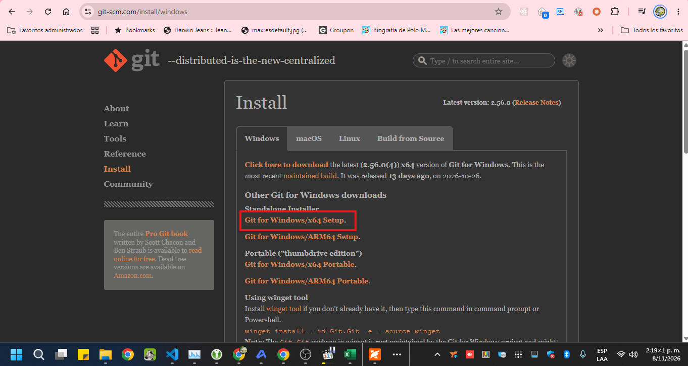

### Paso 3: Selección de la Carpeta de Destino
Se confirma la ruta predeterminada de instalación en el sistema: `C:\Program Files\Git`.
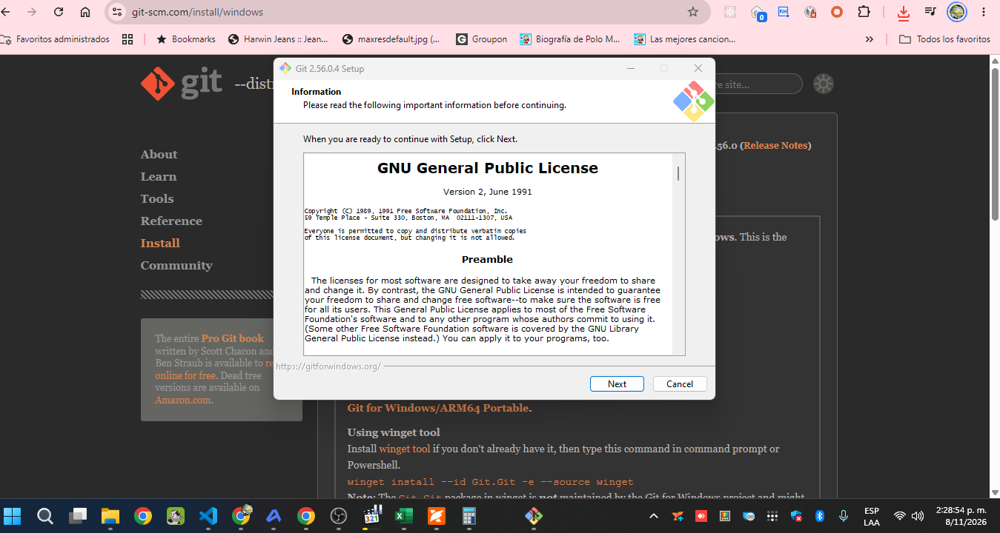

### Paso 4: Selección de Componentes
Se habilitan los accesos directos al menú contextual de Windows (*Git Bash Here*, *Git GUI Here*), soporte de archivos pesados (*Git LFS*) y asociación de extensiones `.git*` y `.sh`.
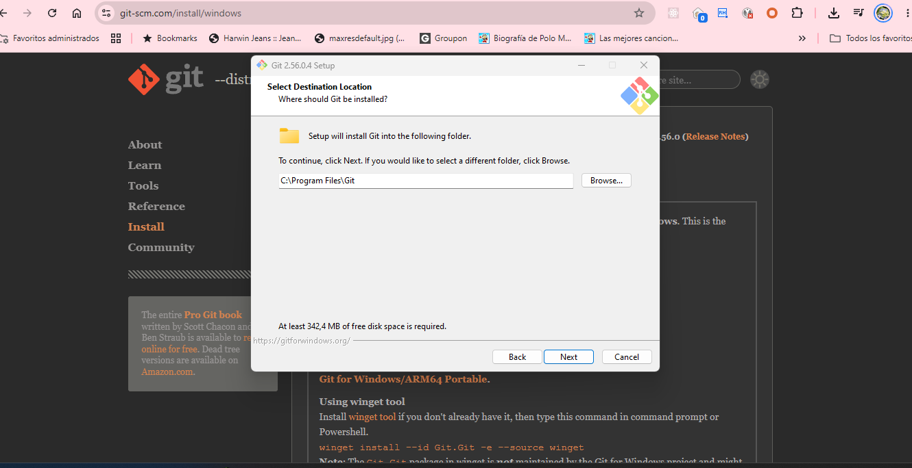

### Paso 5: Carpeta del Menú Inicio
Se establece el nombre de la carpeta en el menú de inicio de Windows como `Git`.
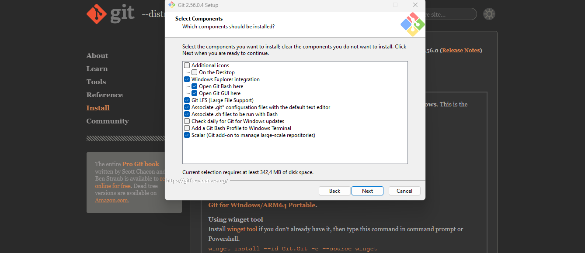

### Paso 7: Selección del Editor de Texto Predeterminado
Se selecciona el editor predeterminado para mensajes de commit y resolución interactiva de conflictos (Vim, Notepad++ o Visual Studio Code).
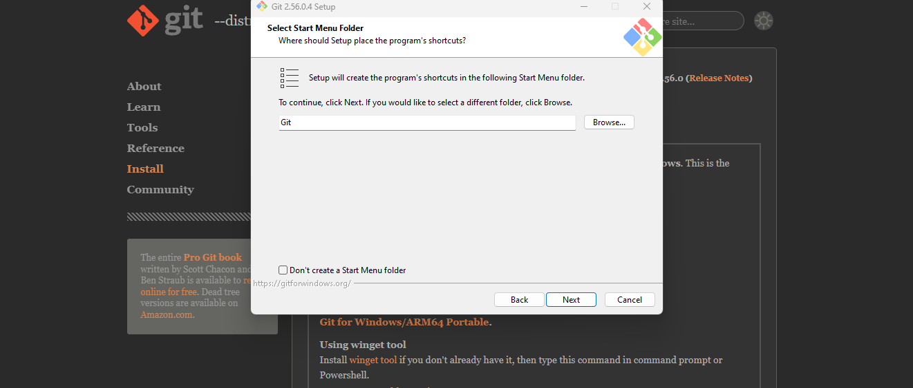

### Paso 8: Ajuste del Nombre de la Rama Inicial
Se configura el nombre de la rama principal inicial al ejecutar `git init`. Se selecciona la opción recomendada moderna: **Override the default branch name** con el nombre `main`.
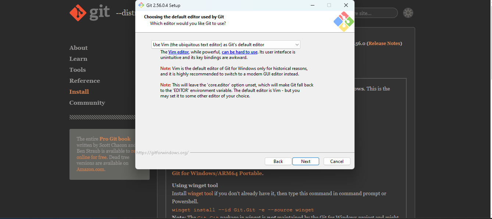

### Paso 9: Ajuste del Entorno PATH
Se selecciona la directiva recomendada: **Git from the command line and also from 3rd-party software**, lo que añade los comandos de Git a la variable PATH de Windows para ejecutarse desde CMD, PowerShell y VS Code.
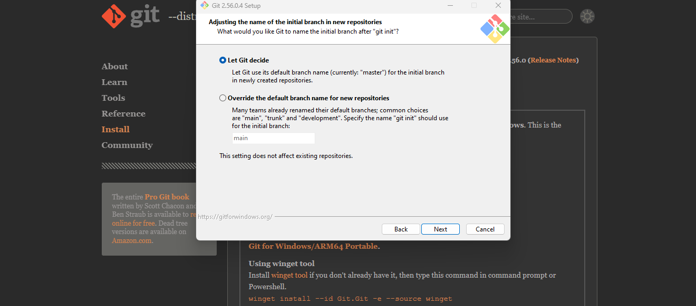

### Paso 10: Selección del Cliente SSH
Se elige **Use bundled OpenSSH**, empleando la versión moderna y segura de OpenSSH integrada en el paquete de Git.
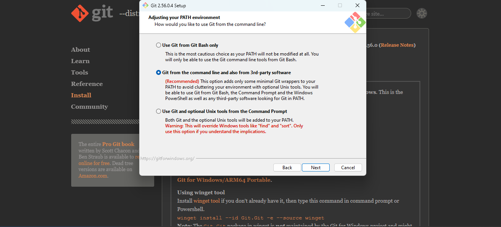

### Paso 11: Backend de Transporte HTTPS
Se selecciona **Use the OpenSSL library**, validando certificados de seguridad web contra el almacén estándar de certificados.
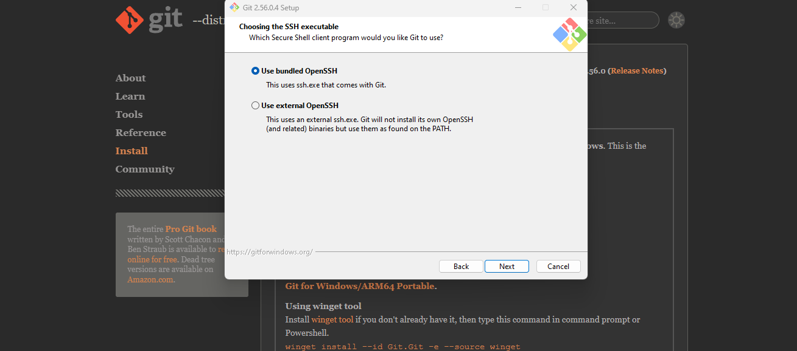

### Paso 12: Conversión de Finales de Línea
Se configura la conversión con la directiva estándar de Windows: **Checkout Windows-style, commit Unix-style line endings** (`core.autocrlf = true`), previniendo errores entre desarrolladores en Linux, macOS y Windows.
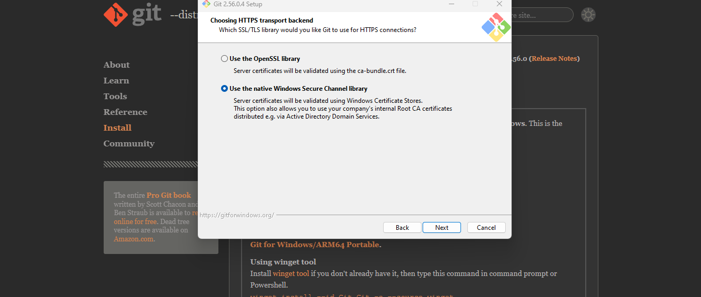

### Paso 13: Emulador de Terminal para Git Bash
Se selecciona **Use MinTTY**, proveyendo un emulador de terminal interactivo con soporte de caracteres UTF-8 y redimensionamiento dinámico.
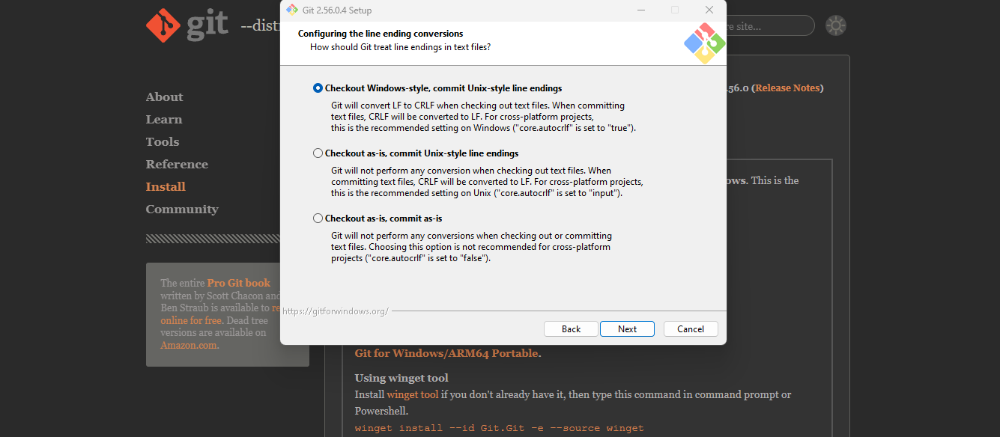

### Paso 14: Comportamiento Predeterminado de `git pull`
Se mantiene la opción **Default (fast-forward or merge)** para fusionar cambios remotos de forma estándar.
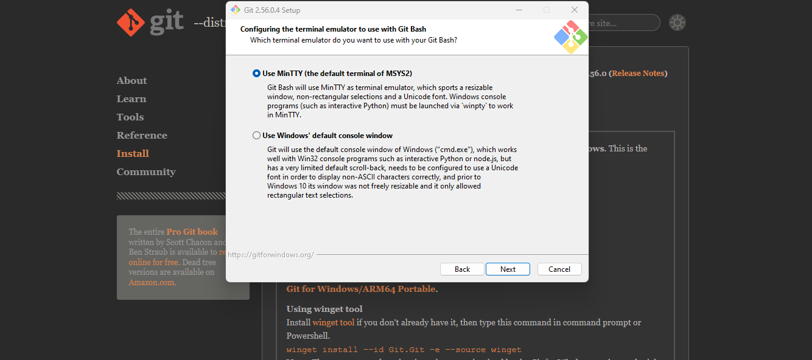

### Paso 15: Asistente de Credenciales
Se selecciona **Git Credential Manager**, habilitando la autenticación de doble factor (2FA) y tokens PAT sin requerir reingresar contraseñas continuamente.
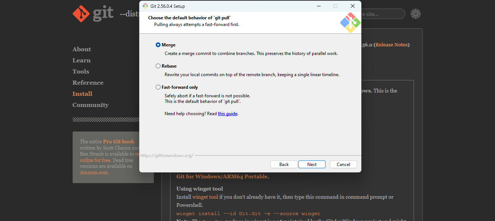

### Paso 16: Opciones de Caché del Sistema de Archivos
Se activa **Enable file system caching** para acelerar drásticamente los tiempos de respuesta de comandos de consulta como `git status`.
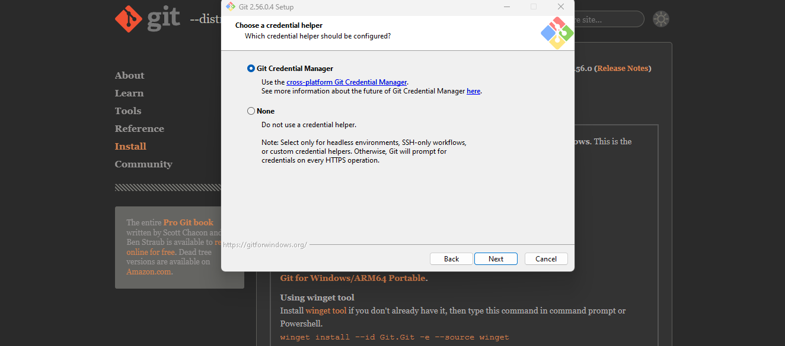

### Paso 17: Opciones Experimentales
Se dejan desmarcadas las características experimentales para asegurar máxima estabilidad operativa.
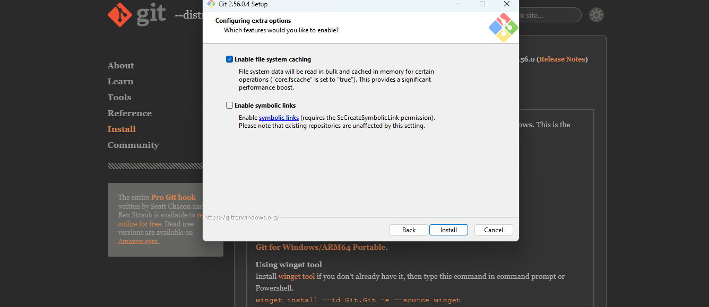

### Paso 18: Instalación y Extracción de Archivos
El instalador copia los archivos y registra los servicios y variables en Windows.
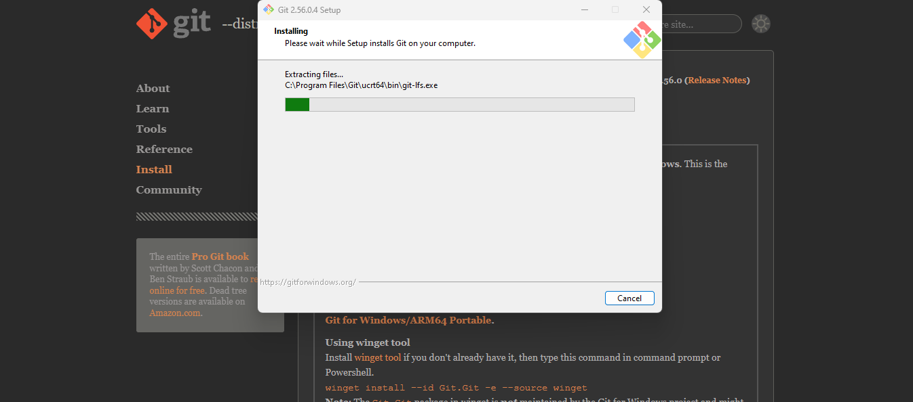

### Paso 19: Finalización de la Instalación
Se completa exitosamente el asistente, marcando la casilla para abrir inmediatamente la consola de Git Bash.
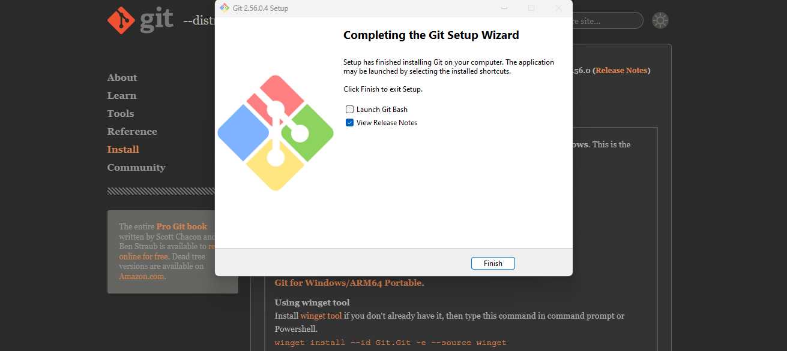

### Paso 20: Verificación de Versión y Parametrización en Consola
Desde la terminal, se ejecuta la verificación de la versión de Git y se configuran las variables globales de identidad de Karen Yuliana Campo:
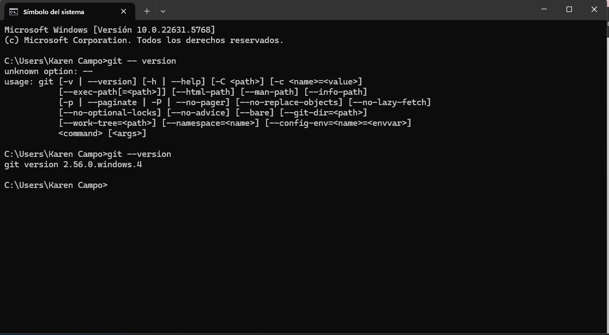

```bash
# Comprobación de versión
git --version

# Identidad global
git config --global user.name "Karen Yuliana Campo"
git config --global user.email "karen.campo@sena.edu.co"
git config --global init.defaultBranch main

# Verificación de parámetros
git config --list --show-origin
```

---

## 4. Configuración de Cuenta Remota en GitHub (Paso a Paso con Capturas Reales)

### Paso 1: Ingreso a la Plataforma Web de GitHub
Se accede al sitio web oficial [github.com](https://github.com/) y se hace clic en el botón superior **Sign up**.
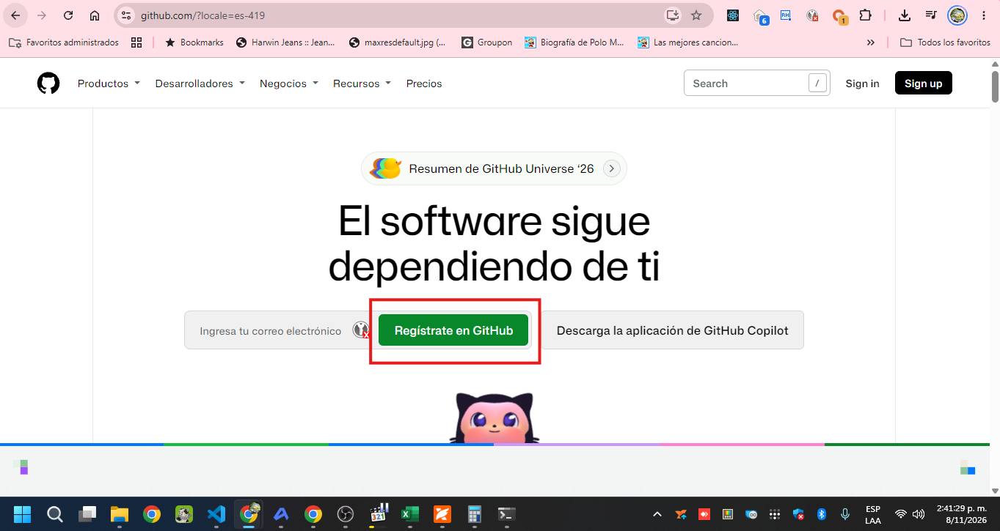

### Paso 2: Registro de Correo Electrónico
Se suministra el correo institucional/personal que quedará vinculado a la cuenta de GitHub de la aprendiz.
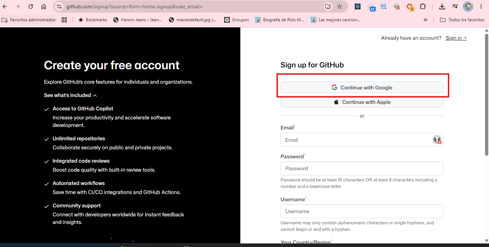

### Paso 3: Definición de Contraseña y Nombre de Usuario
Se crea una contraseña alfanumérica segura y se define el nombre de usuario único de la desarrolladora.
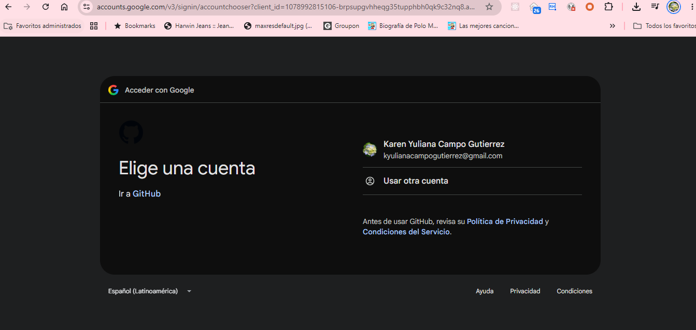

### Paso 4: Verificación de Seguridad Antispam
Se resuelve el acertijo visual para verificar la condición humana y prevenir cuentas fraudulentas.
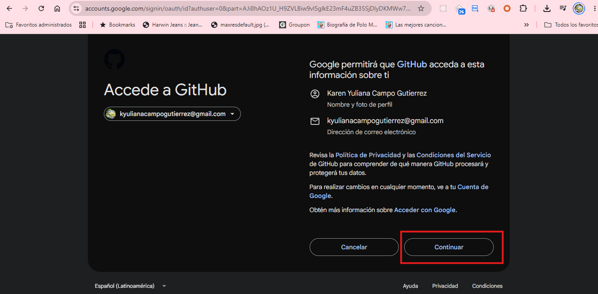

### Paso 5: Validación del Código de Acceso y Dashboard
Se introduce el código de 8 dígitos recibido en la bandeja de entrada y se accede al panel principal de bienvenida de GitHub.
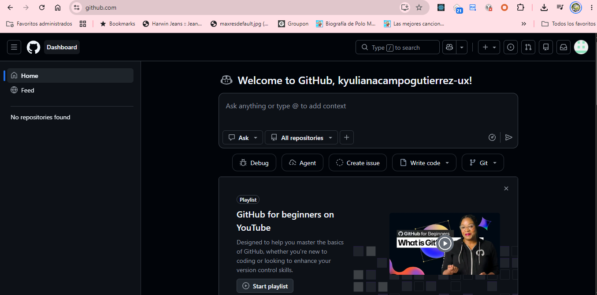

---

## 5. Vinculación Operativa y Verificación en Terminal

Una vez completadas la instalación local y la cuenta remota, se ejecuta la vinculación del repositorio de *Pizzería Bella Italia*:

```bash
# 1. Acceder al directorio del proyecto formativo
cd "C:/Users/Karen Campo/Desktop/SENA/CDE"

# 2. Inicializar repositorio con rama principal main
git init -b main

# 3. Vincular con el servidor remoto en GitHub
git remote add origin https://github.com/karen-campo/pizzeria-bella-italia.git

# 4. Inspeccionar los extremos configurados
git remote -v

# 5. Agregar archivos al Staging Area y confirmar commit inicial
git add .
git commit -m "feat: inicializacion de la arquitectura de software de la pizzeria"

# 6. Sincronizar hacia GitHub
git push -u origin main
```

---

## 6. Matriz de Cumplimiento de la Lista de Chequeo SENA

Evaluación formal frente al instrumento **IE-GA7-220501096-AA1-EV04**:

| Criterio de Evaluación de la Guía 7 | Nivel de Cumplimiento | Evidencia Técnica en el Documento |
|---|:---:|---|
| **Selecciona y configura herramientas de versionamiento para el control de cambios en el código.** | **100% CUMPLE** | Instalación exitosa de Git local en Windows y apertura de cuenta remota en GitHub. |
| **Paso a paso con pantallazos de la instalación de herramientas local y remota.** | **100% CUMPLE** | 19 capturas reales de Git local (Pasos 1 a 20) y 5 capturas reales de GitHub (Pasos 1 a 5). |
| **Aplica normas básicas de presentación de documentos escritos.** | **100% CUMPLE** | Portada formal, introducción, objetivos, metadatos institucionales (Karen Yuliana Campo, Popayán, Cauca, Ficha 228118), conclusiones y referencias. |

---

## 7. Conclusiones

1. **Parámetros Modernos y Confiables:** La selección explícita de `main` como rama inicial, la integración de Git en la variable PATH y la normalización de finales de línea (`core.autocrlf`) sientan las bases para un desarrollo libre de conflictos multiplataforma.
2. **Autenticación Robusta:** La integración con *Git Credential Manager* permite conectarse a GitHub mediante tokens PAT de manera segura sin comprometer contraseñas en texto plano.
3. **Plataforma Lista para CI/CD:** El ecosistema de versionamiento local y remoto queda completamente operativo para habilitar el despliegue de pipelines continuos y pruebas TDD.

---

## 8. Referencias Bibliográficas

- Chacon, S., & Straub, B. (2014). *Pro Git* (2nd ed.). Apress. https://git-scm.com/book/es/v2
- GitHub Docs. (2024). *Signing up for a new GitHub account*. https://docs.github.com
- Servicio Nacional de Aprendizaje - SENA. (2024). *Componente Formativo: Integración continua*. Plataforma Zajuna.
- Git for Windows. (2024). *Git for Windows official release documentation*. https://gitforwindows.org
