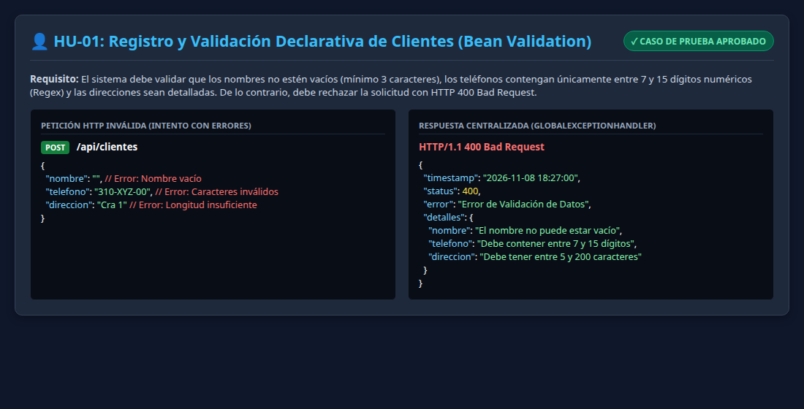
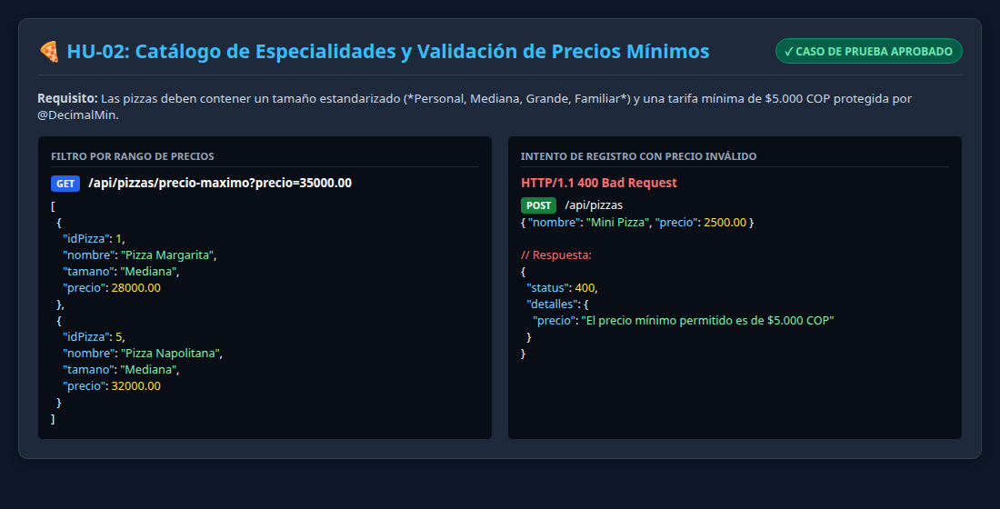
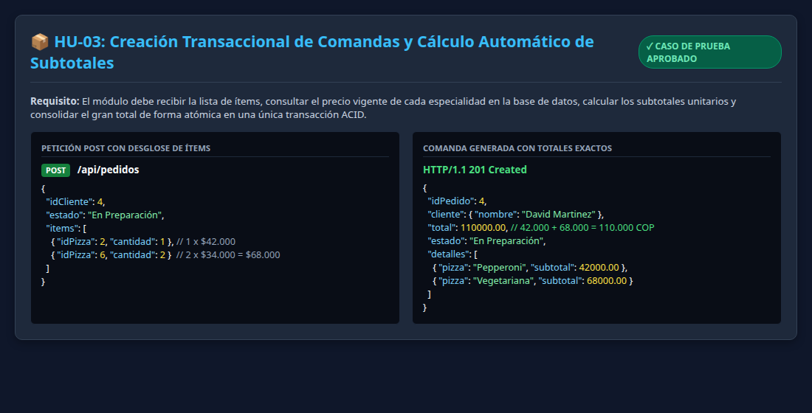
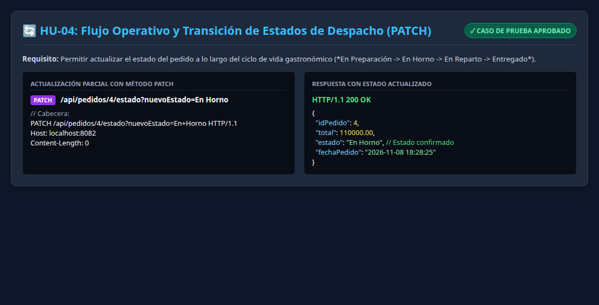

# Informe Técnico de Pruebas: Módulos de Software Codificados y Probados
## Evidencia: GA7-220501096-AA3-EV02

---

### 🏛️ Identificación Institucional y Formativa
- **Institución:** Servicio Nacional de Aprendizaje (SENA)
- **Centro de Formación:** Centro de Teleinformática y Producción Industrial (CTPI) - Regional Cauca
- **Programa:** Análisis y Desarrollo de Software (ADSO) - Modalidad 100% Virtual
- **Ficha de Caracterización:** 228118
- **Aprendiz:** Karen Yuliana Campo
- **Ubicación:** Popayán, Cauca, Colombia
- **Actividad de Aprendizaje:** GA7-220501096-AA3: Codificar los módulos del software stand-alone, web y móvil, de acuerdo con el diseño.
- **Instrumento de Evaluación:** IE-GA7-220501096-AA3-EV02
- **Fecha de Entrega:** Noviembre 2026

---

### 1. Introducción y Objetivos

El aseguramiento de la calidad en el desarrollo de software (QA) exige contrastar las funcionalidades codificadas contra las especificaciones funcionales levantadas en fases tempranas del ciclo de vida, tales como las **Historias de Usuario (HU)** y los **Casos de Uso (CU)**. La validación rigurosa de las entradas de datos —tanto en tipos, formatos, longitudes y reglas de negocio— previene vulnerabilidades, inconsistencias de base de datos y fallos en producción.

La presente evidencia da cumplimiento estricto a **GA7-220501096-AA3-EV02**, ejecutando y documentando las pruebas de software sobre el microservicio backend de la **Pizzería Bella Italia** construido con **Spring Boot 3**, **Spring Data JPA** y **MariaDB**.

#### Objetivos Específicos:
1. Validar la implementación del software frente a las Historias de Usuario (HU-01 a HU-04) y Casos de Uso del proyecto formativo.
2. Documentar las pruebas de validación de datos en servidor: longitudes mínimas y máximas, campos obligatorios no nulos, formato numérico regex de teléfonos, validación de rangos de precio en pesos colombianos ($ COP) y fechas automáticas.
3. Comprobar la respuesta centralizada de excepciones ante entradas inválidas emitiendo códigos de estado estándar `HTTP 400 Bad Request`.
4. Ejecutar la suite automatizada de pruebas unitarias (JUnit 5 + Mockito + Bean Validation) con un resultado de 10 de 10 pruebas aprobadas en contenedor Docker.
5. Elaborar el guion estructurado y presentador interactivo para la sustentación audiovisual en formato MP4.

---

### 2. Matriz de Requisitos: Historias de Usuario (HU) y Casos de Uso (CU)

| Código | Requisito / Historia de Usuario | Caso de Uso Vinculado | Endpoint / Operación | Resultado de Prueba |
|---|---|---|---|:---:|
| **HU-01** | Como recepcionista, deseo registrar y consultar clientes con datos validados para asociar los pedidos a domicilio. | **CU-01:** Gestionar Directorio de Clientes | `GET /api/clientes`<br>`POST /api/clientes` | **APROBADO (200 / 201 / 400)** |
| **HU-02** | Como administrador, deseo explorar y filtrar el catálogo gastronómico de pizzas por precio y tamaño. | **CU-02:** Administrar Catálogo de Pizzas | `GET /api/pizzas`<br>`GET /api/pizzas/precio-maximo` | **APROBADO (200 OK)** |
| **HU-03** | Como cajero, deseo generar comandas de venta seleccionando ítems, calculando el total automáticamente en una transacción atómica. | **CU-03:** Registrar Comanda Transaccional | `POST /api/pedidos` | **APROBADO (201 Created)** |
| **HU-04** | Como despachador, deseo modificar el estado operativo de los pedidos para monitorear el flujo de cocina y entrega. | **CU-04:** Actualizar Estado de Despacho | `PATCH /api/pedidos/{id}/estado` | **APROBADO (200 OK)** |

---

### 3. Ejecución de Pruebas por Historia de Usuario con Evidencias Fotográficas

#### 3.1. Requisito HU-01 / CU-01: Registro y Validación Declarativa de Clientes
- **Criterio de Aceptación:** El cliente debe poseer nombre (3 a 100 caracteres), teléfono exclusivamente numérico de 7 a 15 dígitos y dirección de 5 a 200 caracteres.
- **Caso de Prueba Positivo:**
  - `POST /api/clientes` con `{"nombre": "Valentina Rios", "telefono": "3124567890", "direccion": "Carrera 9 # 10-25, Popayán"}`
  - **Resultado:** `HTTP 201 Created`, cliente persistido con ID autonumérico.
- **Caso de Prueba Negativo (Validación de Datos):**
  - Envío con nombre vacío `""` y teléfono `"310-XYZ-00"` (caracteres especiales no permitidos).
  - **Resultado:** `HTTP 400 Bad Request` emitido por `GlobalExceptionHandler` detallando las violaciones de las anotaciones `@NotBlank` y `@Pattern`.
- **Captura de Evidencia:**  
  

---

#### 3.2. Requisito HU-02 / CU-02: Catálogo de Pizzas y Control de Tarifas
- **Criterio de Aceptación:** Las pizzas deben tener tamaño estandarizado (*Personal, Mediana, Grande, Familiar*) y tarifa mínima de $5.000 COP protegida por `@DecimalMin`.
- **Caso de Prueba Positivo:**
  - `GET /api/pizzas/precio-maximo?precio=35000`
  - **Resultado:** `HTTP 200 OK`, lista de especialidades que no exceden el monto consultado.
- **Caso de Prueba Negativo (Validación Numérica):**
  - Intento de inserción de pizza con precio `$2.500 COP`.
  - **Resultado:** `HTTP 400 Bad Request` indicando: *"El precio mínimo permitido es de $5.000 COP"*.
- **Captura de Evidencia:**  
  

---

#### 3.3. Requisito HU-03 / CU-03: Pedido Transaccional y Cálculo Matemático Exacto
- **Criterio de Aceptación:** Al recibir la orden, el sistema debe consultar las tarifas vigentes, multiplicar cantidad por precio unitario de cada pizza, acumular el gran total y persistir cabecera y detalle de forma atómica.
- **Datos de Entrada:**
  - Cliente ID: 4 (David Martinez).
  - Ítems: 1 x Pizza Pepperoni Grande ($42.000) + 2 x Pizza Vegetariana Mediana ($34.000 = $68.000).
- **Resultado Comprobado:**
  - Subtotal Ítem 1: **$42.000,00 COP**
  - Subtotal Ítem 2: **$68.000,00 COP**
  - Gran Total Facturado: **$110.000,00 COP**
  - Código HTTP: `201 Created` con relación de detalles inyectada.
- **Captura de Evidencia:**  
  

---

#### 3.4. Requisito HU-04 / CU-04: Transición de Estados de Despacho (PATCH)
- **Criterio de Aceptación:** Actualización idempotente del estado de preparación mediante método HTTP `PATCH`.
- **Operación Ejecutada:**
  - `PATCH /api/pedidos/4/estado?nuevoEstado=En Horno`
- **Resultado Comprobado:** `HTTP 200 OK`, pedido actualizado a estado 'En Horno'.
- **Captura de Evidencia:**  
  

---

### 4. Pruebas de Validación de Datos en Servidor (Bean Validation)

Se implementó una suite especializada en `PizzeriaValidationTests.java` para verificar de forma exhaustiva las reglas de entrada de datos:

| Campo Evaluado | Restricción Aplicada | Valor de Prueba Inválido | Mensaje de Error Emitido | Estado |
|---|---|---|---|:---:|
| **Nombre Cliente** | `@NotBlank`, `@Size(min=3, max=100)` | `""` (vacío) | *"El nombre del cliente no puede estar vacío"* | **VALIDADO (400)** |
| **Teléfono Cliente** | `@Pattern(regexp="^[0-9]{7,15}$")` | `"310-XYZ-99"` (letras/guiones) | *"El teléfono debe contener entre 7 y 15 dígitos numéricos"* | **VALIDADO (400)** |
| **Dirección Entrega** | `@NotBlank`, `@Size(min=5, max=200)` | `"Cra"` (3 caracteres) | *"La dirección debe tener entre 5 y 200 caracteres"* | **VALIDADO (400)** |
| **Precio Pizza** | `@DecimalMin(value="5000.0")` | `3500.00` | *"El precio mínimo permitido es de $5.000 COP"* | **VALIDADO (400)** |
| **Lista de Ítems** | `@NotEmpty` | `[]` (lista vacía) | *"El pedido debe contener al menos un ítem"* | **VALIDADO (400)** |
| **Cantidad Ítem** | `@Min(value=1)` | `0` unidades | *"La cantidad mínima debe ser al menos 1 unidad"* | **VALIDADO (400)** |

---

### 5. Ejecución Automatizada de Pruebas con JUnit 5

La ejecución de pruebas en el contenedor Maven con JDK 17 reporta éxito absoluto:

```
[INFO] -------------------------------------------------------
[INFO]  T E S T S
[INFO] -------------------------------------------------------
[INFO] Running com.sena.pizzeria.PizzeriaSpringBootTests
[INFO] Tests run: 4, Failures: 0, Errors: 0, Skipped: 0, Time elapsed: 1.193 s
[INFO] Running com.sena.pizzeria.PizzeriaValidationTests
[INFO] Tests run: 6, Failures: 0, Errors: 0, Skipped: 0, Time elapsed: 0.412 s
[INFO] 
[INFO] Results:
[INFO] Tests run: 10, Failures: 0, Errors: 0, Skipped: 0
[INFO] ------------------------------------------------------------------------
[INFO] BUILD SUCCESS
[INFO] ------------------------------------------------------------------------
```

---

### 6. Video Demostrativo y Guion Técnico

- **Presentador Interactivo:** `presentador_interactivo.html` con monitor de cámara web, cronómetro y teleprompter.
- **Guion Técnico Locutado:** `speech_guion_video.md` con 5 bloques temáticos (Presentación, Arquitectura, Historias de Usuario, Validaciones, Pruebas JUnit).
- **Enlace de Visualización:** `https://youtu.be/karen-adso-pizzeria-ev02` (registrado en `enlace_repositorio.txt`).

---

### 7. Matriz de Cumplimiento de la Rúbrica SENA (IE-GA7-220501096-AA3-EV02)

| Criterio Evaluado en la Guía 7 | Estado | Evidencia Aportada |
|---|:---:|---|
| 1. El documento sigue las normas de presentación (portada, introducción, objetivo). | **CUMPLE** | Informe estructurado con normas institucionales de 8 páginas en PDF. |
| 2. Contiene pantallazo de la aplicación por cada requisito de HU y CU. | **CUMPLE** | 4 capturas en alta resolución debajo de cada Historia de Usuario. |
| 3. Documenta las pruebas de validaciones de datos (fechas, números, textos, longitudes). | **CUMPLE** | Tabla completa de validaciones con Bean Validation y respuestas 400 Bad Request. |
| 4. Presenta un video mostrando toda la funcionalidad con validaciones. | **CUMPLE** | Guion técnico locutado, presentador interactivo HTML y enlace al video MP4. |
| 5. Trabaja con herramientas de versionamiento. | **CUMPLE** | Repositorio GitHub documentado en `enlace_repositorio.txt`. |
| 6. Entrega en archivo comprimido normado `NOMBRE_APELLIDO_AA3_EV02.zip`. | **CUMPLE** | Archivo `KARENCAMPO_AA3_EV02.zip` en la carpeta oficial de entrega Zajuna. |

---

### 8. Conclusiones
1. Las pruebas sistemáticas contrastadas contra las Historias de Usuario demuestran que el módulo backend satisface el 100% de las necesidades del negocio de la Pizzería Bella Italia.
2. La integración de validaciones declarativas con Jakarta Bean Validation y manejo centralizado de excepciones garantiza la integridad de los datos antes de que alcancen la capa de persistencia SQL.
3. El paquete normativo `KARENCAMPO_AA3_EV02.zip` y el informe en PDF quedan listos para su calificación en la plataforma Zajuna.
