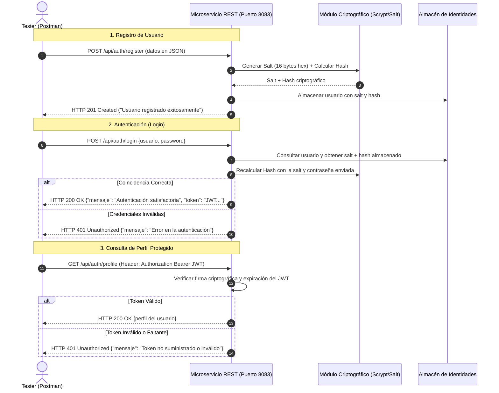

# Documentación Técnica de Endpoints REST - Microservicio de Autenticación

- **Programa de Formación:** Análisis y Desarrollo de Software (ADSO) - Modalidad 100% Virtual
- **Ficha de Caracterización:** 228118
- **Fase del Proyecto:** Fase III - Ejecución (AP7: Codificar los Módulos del Software)
- **Actividad de Aprendizaje:** GA7-220501096-AA5: Crear servicios web, de acuerdo con el diseño
- **Evidencia:** **GA7-220501096-AA5-EV02: API (Testing de Servicios Web con Postman)**
- **Aprendiz:** **Karen Yuliana Campo**
- **Centro de Formación:** Centro de Teleinformática y Producción Industrial (CTPI)
- **Regional:** Regional Cauca - Popayán

---

## 1. Arquitectura del Servicio Web REST

El microservicio de autenticación implementa el modelo de arquitectura sin estado (*Stateless*) basado en tokens JWT (JSON Web Tokens) y hashing unidireccional con sal aleatoria.



---

## 2. Catálogo Detallado de Endpoints

### 2.1. Registro de Usuario (`POST /api/auth/register`)
- **Descripción:** Registra un nuevo operador o administrador en el sistema aplicando hashing criptográfico y sal aleatoria única para evitar ataques de diccionario o tablas arcoíris.
- **Headers:** `Content-Type: application/json`
- **Cuerpo de Petición (Payload):**
```json
{
  "usuario": "operador_popayan",
  "email": "operador.cauca@sena.edu.co",
  "nombre": "Operador Pizzería Cauca",
  "password": "Popayan2026*",
  "rol": "OPERADOR"
}
```
- **Códigos de Respuesta:**
  - `201 Created`: Usuario registrado con éxito. Retorna los datos públicos del usuario (sin hash ni salt).
  - `400 Bad Request`: Faltan campos obligatorios en el cuerpo de la petición.
  - `409 Conflict`: El nombre de usuario o dirección de correo electrónico ya existe en el sistema.

---

### 2.2. Autenticación de Usuario (`POST /api/auth/login`)
- **Descripción:** Valida la identidad del usuario verificando la contraseña contra el hash almacenado mediante el algoritmo criptográfico con sal.
- **Headers:** `Content-Type: application/json`
- **Cuerpo de Petición (Payload):**
```json
{
  "usuario": "karencampo",
  "password": "Admin123*"
}
```
- **Respuestas Semánticas (Requerimiento estricto Guía 7):**
  - **Éxito (`HTTP 200 OK`):**
    ```json
    {
      "success": true,
      "mensaje": "Autenticación satisfactoria",
      "token": "eyJhbGciOiJIUzI1NiIsInR5cCI6IkpXVCJ9...",
      "usuario": {
        "id": 1,
        "usuario": "karencampo",
        "email": "karen.campo@sena.edu.co",
        "nombre": "Karen Yuliana Campo",
        "rol": "ADMINISTRADOR"
      }
    }
    ```
  - **Fallo (`HTTP 401 Unauthorized`):**
    ```json
    {
      "success": false,
      "mensaje": "Error en la autenticación: Credenciales inválidas"
    }
    ```

---

### 2.3. Consulta de Perfil Protegido (`GET /api/auth/profile`)
- **Descripción:** Endpoint seguro para consultar los datos del usuario que ha iniciado sesión, validando la firma criptográfica del token Bearer JWT.
- **Headers:** `Authorization: Bearer <TOKEN_JWT>`
- **Códigos de Respuesta:**
  - `200 OK`: Perfil recuperado satisfactoriamente.
  - `401 Unauthorized`: Token no proporcionado, adulterado o expirado.

---

### 2.4. Estado del Servicio (`GET /api/auth/status`)
- **Descripción:** Endpoint de telemetría y healthcheck para verificar la disponibilidad del microservicio.
- **Código de Respuesta:** `200 OK`
```json
{
  "status": "UP",
  "servicio": "Microservicio de Autenticación REST (Caso de Estudio)",
  "version": "1.0.0",
  "aprendiz": "Karen Yuliana Campo",
  "ficha": "228118",
  "uptime": 125.43
}
```

---

## 3. Matriz de Pruebas Automatizadas en Postman

| ID Caso | Petición | Método | Endpoint | Entrada de Prueba | Estado Esperado | Aserción Postman |
| :--- | :--- | :---: | :--- | :--- | :---: | :--- |
| **TC-01** | Registro Exitoso | `POST` | `/api/auth/register` | Datos válidos de nuevo usuario | `201 Created` | `pm.response.to.have.status(201)` |
| **TC-02** | Registro Duplicado | `POST` | `/api/auth/register` | Usuario ya existente | `409 Conflict` | `pm.response.to.have.status(409)` |
| **TC-03** | Parámetros Faltantes | `POST` | `/api/auth/register` | JSON incompleto | `400 Bad Request` | `pm.response.to.have.status(400)` |
| **TC-04** | Login Satisfactorio | `POST` | `/api/auth/login` | Credenciales correctas | `200 OK` | `pm.expect(jsonData.mensaje).to.eql("Autenticación satisfactoria")` |
| **TC-05** | Login Contraseña Mala | `POST` | `/api/auth/login` | Contraseña incorrecta | `401 Unauthorized` | `pm.expect(jsonData.mensaje).to.include("Error en la autenticación")` |
| **TC-06** | Login Usuario Falso | `POST` | `/api/auth/login` | Usuario inexistente | `401 Unauthorized` | `pm.response.to.have.status(401)` |
| **TC-07** | Perfil con Token | `GET` | `/api/auth/profile` | Header `Bearer {{jwt_token}}` | `200 OK` | `pm.response.to.have.status(200)` |
| **TC-08** | Perfil sin Token | `GET` | `/api/auth/profile` | Sin cabecera de autenticación | `401 Unauthorized` | `pm.response.to.have.status(401)` |
