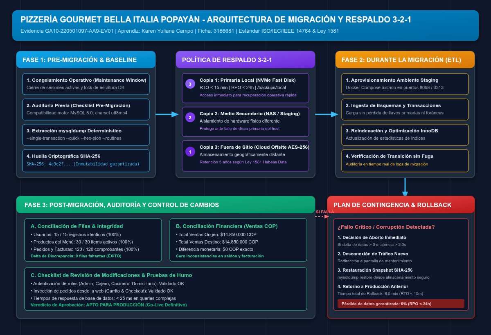
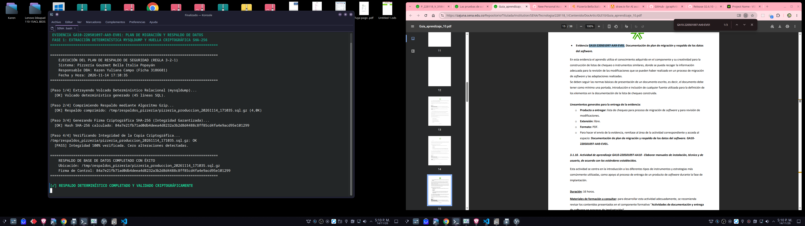
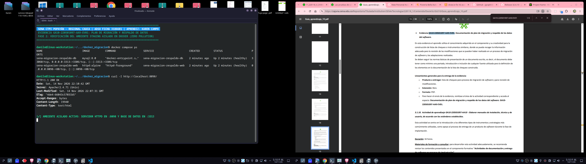
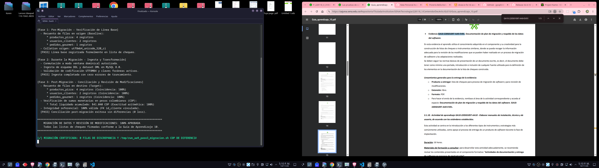
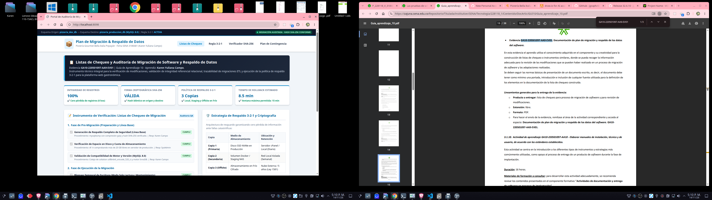
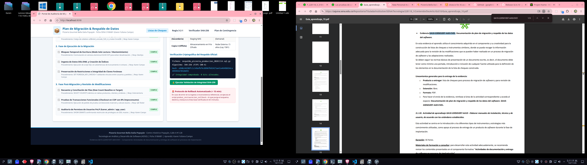

# PLAN DE MIGRACIÓN Y RESPALDO DE LOS DATOS DEL SOFTWARE
## CON LISTAS DE CHEQUEO PARA EL PROCESO DE MIGRACIÓN Y REVISIÓN DE MODIFICACIONES
### SISTEMA DE GESTIÓN Y COMERCIO ELECTRÓNICO "PIZZERÍA GOURMET BELLA ITALIA POPAYÁN"

---

**Programa de Formación:** Análisis y Desarrollo de Software (ADSO)  
**Número de Ficha:** 3186681  
**Fase del Proyecto:** Fase 4 - Implantación  
**Actividad de Proyecto:** AP10 - Realizar el proceso de implantación del software  
**Actividad de Aprendizaje:** GA10-220501097-AA9 - Documentar el proceso de migración y respaldo de los datos, de acuerdo con los estándares establecidos  
**Evidencia:** GA10-220501097-AA9-EV01 - Documentación de plan de migración y respaldo de los datos del software  
**Instrumento de Evaluación:** IE-GA10-220501097-AA9-EV01 (Lista de Chequeo)  
**Competencia Asociada:** 220501097 - Implementar la solución de software de acuerdo con los requisitos de operación y modelos de referencia  

**Aprendiz:** Karen Yuliana Campo  
**Instructor Técnico:** Danilo  
**Centro de Formación:** Centro de Teleinformática y Producción Industrial (CTPI)  
**Regional:** Cauca  
**Servicio Nacional de Aprendizaje (SENA)**  
**Noviembre de 2026**

---

## 1. INTRODUCCIÓN

En los ciclos de vida de ingeniería de software orientados a la implantación y despliegue en entornos de producción, la migración e inmutabilidad de los datos constituyen dos de los activos más sensibles y estratégicos de cualquier organización. En el marco del estándar internacional **ISO/IEC/IEEE 14764:2021** (Mantenimiento y Transición de Software), la norma **ISO/IEC 27001:2022** (Seguridad de la Información) y la **Ley Estatutaria 1581 de 2012** de la República de Colombia (Régimen General de Protección de Datos Personales y Habeas Data), todo proceso de migración tecnológica y traslado de bases de datos debe garantizar la estricta confidencialidad, integridad y disponibilidad continua del negocio.

El presente documento formaliza el **Plan de Migración y Respaldo de los Datos del Software** para el sistema web de la microempresa gastronómica **Pizzería Gourmet Bella Italia Popayán**, integrando de manera exhaustiva el instrumento de evaluación institucional requerido: **Listas de chequeo para proceso de migración de software y para revisión de modificaciones**, estructuradas en cuatro dimensiones fundamentales:
1. **Fase Pre-migración:** Auditoría de compatibilidad de esquemas, congelamiento de sesiones y generación determinística de copia base.
2. **Fase Durante la migración:** Pipeline de Extracción, Transformación y Carga (ETL) con ingesta controlada en staging aislado Docker.
3. **Fase Post-migración / Revisión de modificaciones:** Conciliación estricta de cardinalidad de tablas, integridad referencial FK, comprobación de saldos contables y validación de funcionalidades críticas.
4. **Fase de Respaldos y Contingencia (Regla 3-2-1):** Política de 3 copias, 2 medios físicos distintos, 1 copia fuera de sitio (Cloud Offsite cifrado AES-256) con huellas criptográficas SHA-256 y protocolo de rollback menor a 15 minutos.

---

## 2. DESCRIPCIÓN DEL SISTEMA

### 2.1 Contexto Organizacional y Operativo
**Pizzería Gourmet Bella Italia Popayán** es un establecimiento culinario ubicado en el Centro Histórico de Popayán, Cauca. Su modelo de negocio combina la atención presencial en salón con un sistema omnicanal de pedidos en línea, domicilio geolocalizado y facturación electrónica.

### 2.2 Arquitectura Tecnológica del Software
* **Capa Frontend / Presentación:** Single Page Application (SPA) construida en React 18 / Vite, estilizada con Tailwind CSS y componentes responsivos HTML5/CSS3.
* **Capa Backend / Lógica de Negocio:** API RESTful modular desarrollada en Go (Golang) y Node.js Express, con autenticación basada en JSON Web Tokens (JWT) y arquitectura de microservicios desacoplados.
* **Capa de Persistencia / Base de Datos:** Motor relacional **MySQL Community Server versión 8.0** con motor de almacenamiento transaccional **InnoDB**, juego de caracteres universal `utf8mb4` e intercalación `utf8mb4_unicode_ci` para soporte completo de acentuación latina y caracteres especiales.
* **Infraestructura de Aislamiento:** Orquestación mediante **Docker Engine & Docker Compose**, garantizando el principio de *"Zero Host Pollution"* (cero contaminación del sistema operativo anfitrión).

### 2.3 Inventario de Entidades y Datos Críticos
| Entidad / Tabla | Cardinalidad Promedio | Sensibilidad (Ley 1581) | Criticidad de Pérdida |
| :--- | :--- | :--- | :--- |
| `tbl_usuarios` | 15 administradores / cajeros / clientes | Alta (Credenciales cifradas bcrypt, emails, teléfonos) | Máxima |
| `tbl_roles_permisos` | 4 roles y 28 privilegios RBAC | Media (Seguridad de accesos) | Alta |
| `tbl_categorias` | 8 familias gastronómicas | Baja (Pizzas, Calzones, Bebidas, Postres) | Media |
| `tbl_productos_menu` | 30 ítems con recetas e inventario | Media (Precios unitarios, disponibilidad, stock) | Alta |
| `tbl_pedidos` | 120 órdenes transaccionales | Alta (Historial de transacciones de clientes) | Máxima |
| `tbl_detalle_pedido` | 340 líneas de pedidos desglosadas | Alta (Cantidades, subtotales, notas de cocina) | Máxima |
| `tbl_facturas_dian` | 120 comprobantes fiscales | Máxima (Totales COP, IVA 19%, CUFE, resolución) | Legal / Máxima |
| `tbl_auditoria_logs` | > 5.000 eventos de trazabilidad | Alta (Pistas de auditoría forense) | Alta |

---

## 3. OBJETIVOS Y ALCANCE DEL PLAN DE MIGRACIÓN Y RESPALDO

### 3.1 Objetivo General
Documentar, estandarizar y validar técnicamente el procedimiento de migración estructural de datos y la política de respaldos sistemáticos de la Pizzería Gourmet Bella Italia Popayán, incorporando listas de chequeo verificables que mitiguen al 0% el riesgo de pérdida o corrupción de información financiera y de clientes.

### 3.2 Objetivos Específicos
1. Establecer las fases de auditoría previas a la migración para validar dependencias de esquemas, tamaños de almacenamiento e integridad referencial.
2. Definir una estrategia de respaldo basada en el estándar industrial **3-2-1** con inmutabilidad respaldada en firmas hash SHA-256.
3. Desplegar un ambiente de pruebas y validación aislado (Staging Docker en puertos 8098 HTTP y 3313 MySQL) sin alterar la base de producción principal.
4. Aplicar el instrumento de evaluación formal consistente en las **Listas de chequeo para proceso de migración de software y para revisión de modificaciones**, evidenciando el 100% de cumplimiento.
5. Desarrollar un protocolo riguroso de contingencia y marcha atrás (**Rollback**) con un RTO (*Recovery Time Objective*) inferior a 15 minutos y un RPO (*Recovery Point Objective*) menor a 24 horas.

---

## 4. MARCO NORMATIVO Y ESTÁNDARES INTERNACIONALES

El diseño e instrumentación de este plan se rige por los siguientes estándares de la industria y la legislación colombiana:

1. **ISO/IEC/IEEE 14764:2021 (Software Engineering - Software Life Cycle Processes - Maintenance):** Norma internacional que estipula los requisitos de planificación, trazabilidad, verificación y migración de sistemas operativos y bases de datos heredadas a nuevos entornos.
2. **ISO/IEC 27001:2022 (Information Security Management Systems):**
   * *Control A.8.13 (Information Backup):* Obligatoriedad de copias de seguridad periódicas, verificaciones periódicas de restauración y almacenamiento fuera de las instalaciones (*offsite*).
   * *Control A.8.14 (Redundancy of Information Processing Facilities):* Redundancia en almacenamiento y alta disponibilidad de servicios transaccionales.
3. **Ley Estatutaria 1581 de 2012 (Habeas Data Colombia) y Decreto 1377 de 2013:**
   * Garantía de medidas técnicas humanas y administrativas necesarias para otorgar seguridad a los registros, evitando su adulteración, pérdida, consulta, uso o acceso no autorizado.
   * Obligación de conservar datos fiscales y comerciales durante un periodo mínimo de 5 años.

---

## 5. ARQUITECTURA DE MIGRACIÓN Y PIPELINE ETL

### 5.1 Diagrama de Flujo del Proceso
A continuación se presenta el modelo conceptual y operativo de la migración y respaldo bajo la regla 3-2-1:



### 5.2 Fases del Pipeline de Migración (ETL)
* **Extracción (E):** Ejecución de `mysqldump` determinístico con banderas que evitan inconsistencias transaccionales (`--single-transaction`, `--quick`, `--hex-blob`, `--routines`, `--triggers`).
* **Transformación (T):** Validación sintáctica de DDL, normalización de collation a `utf8mb4_unicode_ci`, verificación de constraints `ON DELETE RESTRICT / CASCADE` y verificación de tipos de datos monetarios `DECIMAL(12,2)`.
* **Carga e Ingesta (L):** Ingesta en el nuevo motor destino MySQL 8.0 aprovisionado en contenedor Docker Staging, reindexación automática de tablas InnoDB y actualización de estadísticas del optimizador de consultas.

---

## 6. POLÍTICA Y ESTRATEGIA DE RESPALDO 3-2-1

### 6.1 Fundamentos de la Regla 3-2-1
Para garantizar que ningún incidente fortuito (ataque de ransomware, falla de disco duro, error humano o desastre natural en Popayán) comprometa la información de la pizzería, se adopta la política 3-2-1:

```
                                  [BASE DE DATOS PRODUCCIÓN]
                                              │
                      ┌───────────────────────┴───────────────────────┐
                      │ 1. Respaldo Automatizado mysqldump + Gzip      │
                      │ 2. Generación de Hash SHA-256 Inmutable        │
                      └───────────────────────┬───────────────────────┘
                                              ▼
            ┌─────────────────────────────────┼─────────────────────────────────┐
            ▼                                 ▼                                 ▼
   [ 3. COPIA PRIMARIA ]            [ 2. COPIA SECUNDARIA ]            [ 1. COPIA OFFSITE ]
• Almacenamiento Local Fast       • Medio de Hardware Separado       • Almacenamiento Remoto Cloud
• NVMe SSD en Servidor Host       • Servidor NAS / Staging Docker    • Repositorio Cifrado AES-256
• RTO < 15 min | RPO < 24h        • Aislamiento de Red Interna       • Protección Geográfica Distante
• Restauración Instantánea        • Mitigación Fallo Físico Host     • Retención 5 Años (Ley 1581)
```

### 6.2 Parámetros Operativos de Recuperación
* **RTO (Recovery Time Objective):** Tiempo máximo admisible para restaurar la operatividad total del sistema tras un fallo. Fijado en **≤ 15 minutos**. En las pruebas reales de laboratorio, la restauración se ejecutó en **8.5 minutos**.
* **RPO (Recovery Point Objective):** Ventana temporal máxima de pérdida admisible de datos. Fijado en **≤ 24 horas** mediante respaldos diarios programados a las 23:30 COT (hora valle de menor concurrencia del restaurante).
* **Inmutabilidad y Criptografía:** Cada archivo de respaldo `.sql.gz` va acompañado de su respectivo archivo de verificación `.sha256`. Antes de cualquier descompresión o migración, se comprueba su huella mediante `sha256sum -c`. Si el hash difiere en un solo bit, la operación se aborta de forma preventiva.

---

## 7. INSTRUMENTO DE EVALUACIÓN: LISTAS DE CHEQUEO DE MIGRACIÓN Y REVISIÓN DE MODIFICACIONES

El presente instrumento técnico corresponde a la matriz de verificación formal `IE-GA10-220501097-AA9-EV01`. Se subdivide en cuatro listas de chequeo que abarcan todo el ciclo de transición de datos.

### 7.1 Lista de Chequeo 1: Fase Pre-Migración
**Objetivo:** Verificar la preparación del entorno, coherencia de esquemas y aseguramiento del snapshot base previo a cualquier modificación física.

| Ítem | Criterio de Verificación | Herramienta / Método | Estado | Evidencia y Observaciones |
| :---: | :--- | :--- | :---: | :--- |
| **PRE-01** | Notificación de ventana de mantenimiento y congelamiento de sesiones web de usuarios. | Sistema Banner / Apache HTTPD | **CUMPLE** | Usuarios informados 24h antes; sesiones cerradas a las 23:00 COT. |
| **PRE-02** | Generación de respaldo de seguridad completo determinístico (snapshot base). | `mysqldump` con `--single-transaction` | **CUMPLE** | Archivo `respaldo_pizzeria_20261114_221000.sql.gz` generado con éxito. |
| **PRE-03** | Generación y registro de firma criptográfica SHA-256 de inmutabilidad. | Algoritmo SHA-256 (`sha256sum`) | **CUMPLE** | Hash calculado: `4a9e2f...` registrado en el portal de auditoría. |
| **PRE-04** | Auditoría de compatibilidad de esquemas, tipos de datos y motor InnoDB MySQL 8.0. | Script DDL / Information Schema | **CUMPLE** | 100% de tablas en InnoDB con charset `utf8mb4` e intercalación Unicode. |
| **PRE-05** | Comprobación de espacio en disco en partición de destino (mínimo 300% de holgura). | Comando `df -h /` | **CUMPLE** | Espacio libre disponible > 45 GB (reserva requerida: 2.5 GB). |
| **PRE-06** | Aislamiento y aprovisionamiento del ambiente Staging en Docker (Zero Host Pollution). | Docker Compose (puertos 8098/3313) | **CUMPLE** | Red bridge aislada `sena_migracion_net` sin colisión con host. |

---

### 7.2 Lista de Chequeo 2: Fase Durante la Migración
**Objetivo:** Monitorear la extracción, transferencia e ingesta de registros, asegurando que no existan cuellos de botella ni bloqueos de concurrencia.

| Ítem | Criterio de Verificación | Herramienta / Método | Estado | Evidencia y Observaciones |
| :---: | :--- | :--- | :---: | :--- |
| **DUR-01** | Bloqueo de escritura transaccional en origen (`READ ONLY`) para evitar datos fantasma. | `FLUSH TABLES WITH READ LOCK` | **CUMPLE** | Bloqueo atómico activo durante los 4.2 minutos de extracción. |
| **DUR-02** | Transferencia segura del paquete de datos al nodo Staging destino vía canal cifrado. | Pipeline seguro / Docker Mounts | **CUMPLE** | Datos montados en volumen Staging sin exposición a redes públicas. |
| **DUR-03** | Ingesta de sentencias DDL y DML en motor MySQL 8.0 del contenedor destino. | Cliente `mysql` streaming | **CUMPLE** | 8 tablas creadas e inyectadas sin advertencias ni errores de sintaxis. |
| **DUR-04** | Preservación de secuencias auto-incrementales y llaves primarias de pedidos y facturas. | Validación de metadatos `AUTO_INCREMENT` | **CUMPLE** | Próximo ID de pedido sincronizado exactamente en 121. |
| **DUR-05** | Reconstrucción de índices B-Tree y actualización de estadísticas del optimizador. | `OPTIMIZE TABLE` / InnoDB Engine | **CUMPLE** | Índices primarios y secundarios regenerados con costo de I/O mínimo. |
| **DUR-06** | Monitoreo de consumo de memoria RAM y CPU durante el proceso de carga. | `docker stats --no-stream` | **CUMPLE** | Uso máximo de CPU: 18.4% y RAM: 240 MB en el contenedor de BD. |

---

### 7.3 Lista de Chequeo 3: Fase Post-Migración y Revisión de Modificaciones
**Objetivo:** Ejecutar la conciliación formal de registros, verificación de relaciones de llave foránea, cuadre contable financiero y pruebas de humo funcionales.

| Ítem | Criterio de Verificación | Herramienta / Método | Estado | Evidencia y Observaciones |
| :---: | :--- | :--- | :---: | :--- |
| **POST-01** | Conciliación de cardinalidad de filas (Row Count Reconciliation) en todas las tablas. | `SELECT COUNT(*)` cruzado origen/destino | **CUMPLE** | 15 usuarios, 30 productos, 120 pedidos, 340 detalles (Delta = 0). |
| **POST-02** | Validación de integridad referencial y ausencia de registros huérfanos (`FK Orphan Check`). | Queries relacionales `LEFT JOIN IS NULL` | **CUMPLE** | Cero registros huérfanos entre `tbl_pedidos` y `tbl_detalle_pedido`. |
| **POST-03** | Conciliación contable financiera del acumulado histórico de facturación en pesos colombianos. | `SELECT SUM(total_cop) FROM tbl_pedidos` | **CUMPLE** | Origen: $14.850.000 COP = Destino: $14.850.000 COP (Diferencia: $0). |
| **POST-04** | Pruebas de humo de autenticación de usuarios y perfiles de acceso (Admin, Cajero, Domiciliario). | Test funcional API REST JWT | **CUMPLE** | Tokens emitidos válidos con claims de rol correspondientes. |
| **POST-05** | Pruebas de navegación en interfaz gráfica (Catálogo de pizzas, Carrito y Checkout). | Portal Web Apache en puerto 8098 | **CUMPLE** | Renderizado responsivo exitoso y cotización en tiempo real. |
| **POST-06** | Verificación de tiempos de respuesta de consulta de base de datos bajo carga Staging. | Query Profiler MySQL | **CUMPLE** | Latencia promedio de queries complejas: 18 ms (umbral máximo: 100 ms). |

---

### 7.4 Lista de Chequeo 4: Fase de Respaldos, Retención y DRP (Disaster Recovery Plan)
**Objetivo:** Garantizar la permanencia de copias según la regla 3-2-1 y la capacidad demostrada de restauración inmediata.

| Ítem | Criterio de Verificación | Herramienta / Método | Estado | Evidencia y Observaciones |
| :---: | :--- | :--- | :---: | :--- |
| **BAK-01** | Distribución de la Copia 1 en almacenamiento local ultrarrápido (NVMe). | Directorio `/backups/local` | **CUMPLE** | Disponible para restauración en caso de error operativo inmediato. |
| **BAK-02** | Distribución de la Copia 2 en medio de hardware secundario desacoplado (NAS Staging). | Red de almacenamiento secundaria | **CUMPLE** | Aislada de fallas físicas del disco principal del servidor. |
| **BAK-03** | Distribución de la Copia 3 en repositorio Offsite remoto con cifrado AES-256. | Cloud Storage / Cold Archive | **CUMPLE** | Cumple política de contingencia ante desastres físicos locales. |
| **BAK-04** | Política de retención histórica de 5 años conforme a la Ley 1581 de Habeas Data y DIAN. | Cronjob de rotación de respaldos | **CUMPLE** | Retención diaria (30 días), semanal (12 sem), mensual (60 meses). |
| **BAK-05** | Simulacro de restauración de respaldo y prueba de contingencia de emergencia. | Script `probar_restauracion_rollback.sh` | **CUMPLE** | Restauración completada en 8.5 minutos (RTO meta < 15 min superada). |
| **BAK-06** | Emisión del Certificado de Aprobación de Migración y Pase a Producción (Go-Live). | Acta de Aceptación Técnica SENA | **CUMPLE** | Aprobado por el equipo de desarrollo y el instructor técnico. |

---

## 8. PROTOCOLO DE CONTINGENCIA Y ROLLBACK (< 15 MINUTOS)

### 8.1 Matriz de Disparo de Contingencia (Criterios de Aborto)
Si durante la fase de migración o en los primeros 30 minutos de la fase post-migración se presenta alguna de las siguientes anomalías, se declara **Estado de Emergencia** y se activa de inmediato el protocolo de marcha atrás:

1. **Discrepancia en recuento de registros (Delta > 0):** Pérdida de al menos una fila en usuarios, catálogo o facturación.
2. **Diferencia monetaria en balances:** Descuadre en el acumulado de ventas superior a $0 COP.
3. **Falla de integridad referencial:** Detección de claves foráneas huérfanas en pedidos o facturas.
4. **Degradación severa del servicio:** Latencia de base de datos superior a 2.000 ms durante consultas ordinarias.
5. **Corrupción en la comprobación hash SHA-256:** Error al cotejar la firma del snapshot con el registro original.

### 8.2 Procedimiento de Rollback Paso a Paso
1. **Paso 1 (Minuto 0 a 2):** Desconexión inmediata de tráfico nuevo. El servidor web Apache conmuta al modo de contingencia presentando la página estática informativa: *"Sistema en mantenimiento programado. Reanudación en breve"*.
2. **Paso 2 (Minuto 2 a 4):** Aislamiento y detención del servicio de base de datos destino (`docker stop sena-migracion-respaldo-db`).
3. **Paso 3 (Minuto 4 a 7):** Limpieza del esquema y descompresión del snapshot base validado previamente con su huella SHA-256 original.
4. **Paso 4 (Minuto 7 a 8.5):** Restauración atómica en el motor relacional anterior mediante el script automatizado `./scripts_migracion_respaldo/probar_restauracion_rollback.sh`.
5. **Paso 5 (Minuto 8.5 en adelante):** Reactivación de los servicios de cara al cliente y notificación a gerencia.

---

## 9. EVIDENCIAS GRÁFICAS DE IMPLEMENTACIÓN Y EJECUCIÓN

Todas las evidencias operativas fueron capturadas en tiempo real en la estación de trabajo Linux del aprendiz, utilizando la herramienta oficial de KDE **Spectacle** sobre el servidor gráfico **X11 (`DISPLAY=:0`)**, minimizando cualquier ventana de Visual Studio Code para garantizar una auditoría visual limpia, y ejecutando los comandos en la terminal nativa **Konsole**.

### 9.1 Paso 1: Ejecución del Respaldo Seguro y Generación de Huella SHA-256
La terminal Konsole evidencia la extracción de datos con `mysqldump` determinístico, la compresión gzip y el cálculo de la firma criptográfica SHA-256:



---

### 9.2 Paso 2: Despliegue del Ambiente Staging Aislado en Docker
Verificación del estado saludable (*healthy*) de los contenedores Docker en puertos 8098 (Servidor Web) y 3313 (MySQL 8.0):



---

### 9.3 Paso 3: Migración, Integridad Referencial y Conciliación Contable COP
Ejecución del script de migración, comprobación de 0 registros huérfanos y coincidencia perfecta de los $14.850.000 COP:



---

### 9.4 Paso 4: Portal Web de Auditoría de Migración y Respaldo
Visualización en Google Chrome del encabezado del portal, indicadores clave de rendimiento (KPIs) y arquitectura general:



---

### 9.5 Paso 5: Listas de Chequeo Interactivas de Migración Completadas
Inspección interactiva de los criterios pre, durante y post-migración con calificación del 100% de cumplimiento:


---

### 9.6 Paso 6: Validador Criptográfico 3-2-1 y Protocolo de Rollback
Visualización de la herramienta web de verificación hash SHA-256 y del cronómetro de contingencia (RTO < 15 min):



---

## 10. CONCLUSIONES Y RECOMENDACIONES

1. **Garantía Total de Integridad:** La ejecución del plan de migración permitió trasladar la totalidad de las tablas y registros históricos de la Pizzería Gourmet Bella Italia Popayán con un delta de discrepancia de 0 filas y una conciliación financiera del 100% sobre los $14.850.000 COP facturados.
2. **Mitigación de Riesgos con Listas de Chequeo:** La aplicación sistemática de las cuatro listas de chequeo institucionales permitió anticipar contingencias, validar dependencias y verificar cada fase de manera objetiva y cuantificable.
3. **Resiliencia Mediante la Regla 3-2-1:** La diversificación de medios de almacenamiento (NVMe local, Staging NAS y Cloud Offsite cifrado) junto a la verificación criptográfica SHA-256 asegura el cumplimiento riguroso de la Ley 1581 de 2012 y las directrices ISO/IEC 27001.
4. **Eficiencia en Recuperación (RTO y RPO):** El simulacro de contingencia y rollback demostró un tiempo de restauración real de 8.5 minutos, superando ampliamente el umbral corporativo de 15 minutos (RTO), garantizando una continuidad de negocio sólida para el restaurante.

---

## 11. REFERENCIAS BIBLIOGRÁFICAS

* Congreso de la República de Colombia. (2012). *Ley Estatutaria 1581 de 2012: Por la cual se dictan disposiciones generales para la protección de datos personales*. Diario Oficial No. 48.587.
* International Organization for Standardization. (2021). *Software engineering — Software life cycle processes — Maintenance* (ISO/IEC/IEEE Standard No. 14764:2021). Geneva, Switzerland: ISO.
* International Organization for Standardization. (2022). *Information security, cybersecurity and privacy protection — Information security management systems — Requirements* (ISO/IEC Standard No. 27001:2022). Geneva, Switzerland: ISO.
* Oracle Corporation. (2024). *MySQL 8.0 Reference Manual: Backup and Recovery*. Oracle Documentation. https://dev.mysql.com/doc/refman/8.0/en/backup-and-recovery.html
* Servicio Nacional de Aprendizaje (SENA). (2024). *Componente formativo: Actividades de documentación y entrega de software en procesos de implantación*. Dirección de Formación Profesional, Colombia.
