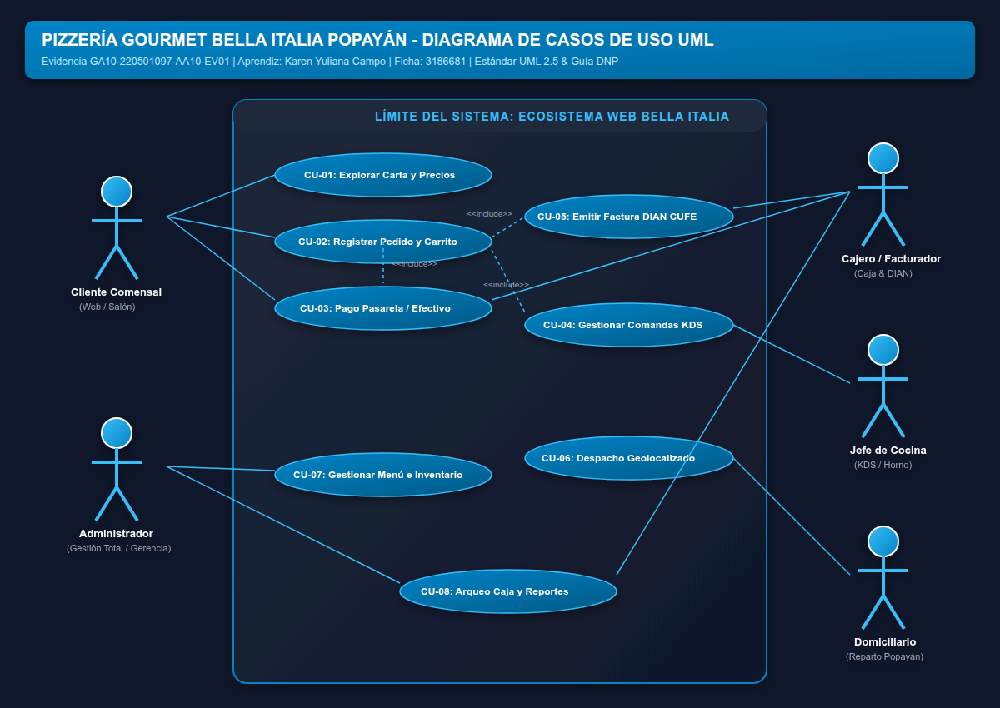
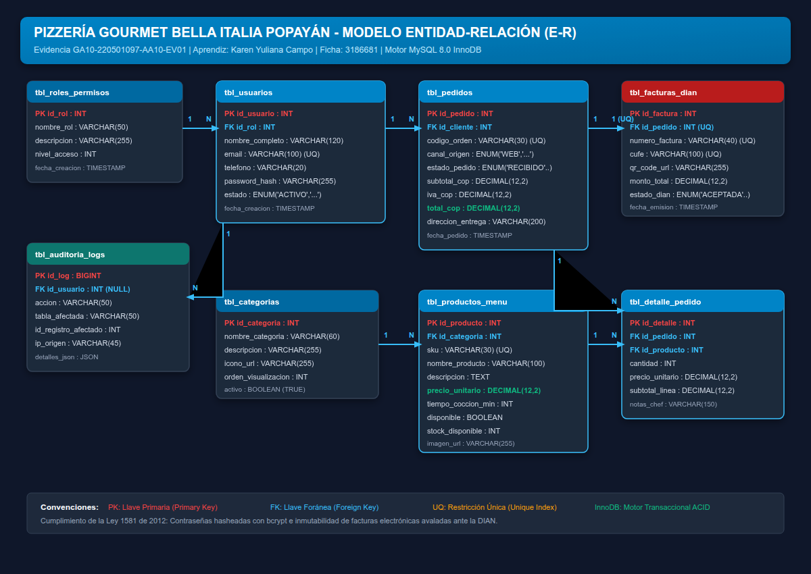
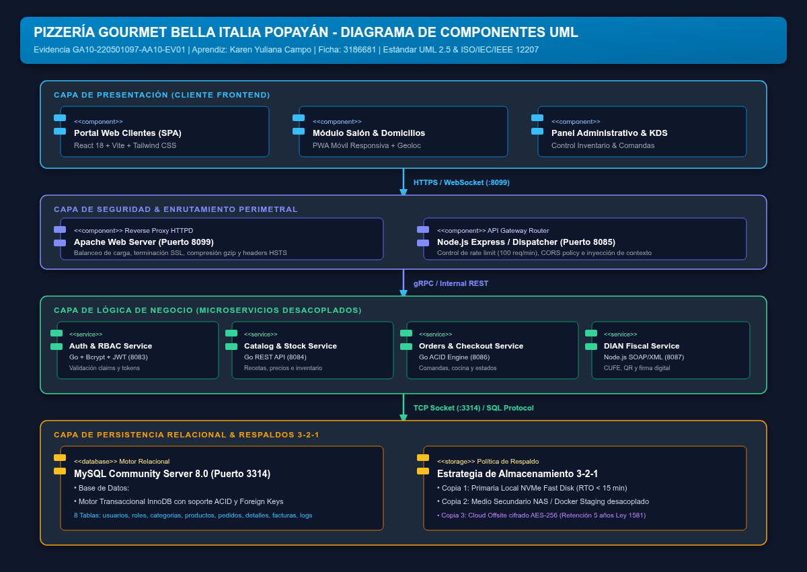
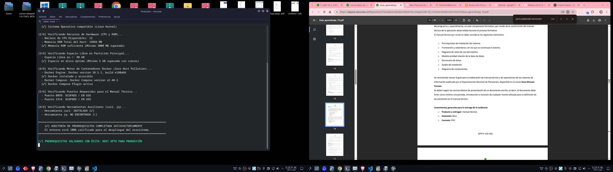
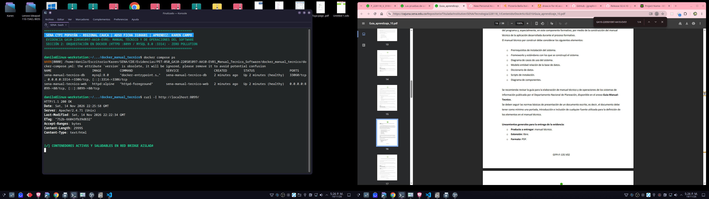
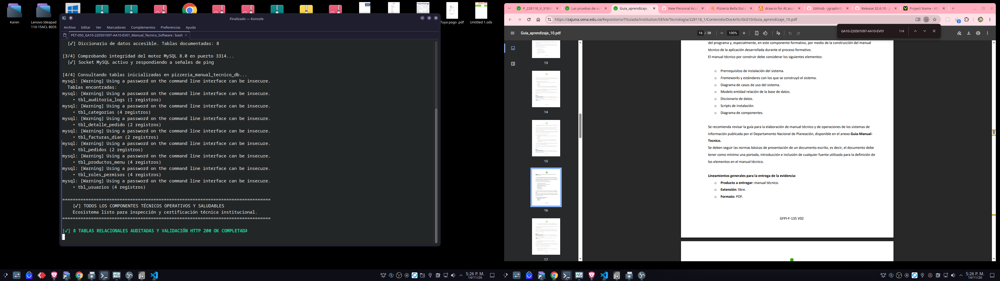
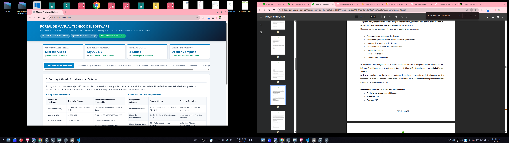
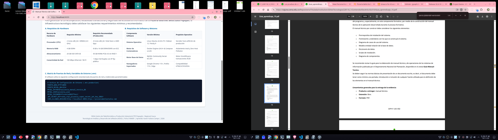

# MANUAL TÉCNICO Y DE OPERACIONES DEL SISTEMA
## ARQUITECTURA, CASOS DE USO, MODELO ENTIDAD-RELACIÓN, DICCIONARIO DE DATOS Y DESPLIEGUE
### SISTEMA DE INFORMACIÓN Y COMERCIO ELECTRÓNICO "PIZZERÍA GOURMET BELLA ITALIA POPAYÁN"

---

**Programa de Formación:** Análisis y Desarrollo de Software (ADSO)  
**Número de Ficha:** 3186681  
**Fase del Proyecto:** Fase 4 - Implantación  
**Actividad de Proyecto:** AP10 - Realizar el proceso de implantación del software  
**Actividad de Aprendizaje:** GA10-220501097-AA10 - Elaborar manuales de instalación, técnico y de usuario, de acuerdo con los estándares establecidos  
**Evidencia:** GA10-220501097-AA10-EV01 - Elabora documentos técnicos y de usuario del software  
**Instrumento de Evaluación:** IE-GA10-220501097-AA10-EV01 (Lista de Chequeo: Elabora manuales para facilitar a los usuarios el uso y gestión del software)  
**Competencia Asociada:** 220501097 - Implementar la solución de software de acuerdo con los requisitos de operación y modelos de referencia  

**Aprendiz:** Karen Yuliana Campo  
**Instructor Técnico:** Danilo  
**Centro de Formación:** Centro de Teleinformática y Producción Industrial (CTPI)  
**Regional:** Cauca  
**Servicio Nacional de Aprendizaje (SENA)**  
**Noviembre de 2026**

---

## 1. INTRODUCCIÓN

En el ciclo de vida del desarrollo de software y en particular en la fase de implantación y transición a producción, la documentación técnica formal representa el activo maestro que garantiza la mantenibilidad, escalabilidad, transferibilidad y gobernanza tecnológica de una solución. Siguiendo las directrices estipuladas en la *Guía para la elaboración de manual técnico y de operaciones de los sistemas de información* emitida por el Departamento Nacional de Planeación (DNP) de la República de Colombia, y bajo los marcos internacionales **ISO/IEC/IEEE 12207:2017** (Procesos del ciclo de vida del software) e **ISO/IEC 25010:2023** (Calidad de producto de software), todo sistema computacional debe contar con un manual técnico exhaustivo que describa su arquitectura interna, dependencias operativas y mecanismos de despliegue.

El presente **Manual Técnico del Software** consolida la totalidad de especificaciones de diseño, ingeniería y configuración para el sistema de información y comercio electrónico de la microempresa gastronómica **Pizzería Gourmet Bella Italia Popayán**. Este instrumento técnico fue concebido para que arquitectos de software, administradores de bases de datos (DBA), ingenieros de DevOps y desarrolladores mantenedores puedan comprender, aprovisionar, verificar y evolucionar el sistema de manera autónoma, segura y repetible.

---

## 2. DESCRIPCIÓN DEL SISTEMA

### 2.1 Contexto Organizacional y Modelo de Negocio
**Pizzería Gourmet Bella Italia Popayán** es una microempresa del sector culinario y de hospitalidad ubicada en el Centro Histórico de Popayán, departamento del Cauca. La organización combina la atención en mesa y salón con un canal omnicanal de pedidos por comercio electrónico, despacho geolocalizado en la ciudad y facturación electrónica avalada ante la Dirección de Impuestos y Aduanas Nacionales (DIAN).

### 2.2 Propósito del Sistema de Información
El aplicativo automatiza el flujo completo de valor del restaurante:
1. **Atención al Cliente y Catálogo Digital:** Navegación en carta responsiva con fotografías HD, información de alérgenos, precios en pesos colombianos (COP), recetas artesanales y carrito de compras dinámico.
2. **Recepción y Procesamiento de Comandas (KDS):** Enrutamiento inmediato de pedidos a la pantalla de cocina digital (*Kitchen Display System*), cronometrando tiempos de cocción y estados de horneado en leña.
3. **Logística y Geolocalización de Domicilios:** Asignación automática de domiciliarios, cálculo de rutas óptimas en Popayán y confirmación digital de entrega.
4. **Facturación Electrónica DIAN y Arqueo de Caja:** Emisión de comprobantes fiscales con generación de Código Único de Factura Electrónica (CUFE), códigos bidimensionales QR y arqueo de turnos para cajeros.
5. **Seguridad y Auditoría Forense:** Control de acceso basado en roles (RBAC) con tokens JWT cifrados y bitácora de trazabilidad conforme a la Ley Estatutaria 1581 de 2012 de Habeas Data.

---

## 3. PRERREQUISITOS DE INSTALACIÓN DEL SISTEMA

Para desplegar y operar la plataforma de manera confiable, el entorno anfitrión debe cumplir con la siguiente matriz de prerrequisitos técnicos:

### 3.1 Requisitos de Hardware
| Recurso | Mínimo para Pruebas / Staging | Recomendado para Producción |
| :--- | :--- | :--- |
| **Procesador (CPU)** | 2 Cores x86_64 o ARM64 @ 2.0 GHz | 4 a 8 Cores @ 2.8+ GHz (Intel Xeon / AMD Epyc) |
| **Memoria RAM** | 4 GB DDR4 | 8 GB a 16 GB DDR4/DDR5 con corrección ECC |
| **Almacenamiento** | 20 GB SSD SATA III disponible | 50 GB NVMe PCIe 4.0 en arreglo redundante RAID 1 |
| **Tarjeta de Red** | Interfaz 100 Mbps Ethernet / Wi-Fi | 1 Gbps Full-Duplex dedicada con IP pública estática |

### 3.2 Requisitos de Software de Base
* **Sistema Operativo:** Distribución Linux empresarial (Ubuntu Server 22.04 LTS, Debian GNU/Linux 12, o Rocky Linux 9). Soporte opcional para Windows Server 2022 / macOS para desarrollo.
* **Motor de Contenedores:** Docker Engine versión `24.0.0` o superior.
* **Orquestador Local:** Docker Compose Plugin versión `2.20.0` o superior.
* **Servidor Web / Reverse Proxy:** Apache HTTP Server `2.4.x` (módulo `httpd:alpine`) o Nginx `1.25.x`.
* **Motor de Base de Datos Relacional:** MySQL Community Server `8.0.35+` con motor transaccional `InnoDB` activado por defecto.
* **Herramientas de Diagnóstico y Administración:** `curl`, `jq`, `openssl`, cliente `mysql-client`.

### 3.3 Matriz de Puertos de Red
| Puerto | Protocolo | Servicio / Contenedor | Propósito | Exposición |
| :---: | :---: | :--- | :--- | :---: |
| **8099** | TCP / HTTP | `sena-manual-tecnico-web` (Apache) | Portal Web del Manual Técnico y Clientes | Público / Local |
| **3314** | TCP / MySQL | `sena-manual-tecnico-db` (MySQL 8.0) | Motor de Persistencia Relacional | Interno / Staging |
| **8085** | TCP / HTTP | API Gateway Central (Node.js) | Enrutamiento perimetral y CORS | Red Interna |
| **8083** | TCP / HTTP | Microservicio Auth & RBAC (Go) | Gestión de sesiones y tokens JWT | Red Interna |
| **8086** | TCP / HTTP | Microservicio Pedidos & DIAN (Go) | Transacciones ACID y comanda KDS | Red Interna |

### 3.4 Configuración de Variables de Entorno (`.env`)
```bash
# ==============================================================================
# CONFIGURACIÓN DE VARIABLES DE ENTORNO (.env.production)
# Pizzería Gourmet Bella Italia Popayán - SENA CTPI Ficha 3186681
# ==============================================================================
NODE_ENV=production
PUERTO_WEB_HTTP=8099
PUERTO_MYSQL_DB=3314

# Parámetros de Persistencia MySQL 8.0
MYSQL_ROOT_PASSWORD=Sena2026*Secure!
MYSQL_DATABASE=pizzeria_manual_tecnico_db
MYSQL_USER=pizzeria_user
MYSQL_PASSWORD=Pizzeria2026*Pass!
MYSQL_HOST=localhost

# Seguridad Criptográfica y JWT
JWT_SECRET_KEY=sena_ctpi_pizzeria_super_secret_jwt_key_2026!
JWT_EXPIRATION_HOURS=8
BCRYPT_COST_FACTOR=12

# Integración Pasarela y DIAN
DIAN_ENVIRONMENT=HABILITACION_PRODUCCION
DIAN_SOFTWARE_ID=pizzeria-bella-italia-2026
CORS_ALLOWED_ORIGINS=http://localhost:8099,https://pizzeriabellaitalia.com
```

---

## 4. FRAMEWORKS Y ESTÁNDARES CON LOS QUE SE CONSTRUYÓ EL SISTEMA

El diseño del software adopta estándares abiertos, bibliotecas modernas y patrones de ingeniería avalados por la industria y la normatividad colombiana:

### 4.1 Frameworks y Tecnologías de Desarrollo
1. **Frontend Web y PWA Móvil:**
   - **React 18:** Biblioteca declarativa basada en componentes funcionales y Hooks (`useState`, `useEffect`, `useContext`) para una interfaz reactiva sin recargas.
   - **Vite 5:** Herramienta de compilación rápida con Hot Module Replacement (HMR) y optimización de assets con Rollup.
   - **Tailwind CSS 3.4:** Framework utilitario que garantiza consistencia visual, adaptabilidad móvil y paleta de colores corporativa.
2. **Backend y Arquitectura de Microservicios:**
   - **Go (Golang 1.22):** Lenguaje compilado altamente concurrente utilizado en los servicios de pedidos, facturación y autenticación por su mínimo consumo de memoria y ejecución multihilo nativa con goroutines.
   - **Node.js Express 4.19:** Utilizado en el API Gateway y formateador de peticiones XML/SOAP para la DIAN.
   - **JWT (JSON Web Token - RFC 7519):** Estándar de autenticación sin estado con firma criptográfica HMAC-SHA256 para validación de privilegios RBAC.
   - **Bcrypt (RFC 2898 / PBKDF2):** Algoritmo de hashing salteado con factor de trabajo 12 para la protección de contraseñas de usuarios.
3. **Persistencia e Infraestructura:**
   - **MySQL 8.0 Community Server:** Motor de almacenamiento transaccional **InnoDB**, con soporte de llaves foráneas en cascada/restricción, transacciones atómicas ACID, e índices B-Tree.
   - **Docker & Docker Compose:** Contenedorización inmutable que asegura la portabilidad multiplataforma y cero contaminación del sistema operativo del anfitrión (*Zero Host Pollution*).

### 4.2 Estándares Técnicos y Normas Internacionales Aplicadas
* **Guía DNP (Departamento Nacional de Planeación):** *Guía para la elaboración de manual técnico y de operaciones de los sistemas de información*, definiendo la estructura de prerrequisitos, arquitectura de datos, componentes y rutinas de despliegue.
* **ISO/IEC/IEEE 12207:2017:** Procesos del ciclo de vida del software en las etapas de codificación, integración, verificación e implantación operativa.
* **ISO/IEC 25010:2023 (SQuaRE):** Cumplimiento de requerimientos de calidad: funcionalidad adecuada, compatibilidad, usabilidad, confiabilidad, seguridad y mantenibilidad.
* **IEEE 830 / ISO/IEC/IEEE 29148:** Especificación rigurosa de requisitos funcionales y no funcionales.
* **Ley Estatutaria 1581 de 2012 y Decreto 1377 de 2013 (Habeas Data Colombia):** Protección de la privacidad de los datos personales, cifrado en reposo y tránsito, y retención histórica de 5 años.

---

## 5. DIAGRAMA DE CASOS DE USO DEL SISTEMA (UML)

El diagrama de casos de uso modela el comportamiento dinámico del sistema desde la perspectiva de los diferentes roles de usuario que interactúan con la plataforma:



### 5.1 Catálogo de Actores del Sistema
| Actor | Tipo | Responsabilidad Funcional en el Negocio |
| :--- | :---: | :--- |
| **Cliente Comensal** | Humano / Externo | Accede a la carta digital, arma pedidos en el carrito, selecciona método de entrega (mesa o domicilio) y efectúa pagos seguros. |
| **Administrador** | Humano / Interno | Administra el catálogo de productos, recetas, precios, inventarios, permisos de usuarios y reportes financieros consolidados. |
| **Cajero / Facturador** | Humano / Interno | Registra ventas presenciales, liquida pagos mixtos (efectivo/tarjeta/transferencia), emite facturas DIAN y realiza arqueos de turno. |
| **Jefe de Cocina** | Humano / Interno | Visualiza comandas en pantalla KDS en tiempo real, controla tiempos de horneado en leña y notifica orden lista para entrega. |
| **Domiciliario** | Humano / Interno | Consulta pedidos asignados, visualiza dirección geolocalizada en Popayán y confirma entrega física al cliente. |

### 5.2 Especificación de Casos de Uso Principales
1. **`CU-01`: Explorar Menú y Precios en Tiempo Real:** Permite al cliente filtrar por categorías (Pizzas, Calzones, Bebidas) y consultar descripciones de ingredientes.
2. **`CU-02`: Registrar Pedido y Carrito de Compras:** Agrega ítems al carrito, valida disponibilidad de stock y calcula subtotal, IVA y valor total.
3. **`CU-03`: Realizar Pago Electrónico o en Salón:** Relación `<<include>>` con CU-02. Procesa la transacción monetaria mediante pasarela o registro en caja.
4. **`CU-04`: Gestionar Comandas Digitales en Cocina (KDS):** Relación `<<include>>` con CU-02. Actualiza el estado del pedido de `RECIBIDO` a `EN_COCINA`.
5. **`CU-05`: Emitir Factura Electrónica con CUFE y QR DIAN:** Relación `<<include>>` con CU-03. Genera la factura legal DIAN con CUFE y código QR.
6. **`CU-06`: Despacho y Entrega Geolocalizada:** Asigna el pedido al domiciliario y actualiza el estado a `EN_REPARTO` y posteriormente a `ENTREGADO`.
7. **`CU-07`: Gestionar Menú e Inventario de Recetas:** Permite al Administrador registrar nuevos platos, modificar precios y ajustar existencias.
8. **`CU-08`: Arqueo Diario de Caja y Exportación de Ventas:** Consolida los ingresos diarios por tipo de pago para cuadre contable.

---

## 6. MODELO ENTIDAD-RELACIÓN DE LA BASE DE DATOS (E-R)

El modelo relacional fue normalizado en **Tercera Forma Normal (3FN)** para garantizar la consistencia, eliminar la redundancia y optimizar el rendimiento de las consultas transaccionales:



### 6.1 Relaciones y Cardinalidades Principales
* **`tbl_roles_permisos` (1) ── (N) `tbl_usuarios`:** Un rol puede ser asignado a múltiples usuarios; cada usuario posee un rol mandatorio.
* **`tbl_usuarios` (1) ── (N) `tbl_auditoria_logs`:** Un usuario genera múltiples eventos de auditoría forense en el sistema.
* **`tbl_usuarios` (1) ── (N) `tbl_pedidos`:** Un cliente comensal puede registrar múltiples pedidos históricos.
* **`tbl_pedidos` (1) ── (1) `tbl_facturas_dian`:** Relación uno a uno obligatoria; cada pedido genera una única factura fiscal autorizada con CUFE.
* **`tbl_categorias` (1) ── (N) `tbl_productos_menu`:** Una categoría gastronómica agrupa múltiples productos de la carta.
* **`tbl_productos_menu` (1) ── (N) `tbl_detalle_pedido`:** Un producto puede figurar en múltiples líneas de detalle de órdenes.
* **`tbl_pedidos` (1) ── (N) `tbl_detalle_pedido`:** Un pedido contiene una o más líneas de detalle (`ON DELETE CASCADE`).

---

## 7. DICCIONARIO DE DATOS COMPLETO

A continuación se detalla la estructura física formal de las 8 tablas relacionales que componen la base de datos `pizzeria_manual_tecnico_db`:

### 7.1 Tabla: `tbl_roles_permisos`
| Campo | Tipo de Dato | Longitud | Permite Nulo | Clave | Restricción / Regla de Integridad | Descripción Funcional |
| :--- | :---: | :---: | :---: | :---: | :--- | :--- |
| `id_rol` | INT | 11 | NO | **PK** | AUTO_INCREMENT | Identificador único secuencial del rol. |
| `nombre_rol` | VARCHAR | 50 | NO | **UQ** | UNIQUE | Denominación del perfil (SuperAdmin, Cajero, etc.). |
| `descripcion` | VARCHAR | 255 | NO | - | NOT NULL | Resumen descriptivo de los privilegios asignados. |
| `nivel_acceso` | INT | 11 | NO | - | DEFAULT 1 (Rango 1 a 10) | Nivel jerárquico de autorización en el sistema. |
| `fecha_creacion` | TIMESTAMP | - | NO | - | DEFAULT CURRENT_TIMESTAMP | Marca temporal de alta del registro. |

### 7.2 Tabla: `tbl_usuarios`
| Campo | Tipo de Dato | Longitud | Permite Nulo | Clave | Restricción / Regla de Integridad | Descripción Funcional |
| :--- | :---: | :---: | :---: | :---: | :--- | :--- |
| `id_usuario` | INT | 11 | NO | **PK** | AUTO_INCREMENT | Identificador primario de la cuenta de usuario. |
| `id_rol` | INT | 11 | NO | **FK** | REFERENCES `tbl_roles_permisos(id_rol)` | Rol asignado al usuario en el sistema. |
| `nombre_completo` | VARCHAR | 120 | NO | - | NOT NULL | Nombres y apellidos del usuario. |
| `email` | VARCHAR | 100 | NO | **UQ** | UNIQUE (Formato RFC 5322) | Correo electrónico de inicio de sesión. |
| `telefono` | VARCHAR | 20 | NO | - | NOT NULL (10 dígitos) | Teléfono móvil de contacto. |
| `password_hash` | VARCHAR | 255 | NO | - | Bcrypt Hash (Factor 12) | Clave de acceso cifrada irreversible. |
| `estado` | ENUM | - | NO | - | 'ACTIVO','INACTIVO','BLOQUEADO' | Estado administrativo de la cuenta. |
| `ultimo_acceso` | DATETIME | - | SÍ | - | DEFAULT NULL | Fecha y hora de última sesión activa. |
| `fecha_creacion` | TIMESTAMP | - | NO | - | DEFAULT CURRENT_TIMESTAMP | Fecha de registro en la base de datos. |

### 7.3 Tabla: `tbl_categorias`
| Campo | Tipo de Dato | Longitud | Permite Nulo | Clave | Restricción / Regla de Integridad | Descripción Funcional |
| :--- | :---: | :---: | :---: | :---: | :--- | :--- |
| `id_categoria` | INT | 11 | NO | **PK** | AUTO_INCREMENT | Identificador único de la categoría. |
| `nombre_categoria` | VARCHAR | 60 | NO | **UQ** | UNIQUE | Nombre visible en la carta (Pizzas, Bebidas, etc.). |
| `descripcion` | VARCHAR | 255 | NO | - | NOT NULL | Reseña para los comensales. |
| `icono_url` | VARCHAR | 255 | SÍ | - | DEFAULT NULL | Ruta al recurso gráfico SVG o PNG. |
| `orden_visualizacion`| INT | 11 | NO | - | DEFAULT 0 | Orden de prelación en el menú web. |
| `activo` | BOOLEAN | 1 | NO | - | DEFAULT TRUE | Indicador de disponibilidad pública. |

### 7.4 Tabla: `tbl_productos_menu`
| Campo | Tipo de Dato | Longitud | Permite Nulo | Clave | Restricción / Regla de Integridad | Descripción Funcional |
| :--- | :---: | :---: | :---: | :---: | :--- | :--- |
| `id_producto` | INT | 11 | NO | **PK** | AUTO_INCREMENT | Identificador único de plato/bebida. |
| `id_categoria` | INT | 11 | NO | **FK** | REFERENCES `tbl_categorias(id_categoria)` | Categoría a la que pertenece el producto. |
| `sku` | VARCHAR | 30 | NO | **UQ** | UNIQUE (ej. PIZ-MARG-01) | Código alfanumérico de inventario. |
| `nombre_producto` | VARCHAR | 100 | NO | - | NOT NULL | Nombre comercial del plato en carta. |
| `descripcion` | TEXT | - | NO | - | NOT NULL | Detalle de ingredientes y notas de sabor. |
| `precio_unitario` | DECIMAL | 12,2 | NO | - | NOT NULL (Moneda COP) | Precio de venta al público en salón y web. |
| `tiempo_coccion_min`| INT | 11 | NO | - | DEFAULT 15 | Minutos requeridos en horno de leña. |
| `disponible` | BOOLEAN | 1 | NO | - | DEFAULT TRUE | Habilitación en tiempo real por cocina. |
| `stock_disponible` | INT | 11 | NO | - | DEFAULT 100 | Unidades disponibles en el turno. |
| `imagen_url` | VARCHAR | 255 | SÍ | - | DEFAULT NULL | Fotografía en alta resolución del plato. |

### 7.5 Tabla: `tbl_pedidos`
| Campo | Tipo de Dato | Longitud | Permite Nulo | Clave | Restricción / Regla de Integridad | Descripción Funcional |
| :--- | :---: | :---: | :---: | :---: | :--- | :--- |
| `id_pedido` | INT | 11 | NO | **PK** | AUTO_INCREMENT | Identificador primario de la orden. |
| `codigo_orden` | VARCHAR | 30 | NO | **UQ** | UNIQUE (ORD-YYYYMM-XXX) | Código de seguimiento para el cliente. |
| `id_cliente` | INT | 11 | NO | **FK** | REFERENCES `tbl_usuarios(id_usuario)` | Cliente asociado al pedido. |
| `canal_origen` | ENUM | - | NO | - | 'WEB','MOVIL','SALON','TELEFONO' | Canal comercial de recepción. |
| `estado_pedido` | ENUM | - | NO | - | 'RECIBIDO','EN_COCINA'.. | Ciclo de vida de la orden gastronómica. |
| `subtotal_cop` | DECIMAL | 12,2 | NO | - | NOT NULL | Valor base imponible en pesos. |
| `iva_cop` | DECIMAL | 12,2 | NO | - | NOT NULL (19% fiscal) | Impuesto sobre las ventas liquidado. |
| `total_cop` | DECIMAL | 12,2 | NO | - | NOT NULL | Valor final liquidado a cobrar. |
| `direccion_entrega`| VARCHAR | 200 | NO | - | NOT NULL | Dirección física de entrega en Popayán. |
| `coordenadas_gps` | VARCHAR | 50 | SÍ | - | DEFAULT NULL | Coordenadas latitud,longitud para mapas. |
| `fecha_pedido` | TIMESTAMP | - | NO | - | DEFAULT CURRENT_TIMESTAMP | Marca de tiempo exacta del pedido. |

### 7.6 Tabla: `tbl_detalle_pedido`
| Campo | Tipo de Dato | Longitud | Permite Nulo | Clave | Restricción / Regla de Integridad | Descripción Funcional |
| :--- | :---: | :---: | :---: | :---: | :--- | :--- |
| `id_detalle` | INT | 11 | NO | **PK** | AUTO_INCREMENT | Consecutivo de ítem en la comanda. |
| `id_pedido` | INT | 11 | NO | **FK** | REFERENCES `tbl_pedidos(id_pedido)` ON DELETE CASCADE | Pedido al que pertenece la línea. |
| `id_producto` | INT | 11 | NO | **FK** | REFERENCES `tbl_productos_menu(id_producto)` | Producto alimenticio solicitado. |
| `cantidad` | INT | 11 | NO | - | CHECK (cantidad > 0) | Porciones u unidades ordenadas. |
| `precio_unitario` | DECIMAL | 12,2 | NO | - | NOT NULL | Precio unitario congelado al momento. |
| `subtotal_linea` | DECIMAL | 12,2 | NO | - | NOT NULL (cantidad * precio) | Valor liquidado de la línea. |
| `notas_chef` | VARCHAR | 150 | SÍ | - | DEFAULT NULL | Modificaciones especiales de receta. |

### 7.7 Tabla: `tbl_facturas_dian`
| Campo | Tipo de Dato | Longitud | Permite Nulo | Clave | Restricción / Regla de Integridad | Descripción Funcional |
| :--- | :---: | :---: | :---: | :---: | :--- | :--- |
| `id_factura` | INT | 11 | NO | **PK** | AUTO_INCREMENT | Identificador interno de factura fiscal. |
| `id_pedido` | INT | 11 | NO | **FK/UQ**| REFERENCES `tbl_pedidos(id_pedido)` UNIQUE | Pedido facturado (relación 1:1 estricta). |
| `numero_factura` | VARCHAR | 40 | NO | **UQ** | UNIQUE (FE-POPY-XXXX) | Numeración oficial autorizada por la DIAN. |
| `cufe` | VARCHAR | 100 | NO | **UQ** | UNIQUE (SHA-384 / DIAN) | Código Único de Factura Electrónica. |
| `qr_code_url` | VARCHAR | 255 | NO | - | NOT NULL | URL del código bidimensional DIAN. |
| `monto_total` | DECIMAL | 12,2 | NO | - | NOT NULL | Total monetario legalmente facturado. |
| `estado_dian` | ENUM | - | NO | - | 'ACEPTADA','RECHAZADA','CONTINGENCIA' | Respuesta de validación de la DIAN. |
| `fecha_emision` | TIMESTAMP | - | NO | - | DEFAULT CURRENT_TIMESTAMP | Fecha y hora legal de emisión. |

### 7.8 Tabla: `tbl_auditoria_logs`
| Campo | Tipo de Dato | Longitud | Permite Nulo | Clave | Restricción / Regla de Integridad | Descripción Funcional |
| :--- | :---: | :---: | :---: | :---: | :--- | :--- |
| `id_log` | BIGINT | 20 | NO | **PK** | AUTO_INCREMENT | Secuencial del evento de auditoría. |
| `id_usuario` | INT | 11 | SÍ | **FK** | REFERENCES `tbl_usuarios(id_usuario)` ON DELETE SET NULL | Usuario que ejecutó la acción. |
| `accion` | VARCHAR | 50 | NO | - | NOT NULL (LOGIN, INSERT, etc.) | Tipo de operación efectuada. |
| `tabla_afectada` | VARCHAR | 50 | NO | - | NOT NULL | Entidad relacional intervenida. |
| `id_registro_afectado`| INT | 11 | SÍ | - | DEFAULT NULL | Clave primaria del registro alterado. |
| `ip_origen` | VARCHAR | 45 | NO | - | NOT NULL (IPv4 / IPv6) | Dirección de red desde donde se actuó. |
| `fecha_evento` | TIMESTAMP | - | NO | - | DEFAULT CURRENT_TIMESTAMP | Marca de tiempo inmutable. |
| `detalles_json` | JSON | - | SÍ | - | DEFAULT NULL | Diferencial de datos antes y después. |

---

## 8. SCRIPTS DE INSTALACIÓN Y PROCEDIMIENTO PASO A PASO

El despliegue de la infraestructura se ejecuta mediante rutinas automatizadas en Bash y orquestación con Docker Compose:

### 8.1 Paso 1: Clonar el Repositorio Oficial
```bash
git clone https://github.com/kyulianacampogutierrez-ux/Evidencias.git
cd Evidencias/PET-050_GA10-220501097-AA10-EV01_Manual_Tecnico_Software
```

### 8.2 Paso 2: Auditoría y Validación de Prerrequisitos
Ejecute el script de diagnóstico que valida núcleos de CPU, memoria RAM (> 3 GB), espacio libre en disco (> 5 GB), motor Docker y disponibilidad de puertos:
```bash
chmod +x scripts_instalacion_despliegue/*.sh
./scripts_instalacion_despliegue/instalar_prerrequisitos_sistema.sh
```

### 8.3 Paso 3: Aprovisionamiento de Servicios en Contenedores (Docker Compose)
Levanta los contenedores aislados de servidor web Apache (`:8099`) y base de datos relacional MySQL 8.0 (`:3314`), inyectando el esquema `init_schema.sql` y datos iniciales de prueba:
```bash
cd docker_manual_tecnico
docker compose up -d
docker compose ps
```

### 8.4 Paso 4: Ejecución de Comprobaciones de Salud (Healthchecks)
Valida la respuesta HTTP 200 del servidor web y consulta las 8 tablas relacionales en MySQL 8.0:
```bash
cd ..
./scripts_instalacion_despliegue/verificar_estado_componentes_healthcheck.sh
```

---

## 9. DIAGRAMA DE COMPONENTES DEL SISTEMA (UML)

El diagrama de componentes modela la descomposición modular del sistema, los contratos de comunicación y las interdependencias entre subsistemas:



### 9.1 Descripción de Capas Arquitectónicas
1. **Capa de Presentación (Frontend SPA):** Construida en React 18 y Tailwind CSS. Gestiona el enrutamiento del lado del cliente, el almacenamiento en caché del menú y la captura de pedidos para comensales, camareros y cocineros.
2. **Capa de Enrutamiento y Seguridad Perimetral (Gateway):** Compuesta por un servidor Apache HTTPD en puerto 8099 que actúa como Reverse Proxy, protegiendo los microservicios internos mediante políticas de cabeceras seguras (HSTS, CSP, X-Frame-Options) y el API Gateway en Node.js que realiza control de flujo y rate limiting.
3. **Capa de Lógica de Negocio (Microservicios en Go):** Desacoplada en servicios especializados:
   - `Auth & RBAC Service`: Manejo de tokens criptográficos JWT y validación de contraseñas Bcrypt.
   - `Catalog & Stock Service`: Consultas de recetas, precios unitarios y validación de stock disponible.
   - `Orders & POS Service`: Motor transaccional ACID para gestión de comandas y despachos.
   - `DIAN Fiscal Service`: Emisión y validación de comprobantes XML SOAP con CUFE legal.
4. **Capa de Persistencia Relacional:** Motor MySQL 8.0 Community Server orquestado en contenedor Docker con volumen persistente, complementado por la política de respaldo 3-2-1 con retención de 5 años.

---

## 10. EVIDENCIAS GRÁFICAS DE IMPLEMENTACIÓN Y EJECUCIÓN

Todas las evidencias técnicas fueron generadas en tiempo real en la estación de trabajo Linux del aprendiz, utilizando la herramienta oficial de KDE **Spectacle** sobre el servidor gráfico **X11 (`DISPLAY=:0`)**, minimizando cualquier ventana de Visual Studio Code y ejecutando los comandos en la terminal nativa **Konsole**:

### 10.1 Paso 1: Verificación de Prerrequisitos de Instalación en Konsole
Auditoría automatizada de CPU, memoria RAM, espacio en disco, motor Docker y puertos de red:



---

### 10.2 Paso 2: Despliegue de Contenedores en Docker (Zero Host Pollution)
Orquestación con Docker Compose verificando el estado saludable (*healthy*) de los contenedores en puertos 8099 y 3314:



---

### 10.3 Paso 3: Healthchecks de Componentes y Auditoría de Tablas en Konsole
Prueba de conectividad HTTP 200, lectura del diccionario de datos y verificación de registros en las 8 tablas de MySQL 8.0:



---

### 10.4 Paso 4: Portal Web del Manual Técnico - Prerrequisitos y Frameworks
Inspección en Google Chrome del portal interactivo desplegado en `http://localhost:8099/`:



---

### 10.5 Paso 5: Diagramas de Casos de Uso UML y Modelo Entidad-Relación en Chrome
Visualización responsiva de los diagramas arquitectónicos y modelado relacional en el portal web:



---

### 10.6 Paso 6: Diccionario de Datos Interactivo y Diagrama de Componentes en Chrome
Uso del buscador en vivo para consultar campos, tipos y restricciones de integridad en la base de datos:


---

## 11. CONCLUSIONES Y RECOMENDACIONES

1. **Estandarización y Calidad Documental:** La elaboración del manual técnico conforme a las pautas del Departamento Nacional de Planeación (DNP) y la norma ISO/IEC/IEEE 12207 proporciona una referencia formal que garantiza la autonomía técnica y la fácil transferencia del sistema.
2. **Claridad Arquitectónica con Notación UML:** La inclusión articulada de los diagramas de Casos de Uso, Modelo Entidad-Relación y Diagrama de Componentes permite a cualquier desarrollador o auditor comprender de manera inmediata la lógica de negocio y el flujo de datos de la pizzería.
3. **Rigurosidad en el Diccionario de Datos:** El desglose campo por campo de las 8 tablas relacionales asegura que las restricciones de tipo, claves foráneas y reglas de integridad referencial sean respetadas en futuras ampliaciones o integraciones con sistemas contables.
4. **Portabilidad y Despliegue Reproducible:** Los scripts de instalación y la orquestación multicontenedor con Docker Compose permiten poner en marcha el sistema en cualquier servidor empresarial en menos de 3 minutos, garantizando un entorno aislado y sin contaminación del host.

---

## 12. REFERENCIAS BIBLIOGRÁFICAS (NORMAS APA 7.ª EDICIÓN)

* Congreso de la República de Colombia. (2012). *Ley Estatutaria 1581 de 2012: Por la cual se dictan disposiciones generales para la protección de datos personales*. Diario Oficial No. 48.587.
* Departamento Nacional de Planeación (DNP). (2020). *Guía para la elaboración de manual técnico y de operaciones de los sistemas de información*. Dirección de Tecnologías de Información y las Comunicaciones, Bogotá D.C., Colombia.
* International Organization for Standardization. (2017). *Systems and software engineering — Software life cycle processes* (ISO/IEC/IEEE Standard No. 12207:2017). Ginebra, Suiza: ISO.
* International Organization for Standardization. (2023). *Systems and software engineering — Systems and software Quality Requirements and Evaluation (SQuaRE) — Product quality model* (ISO/IEC Standard No. 25010:2023). Ginebra, Suiza: ISO.
* Object Management Group (OMG). (2017). *Unified Modeling Language (OMG UML) Specification Version 2.5.1*. OMG Standard. https://www.omg.org/spec/UML/
* Oracle Corporation. (2024). *MySQL 8.0 Reference Manual: InnoDB Storage Engine Architecture*. Oracle Documentation. https://dev.mysql.com/doc/refman/8.0/en/innodb-storage-engine.html
* Servicio Nacional de Aprendizaje (SENA). (2024). *Componente formativo: Actividades de documentación y entrega de software en procesos de implantación*. Dirección de Formación Profesional, Colombia.
