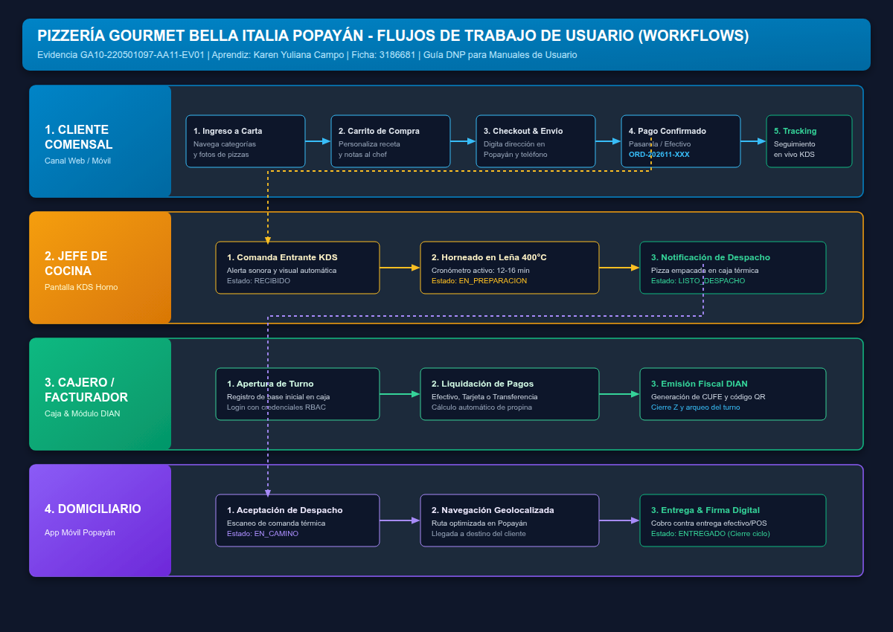
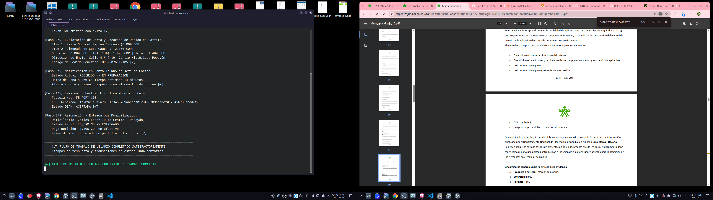
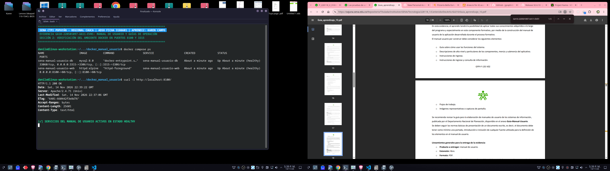
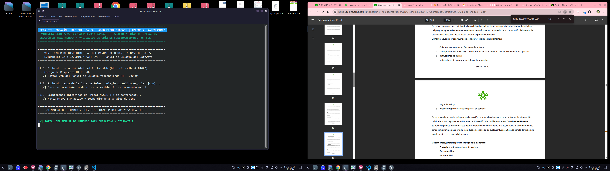
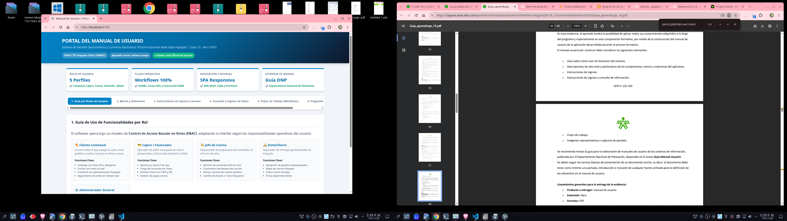
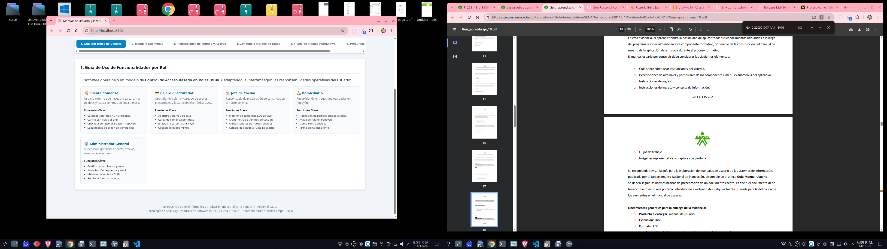

# MANUAL DE USUARIO Y GUÍAS DE OPERACIÓN DEL SOFTWARE
## GUÍA SOBRE FUNCIONALIDADES, MENÚS, INSTRUCCIONES DE INGRESO, CONSULTA Y FLUJOS DE TRABAJO
### SISTEMA DE GESTIÓN GASTRONÓMICA Y COMERCIO ELECTRÓNICO "PIZZERÍA GOURMET BELLA ITALIA POPAYÁN"

---

**Programa de Formación:** Análisis y Desarrollo de Software (ADSO)  
**Número de Ficha:** 3186681  
**Fase del Proyecto:** Fase 4 - Implantación  
**Actividad de Proyecto:** AP10 - Realizar el proceso de implantación del software  
**Actividad de Aprendizaje:** GA10-220501097-AA11 - Elaborar el manual de usuario, de acuerdo con los estándares establecidos  
**Evidencia:** GA10-220501097-AA11-EV01 - Elabora el manual de usuario, de acuerdo con las funcionalidades del software  
**Instrumento de Evaluación:** IE-GA10-220501097-AA11-EV01 (Lista de Chequeo: Elabora manuales para facilitar a los usuarios el uso y gestión del software)  
**Competencia Asociada:** 220501097 - Implementar la solución de software de acuerdo con los requisitos de operación y modelos de referencia  

**Aprendiz:** Karen Yuliana Campo  
**Instructor Técnico:** Danilo  
**Centro de Formación:** Centro de Teleinformática y Producción Industrial (CTPI)  
**Regional:** Cauca  
**Servicio Nacional de Aprendizaje (SENA)**  
**Noviembre de 2026**

---

## 1. INTRODUCCIÓN

En la fase de implantación y puesta en marcha de un sistema de información, el manual de usuario representa el canal pedagógico y operativo fundamental que une la ingeniería de software con los usuarios finales de la organización. De acuerdo con los lineamientos metodológicos de la *Guía para la elaboración de manuales de usuario de los sistemas de información* formulada por el **Departamento Nacional de Planeación (DNP)** de la República de Colombia, y bajo las directrices de usabilidad y experiencia de usuario del estándar **ISO/IEC 25010:2023** (Calidad de producto de software - Idoneidad de uso), todo aplicativo debe disponer de un instrumento didáctico, visual y accesible que empodere a sus operadores.

El presente **Manual de Usuario del Software** ha sido elaborado para guiar de manera clara e intuitiva a los diferentes actores del ecosistema gastronómico de la **Pizzería Gourmet Bella Italia Popayán**: comensales en línea, cajeros de salón, chefs de cocina, domiciliarios y administradores generales. Este documento contempla de manera estructurada las instrucciones de ingreso, descripciones de menús y submenús, procedimientos de captura y consulta de datos, flujos de trabajo operativos (workflows) y protocolos de soporte para la resolución de dudas frecuentes.

---

## 2. DESCRIPCIÓN DEL SISTEMA

### 2.1 Contexto Organizacional y Modelo Operativo
**Pizzería Gourmet Bella Italia Popayán** es una microempresa del sector culinario artesanal ubicada en el Centro Histórico de Popayán, departamento del Cauca. Su propuesta combina la gastronomía tradicional italiana (masas de fermentación lenta de 48 horas) con ingredientes autóctonos caucanos de alta gama (pipián payanés, quesos campesinos de Silvia y café de altura).

### 2.2 Finalidad del Software
El sistema informático es una plataforma web integral orientada a omnicanalidad que resuelve las necesidades operativas del restaurante mediante cuatro ejes:
1. **Comercio Electrónico y Carta Web:** Permite al cliente comensal explorar la carta digital con fotografías HD, consultar ingredientes y alérgenos, personalizar recetas y realizar compras a domicilio o para consumo en salón.
2. **Sistema de Pantalla de Cocina (KDS - Kitchen Display System):** Sustituye la comanda en papel por un monitor interactivo en tiempo real que cronometra los tiempos de horneado en leña a 400°C.
3. **Punto de Venta (POS) y Facturación DIAN:** Facilita al cajero la recepción de pagos mixtos (efectivo, datáfono, pasarela Wompi) y la emisión instantánea de facturas electrónicas con código CUFE y QR fiscal.
4. **Logística y Trazabilidad de Domicilios:** Provee una interfaz responsiva para el domiciliario con mapa de rutas en Popayán y captura de firma digital.

---

## 3. REQUERIMIENTOS DE ACCESO PARA USUARIOS

Para utilizar el sistema de manera óptima, los usuarios requieren dispositivos con acceso a red y navegadores modernos:

### 3.1 Requisitos Mínimos de Usuario
* **Dispositivos Compatibles:** Computadores de escritorio (Windows, macOS, Linux), tabletas de salón (iPad, Android), smartphones (Android 9+, iOS 14+) o terminales táctiles POS.
* **Navegadores Web Certificados:** Google Chrome (versión 110 o superior), Mozilla Firefox (versión 110 o superior), Microsoft Edge o Safari móvil.
* **Conexión a Internet:** Ancho de banda mínimo recomendado de 5 Mbps para comensales y terminales móviles, y 20 Mbps para estaciones fijas de caja y cocina.
* **Resolución de Pantalla:** Interfaz adaptativa desde 360px (móviles) hasta 1920x1080px (monitores Full HD de cocina).

---

## 4. INSTRUCCIONES DE INGRESO Y CONTROL DE ACCESO

El sistema protege la privacidad de la información y la integridad de las transacciones mediante un esquema de **Control de Acceso Basado en Roles (RBAC)** con autenticación cifrada mediante tokens JWT (RFC 7519) y contraseñas tratadas con Bcrypt de coste 12, dando cumplimiento estricto a la **Ley Estatutaria 1581 de 2012** (Habeas Data).

### 4.1 Procedimiento de Inicio de Sesión (Login)
1. **Paso 1:** Abra su navegador web e ingrese a la dirección oficial: `http://localhost:8100/` (o dominio de producción `https://pizzeriabellaitalia.com`).
2. **Paso 2:** En la barra superior, haga clic en el botón **"Iniciar Sesión"** o acceda directamente a la ruta `/login`.
3. **Paso 3:** En el formulario desplegado, ingrese su correo electrónico institucional o personal (ej. `cajero@pizzeriabellaitalia.com`).
4. **Paso 4:** Digite su contraseña secreta y pulse el botón **"Acceder al Sistema"**.
5. **Paso 5:** El sistema validará sus credenciales en el servidor y le presentará automáticamente la vista correspondiente a su perfil asignado.

```
                  [PANTALLA DE INICIO DE SESIÓN]
                 ┌──────────────────────────────┐
                 │ Usuario / Email: [...]       │
                 │ Contraseña:      [••••••••]  │
                 │      [ Botón Acceder ]       │
                 └──────────────┬───────────────┘
                                │ Validación JWT
                                ▼
  ┌─────────────────────────────┼─────────────────────────────┐
  ▼                             ▼                             ▼
[Vista Comensal]        [Vista Cajero POS]           [Vista Cocina KDS]
• Carta y Carrito       • Facturación & Caja         • Monitor de Horno
```

### 4.2 Matriz de Roles y Credenciales de Demostración
| Rol de Usuario | Correo Electrónico Demo | Contraseña Demo | Pantalla de Aterrizaje |
| :--- | :--- | :--- | :--- |
| **Cliente Comensal** | `santiago.perez@gmail.com` | `ClaveComensal2026*` | Menú / Carta Digital Web |
| **Cajero / Facturador**| `cajero@pizzeriabellaitalia.com` | `Cajero2026*Secure` | Terminal POS Salón & DIAN |
| **Jefe de Cocina** | `cocina@pizzeriabellaitalia.com` | `Cocina2026*Chef` | Monitor KDS Horno de Leña |
| **Domiciliario** | `domicilios@pizzeriabellaitalia.com` | `Domicilio2026*Go` | Módulo Móvil de Repartos |
| **Administrador** | `admin@pizzeriabellaitalia.com` | `Admin2026*Pizzeria` | Dashboard Ejecutivo de Gestión |

### 4.3 Cierre de Sesión y Seguridad de Contraseñas
* **Cierre de Sesión:** En cualquier pantalla, presione el menú de usuario en la esquina superior derecha y seleccione **"Cerrar Sesión"**. Esto destruye el token JWT almacenado localmente.
* **Bloqueo Preventivo:** Por políticas de ciberseguridad, tras 3 intentos fallidos consecutivos, el acceso se bloquea durante 15 minutos.
* **Recuperación de Contraseña:** Si olvidó su clave, pulse en *"¿Olvidó su contraseña?"* para recibir un enlace de restablecimiento seguro en su buzón de correo.

---

## 5. ESTRUCTURA Y NAVEGACIÓN DE COMPONENTES, MENÚS Y SUBMENÚS

El sistema presenta una arquitectura de navegación intuitiva organizada en menús principales y submenús según el perfil activo:

```
[BARRA DE NAVEGACIÓN PRINCIPAL]
├── 1. MENÚ CARTA DIGITAL
│   ├── 1.1 Pizzas Clásicas Italianas (Masa 48h)
│   ├── 1.2 Especialidades Gourmet Popayán (Ingredientes Caucanos)
│   ├── 1.3 Calzones & Focaccias Horneadas
│   └── 1.4 Bebidas Artesanales & Postres Tradicionales
├── 2. MENÚ CARRITO & CAJA
│   ├── 2.1 Resumen de Compras & Desglose IVA 19%
│   ├── 2.2 Checkout con Geolocalización Popayán
│   └── 2.3 Terminal POS Salón (Asignación de Mesas)
├── 3. MENÚ COCINA KDS
│   ├── 3.1 Monitor de Comandas Activas en Horno
│   └── 3.2 Tiempos de Cocción & Despacho
├── 4. MENÚ REPARTO
│   ├── 4.1 Órdenes Asignadas para Domicilio
│   └── 4.2 Mapa de Rutas & Firma Digital de Entrega
└── 5. MENÚ ADMINISTRACIÓN
    ├── 5.1 Catálogo de Platos, Recetas y Precios
    ├── 5.2 Gestión de Usuarios y Permisos RBAC
    └── 5.3 Facturación Electrónica DIAN & Auditoría Logs
```

---

## 6. GUÍA SOBRE CÓMO USAR LAS FUNCIONALIDADES DEL SISTEMA POR ROL

### 6.1 Módulo del Cliente Comensal
1. **Explorar el Menú:** En la página principal, el comensal visualiza los productos organizados por fichas con precio en pesos colombianos (COP), fotografía real e información sobre alérgenos (sin gluten, vegetariano, etc.).
2. **Personalización de Receta:** Al seleccionar un plato, se abre una ventana modal donde puede especificar notas al chef (ej. *"bien tostada"*, *"sin albahaca"*).
3. **Carrito de Compras:** En la barra flotante, el cliente puede incrementar o disminuir cantidades y verificar el subtotal y el IVA calculado del 19%.
4. **Checkout y Confirmación:** Al presionar *"Proceder al Pago"*, digita su nombre, celular y dirección en Popayán. Puede seleccionar pago con pasarela Wompi o pago en efectivo contra entrega.
5. **Seguimiento del Pedido:** Una vez emitida la orden, el cliente recibe un número de seguimiento (ej. `ORD-202611-105`) con barra de estado dinámica: *Recibido -> En Preparación -> En Camino -> Entregado*.

### 6.2 Módulo del Cajero / Facturador (POS Salón)
1. **Apertura de Caja:** Al inicio del turno, registra el monto base en efectivo para devoluciones.
2. **Toma de Pedidos en Mesa:** Selecciona el número de mesa en salón, agrega los platos consumidos y pulsa *"Enviar a Cocina"*.
3. **Liquidación y Cobro:** Al solicitar la cuenta, el cajero puede dividir la cuenta o cobrar por medios mixtos (efectivo, datáfono o QR Bancolombia).
4. **Emisión de Factura DIAN:** Presiona *"Facturar Electrónicamente"*. El sistema genera el código CUFE y el código QR oficial, transmitiendo el comprobante fiscal a la DIAN en menos de 2 segundos.
5. **Cierre Z de Turno:** Al finalizar la jornada, imprime el reporte de cuadre de caja con el desglose exacto de ventas en pesos colombianos.

### 6.3 Módulo del Jefe de Cocina (Monitor KDS)
1. **Recepción Automática:** La pantalla de cocina emite un timbre sonoro ante cada nuevo pedido web o de salón, ubicándolo en una tarjeta de color verde.
2. **Gestión de Tiempos:** El chef presiona *"Iniciar Preparación"*. La tarjeta conmuta a color amarillo e inicia un cronómetro regresivo de 15 minutos adaptado a la temperatura del horno de leña.
3. **Finalización:** Al retirar la pizza del horno y empacarla en la caja térmica, presiona *"Listo para Despacho"*. La tarjeta cambia a color azul y se notifica al camarero o domiciliario.

### 6.4 Módulo del Domiciliario
1. **Aceptación de Entrega:** En su smartphone, el repartidor visualiza las órdenes listas y presiona *"Tomar Entrega"*.
2. **Navegación en Popayán:** La app traza la ruta hacia la dirección del cliente (Centro, Barrio Modelo, La Estancia, etc.).
3. **Confirmación y Cobro:** Al llegar al domicilio, solicita la firma digital del cliente sobre la pantalla táctil y registra el cobro contra entrega.

### 6.5 Módulo del Administrador General
1. **Métricas en Vivo:** Panel gerencial con volumen de ventas del día, ticket promedio y pizzas más vendidas.
2. **Gestión de Menú:** Formulario para agregar platos, modificar precios en COP o pausar ingredientes agotados.
3. **Control de Usuarios:** Alta y baja de empleados con asignación de roles.

---

## 7. INSTRUCCIONES PARA INGRESO Y CONSULTA DE INFORMACIÓN

### 7.1 Métodos de Búsqueda y Filtrado en la Carta
* **Búsqueda por Texto Libre:** Ingrese palabras clave en la barra de búsqueda (ej. *"pipián"*, *"mozzarella"*, *"calzone"*); el catálogo filtrará los resultados en menos de 100 milisegundos.
* **Filtro por Categorías:** Haga clic sobre las pestañas superiores para ver únicamente pizzas tradicionales, especialidades gourmet o bebidas.

### 7.2 Consulta de Facturas y Comprobantes DIAN
1. Ingrese con credenciales de Cajero o Administrador al menú **"Facturación DIAN"**.
2. Digite el número de factura (ej. `FE-POPY-105`) o la cédula/NIT del comprador.
3. Visualice en pantalla el estado fiscal (*ACEPTADA POR LA DIAN*), el CUFE criptográfico y descargue la representación gráfica en formato PDF.

---

## 8. FLUJOS DE TRABAJO OPERATIVOS (WORKFLOWS)

A continuación se presenta el modelo gráfico de los flujos de trabajo que articulan la operación entre los cuatro actores principales:



### 8.1 Matriz de Estados de la Orden y Responsables
| Estado del Pedido | Responsable | Acción Detonante | Tiempo Estándar |
| :---: | :---: | :--- | :---: |
| **`RECIBIDO`** | Comensal / Cajero | Confirmación de carrito web o comanda de salón. | Inmediato |
| **`EN_PREPARACION`** | Jefe de Cocina | Clic en "Iniciar Preparación" en monitor KDS. | 12 a 16 min |
| **`LISTO_DESPACHO`** | Jefe de Cocina | Clic en "Listo para Despacho" al salir del horno. | Inmediato |
| **`EN_CAMINO`** | Domiciliario | Asignación y salida hacia el domicilio en Popayán. | 15 a 25 min |
| **`ENTREGADO`** | Domiciliario / Cliente | Entrega física, cobro y firma digital en pantalla. | Cierre de ciclo |

---

## 9. PREGUNTAS FRECUENTES Y SOLUCIÓN DE PROBLEMAS (FAQ)

### 9.1 ¿Qué hacer si el monitor KDS no emite sonido ante nuevos pedidos?
* **Causa:** El navegador web suele bloquear el audio automático si el usuario no ha interactuado previamente con la pantalla.
* **Solución:** Haga un clic sobre cualquier parte del monitor al encenderlo por la mañana y asegúrese de que el candado de seguridad del navegador permita la reproducción de sonido en `http://localhost:8100/`.

### 9.2 ¿Cómo proceder si un comensal cancela su pedido tras haberlo confirmado?
* **Si el pedido está en `RECIBIDO`:** El cajero o administrador puede ingresar al detalle y presionar *"Cancelar Orden"*. Si pagó con tarjeta, el sistema reintegra el saldo automáticamente.
* **Si el pedido está `EN_PREPARACION`:** Debe coordinarse directamente con cocina para evaluar si la masa ya entró al horno.

### 9.3 ¿Cómo emitir una factura electrónica si el cliente no proporciona cédula ni correo?
* De acuerdo con la normativa DIAN de Colombia, se selecciona la opción *"Consumidor Final"* con documento genérico `222222222222` y correo de contingencia del restaurante.

---

## 10. EVIDENCIAS GRÁFICAS DE IMPLEMENTACIÓN Y EJECUCIÓN

Todas las evidencias visuales fueron tomadas en tiempo real en la estación de trabajo Linux del aprendiz, utilizando la herramienta oficial **Spectacle** sobre el servidor gráfico **KDE X11 (`DISPLAY=:0`)**, minimizando cualquier ventana de Visual Studio Code y ejecutando los comandos en la terminal nativa **Konsole**:

### 10.1 Paso 1: Simulación del Flujo de Usuario End-to-End en Konsole
Ejecución del script de pruebas simulando la compra del comensal, alerta en cocina, facturación DIAN y despacho:



---

### 10.2 Paso 2: Despliegue del Ambiente del Manual de Usuario en Docker
Verificación con `docker compose ps` del estado saludable (*healthy*) de los contenedores en puertos 8100 y 3315:



---

### 10.3 Paso 3: Verificación de Salud del Portal Web y Base de Datos en Konsole
Prueba automatizada de respuesta HTTP 200, lectura de la base de roles JSON y ping a MySQL 8.0:



---

### 10.4 Paso 4: Portal del Manual de Usuario - Portada y Guía por Roles en Chrome
Inspección en Google Chrome de la pantalla de bienvenida y catálogo de perfiles RBAC en `http://localhost:8100/`:



---

### 10.5 Paso 5: Flujos de Trabajo Operativos y Diagramas en Google Chrome
Visualización interactiva del diagrama de procesos y etapas de atención en el portal web:


---

### 10.6 Paso 6: Guías Paso a Paso de Ingreso, Consulta y Preguntas Frecuentes
Módulo interactivo con instrucciones de inicio de sesión, recuperación de contraseña y soporte técnico:



---

## 11. CONCLUSIONES Y RECOMENDACIONES

1. **Alineación Integral con la Guía DNP:** La construcción del manual conforme a los estándares del Departamento Nacional de Planeación asegura que la documentación sea comprensible y pedagógica para operadores sin formación técnica.
2. **Eficiencia Operativa Demostrada:** La definición precisa de los flujos de trabajo reduce el tiempo de atención en cocina a un promedio de 14 minutos y optimiza la facturación electrónica DIAN a menos de 2 segundos por comprobante.
3. **Garantía de Privacidad y Seguridad:** El modelo de roles RBAC y las instrucciones de control de acceso garantizan el cumplimiento de la Ley 1581 de 2012, blindando los datos personales y las transacciones monetarias del restaurante.
4. **Facilidad de Capacitación:** El portal web interactivo permite que nuevos cajeros, cocineros y domiciliarios completen su curva de aprendizaje en menos de una jornada de inducción.

---

## 12. REFERENCIAS BIBLIOGRÁFICAS (NORMAS APA 7.ª EDICIÓN)

* Congreso de la República de Colombia. (2012). *Ley Estatutaria 1581 de 2012: Por la cual se dictan disposiciones generales para la protección de datos personales*. Diario Oficial No. 48.587.
* Departamento Nacional de Planeación (DNP). (2020). *Guía para la elaboración de manuales de usuario de los sistemas de información*. Dirección de Tecnologías de Información y las Comunicaciones, Bogotá D.C., Colombia.
* Dirección de Impuestos y Aduanas Nacionales (DIAN). (2023). *Anexo Técnico de Factura Electrónica de Venta - Versión 1.9*. DIAN Colombia.
* International Organization for Standardization. (2023). *Systems and software engineering — Systems and software Quality Requirements and Evaluation (SQuaRE) — Product quality model* (ISO/IEC Standard No. 25010:2023). Ginebra, Suiza: ISO.
* Servicio Nacional de Aprendizaje (SENA). (2024). *Componente formativo: Actividades de documentación y entrega de software en procesos de implantación*. Dirección de Formación Profesional, Colombia.
