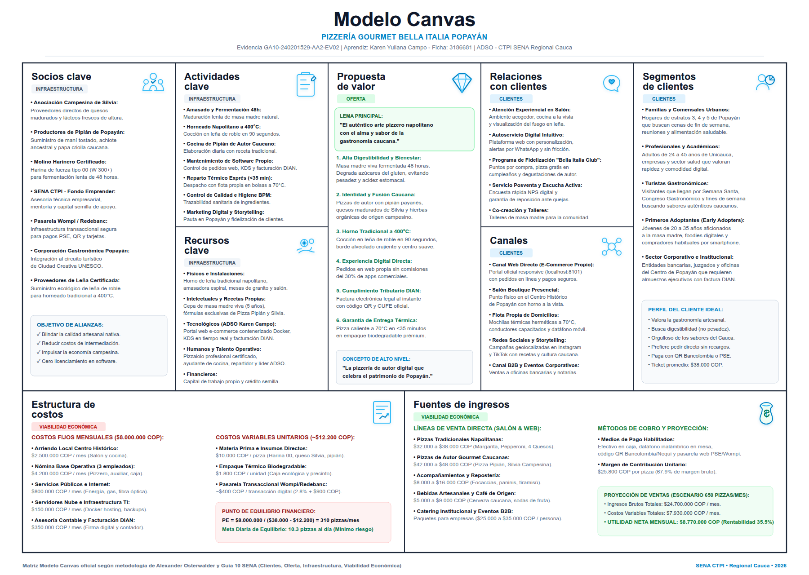

# MODELO CANVAS DEL EMPRENDIMIENTO
## DEFINIR LA IDEA DE NEGOCIO A DESARROLLAR EN EL EMPRENDIMIENTO SEGÚN LAS OPORTUNIDADES DE MERCADO
### PROYECTO PRODUCTIVO: "PIZZERÍA GOURMET BELLA ITALIA POPAYÁN"

---

**Programa de Formación:** Análisis y Desarrollo de Software (ADSO)  
**Número de Ficha:** 3186681  
**Fase del Proyecto:** Fase 4 - Implantación  
**Actividad de Proyecto:** AP10 - Realizar el proceso de implantación del software  
**Actividad de Aprendizaje:** GA10-240201529-AA2 - Definir la idea de negocio a desarrollar en el emprendimiento, según las oportunidades de mercado  
**Evidencia:** GA10-240201529-AA2-EV02 - Modelo Canvas del emprendimiento  
**Instrumento de Evaluación:** IE-GA10-240201529-AA2-EV02 (Lista de Chequeo: Estructura un perfil de emprendedor teniendo en cuenta las habilidades y principios de la gestión empresarial)  
**Competencia Transversal:** 240201529 - Gestionar procesos propios de la cultura emprendedora y empresarial de acuerdo con el perfil personal y los requerimientos de los contextos productivo y social  
**Resultado de Aprendizaje (RAP):** 240201529-02 - Caracterizar la idea de negocio teniendo en cuenta las oportunidades y necesidades del sector productivo y social  
**Componente Formativo:** *Entendiendo la empresa* / *Ser emprendedor*  

**Aprendiz:** Karen Yuliana Campo  
**Instructor Técnico:** Danilo  
**Centro de Formación:** Centro de Teleinformática y Producción Industrial (CTPI)  
**Regional:** Cauca  
**Servicio Nacional de Aprendizaje (SENA)**  
**Noviembre de 2026**

---

## 1. INTRODUCCIÓN Y MARCO TEÓRICO DEL MODELO CANVAS

El diseño y estructuración de un modelo de negocio sólido representa el cimiento estratégico para cualquier iniciativa de emprendimiento moderno. En el marco de la formación del Servicio Nacional de Aprendizaje (SENA) y las directrices de la **Guía de Aprendizaje 10 (Actividad 3.2.2)**, el **Modelo Canvas**, conceptualizado originalmente por Alexander Osterwalder e Yves Pigneur (2010), junto con las adaptaciones ágiles de **Lean Canvas** de Ash Maurya (2012) bajo la filosofía *Lean Startup* de Eric Ries (2011), constituyen herramientas de gestión estratégica y visual que permiten describir, diseñar, retar y pivotar la lógica mediante la cual una organización crea, entrega y captura valor.

El Modelo Canvas organiza de forma holística los componentes esenciales de una empresa dividiéndolos en **cuatro (4) áreas estratégicas directivas**:
1. **Infraestructura:** El engranaje operativo y técnico (*¿Cómo lo hacemos?*): Socios clave, Actividades clave, Recursos clave y Ventaja injusta.
2. **Oferta:** El núcleo de valor (*¿Qué ofrecemos?*): Solución al problema identificado y Propuesta única de valor.
3. **Clientes:** La relación con el mercado y la audiencia (*¿A quién se lo ofrecemos?*): Relaciones con clientes, Canales y Segmento de clientes.
4. **Viabilidad Económica:** La sostenibilidad financiera (*¿Cuánto nos cuesta y cuánto ganamos?*): Estructura de costos, Flujos de ingresos y Métricas claves.

Estas cuatro áreas se desglosan en **nueve (9) bloques constructivos interconectados**. El presente documento formaliza el Modelo Canvas desarrollado para el emprendimiento gastronómico y tecnológico **Pizzería Gourmet Bella Italia Popayán**, liderado por la aprendiz **Karen Yuliana Campo**.

---

## 2. CONTEXTO Y CARACTERIZACIÓN DE LA IDEA DE NEGOCIO

### 2.1 Identificación del Emprendimiento
* **Razón Comercial:** Pizzería Gourmet Bella Italia Popayán.
* **Naturaleza del Negocio:** Restaurante de alta cocina artesanal especializado en pizzas napolitanas en horno de leña tradicional a 400°C, fusionadas con ingredientes autóctonos del departamento del Cauca (pipián payanés y quesos campesinos de Silvia), apalancado en un ecosistema de software propietario para comercio electrónico, pantalla de cocina KDS (*Kitchen Display System*) y facturación electrónica DIAN.
* **Sede Operativa:** Centro Histórico de Popayán, departamento del Cauca (Ciudad Creativa de la Gastronomía por la UNESCO).

### 2.2 Diagnóstico de Mercado y Oportunidad
Popayán posee un prestigio gastronómico reconocido internacionalmente. Sin embargo, el mercado local de pizzas exhibe una brecha crítica: por un lado, franquicias multinacionales que comercializan pizzas ultraprocesadas con masas industriales de digestión pesada y aditivos químicos; por el otro, establecimientos informales sin protocolos de trazabilidad, ni canales digitales propios, obligados a depender de aplicaciones comerciales de delivery que retienen entre el 25% y el 30% del valor del pedido.

Existe una creciente demanda por parte de familias, jóvenes profesionales, académicos y turistas nacionales e internacionales por alimentos saludables, altamente digestivos (fermentación lenta de masa madre viva durante 48 horas) e identitarios de la región caucana, combinados con la comodidad de solicitar pedidos directos vía web sin pagar sobrecostos y con facturación electrónica legal inmediata.

---

## 3. ANÁLISIS DE LAS CUATRO (4) ÁREAS ESTRATÉGICAS

Siguiendo las pautas pedagógicas del SENA, el emprendimiento se estructura en cuatro áreas directivas interdependientes:

```
┌─────────────────────────────────────────────────────────────────────────────┐
│                    LAS CUATRO (4) ÁREAS DEL MODELO CANVAS                   │
├──────────────────────┬──────────────────────┬───────────────────────────────┤
│ 1. INFRAESTRUCTURA   │ 2. OFERTA            │ 3. CLIENTES                   │
│ • Socios Clave       │ • Problema Validado  │ • Relaciones con Clientes     │
│ • Actividades Clave  │ • Solución           │ • Canales Directos y Web      │
│ • Recursos Clave     │ • Propuesta Única    │ • Segmento de Clientes        │
│ • Ventaja Injusta    │   de Valor (UVP)     │ • Early Adopters              │
├──────────────────────┴──────────────────────┴───────────────────────────────┤
│ 4. VIABILIDAD ECONÓMICA                                                     │
│ • Estructura de Costos Fijos y Variables Unitarios                          │
│ • Flujos de Ingresos y Métricas Claves                                      │
│ • Simulación del Punto de Equilibrio Operativo                              │
└─────────────────────────────────────────────────────────────────────────────┘
```

### 3.1 Área de Infraestructura
Asegura la capacidad operativa, el suministro de materias primas orgánicas y el desarrollo tecnológico. Se fundamenta en la alianza con productores campesinos de Silvia (Cauca) para el suministro de quesos frescos madurados y en la plataforma de software construida por la aprendiz Karen Campo en su formación de ADSO, lo que representa una **ventaja injusta** tecnológica que elimina costos de licenciamiento de terceros.

### 3.2 Área de Oferta
Representa el corazón del modelo de negocio: dar **solución** integral a los tres grandes problemas del mercado (pesadez digestiva, falta de identidad caucana y abusos de apps comerciales) mediante una **propuesta única de valor**: pizzas napolitanas fermentadas 48 horas con masa madre viva y combinadas con pipián payanés tradicional, horneadas a 400°C en leña de roble.

### 3.3 Área de Clientes
Articula la relación y los canales de comunicación hacia los consumidores del **segmento de clientes** en Popayán y los turistas gastronómicos. Se prioriza el canal web directo (`http://localhost:8101/`) y el restaurante boutique en el Centro Histórico, ofreciendo un trato experiencial y programas de fidelización (*Bella Italia Club*).

### 3.4 Área de Viabilidad Económica
Garantiza la sostenibilidad financiera del emprendimiento mediante el monitoreo de **métricas claves** (CAC, LTV, retención y tiempo KDS). Con una **estructura de costos** fijos mensuales de $8.000.000 COP y un costo variable unitario de $12.200 COP por pizza, y diversos **flujos de ingresos**, el modelo logra un margen de contribución del 67.9% ($25.800 COP por pizza), requiriendo un **punto de equilibrio** de apenas 310 pizzas al mes (10.3 pizzas al día).

---

## 4. DESARROLLO DETALLADO DE LOS NUEVE (9) BLOQUES DEL MODELO CANVAS

A continuación se detalla exhaustivamente cada uno de los bloques del lienzo:

### 4.1 Bloque 1: Socios Clave y Problema Validado [Área: Infraestructura & Oferta]
* **Problema Identificado:** Masas industriales pesadas de digestión lenta; ausencia de identidad gastronómica caucana en comida casual; y altas comisiones (25%-30%) en aplicaciones comerciales de domicilio sin garantía térmica.
* **Socios Clave Estratégicos:**
  - *Asociación Campesina de Silvia (Cauca):* Proveeduría directa de quesos madurados artesanales y lácteos orgánicos de altura.
  - *Productores Tradicionales de Popayán:* Abastecimiento de papa criolla, maní tostado y achiote para el pipián payanés.
  - *Molino Harinero Certificado:* Harina de fuerza tipo 00 (W 300+) para fermentación prolongada de 48 horas.
  - *SENA CTPI & Fondo Emprender:* Mentoría técnica, validación de modelo y apalancamiento en capital semilla.
  - *Pasarela de Pagos Wompi / Redebanc:* Procesamiento transaccional de pagos PSE, QR Bancolombia y tarjetas.
  - *Corporación Gastronómica de Popayán (UNESCO):* Respaldo institucional y visibilidad en agendas turísticas.

### 4.2 Bloque 2: Actividades Clave y Solución [Área: Infraestructura & Oferta]
* **Solución Integral Desarrollada:**
  - Amasado con masa madre viva y fermentación lenta en frío durante 48 horas continuas.
  - Cocción napolitana en horno tradicional a 400°C en leña de roble en 90 segundos por unidad.
  - Creación de recetas de autor integrando pipián payanés y quesos campesinos de Silvia.
  - Plataforma de software propia de comercio electrónico con monitor KDS de cocina y facturación DIAN en 2 segundos.
* **Actividades Clave Operativas:**
  - Control riguroso de temperaturas y maduración biológica de masas.
  - Elaboración artesanal diaria del pipián según receta ancestral caucana.
  - Despacho exprés en flota propia con mochilas térmicas a 70°C en menos de 35 minutos.
  - Control de calidad higiénico-sanitario bajo normas BPM.

### 4.3 Bloque 3: Recursos Clave y Ventaja Injusta [Área: Infraestructura]
* **Recursos Clave:**
  - *Físicos:* Local comercial en el Centro Histórico de Popayán, horno de leña abovedado refractario, amasadora espiral profesional, mesones de granito y cajas térmicas para delivery.
  - *Intelectuales:* Recetas de autor patentadas (*Pizza Pipián Gourmet*, *Pizza Silvia Campesina*), cepa de masa madre viva (*lievito madre* de 5 años) y registro de marca comercial.
  - *Tecnológicos:* Ecosistema de software contenerizado en Docker (Karen Campo - ADSO), API facturación electrónica DIAN.
  - *Humanos:* Maestro pizzero profesional (*Pizzaiolo*), ayudantes de cocina capacitados, repartidor y líder ADSO.
* **Ventaja Injusta (Unfair Advantage):**
  - Propiedad intelectual del software integral ADSO, sin costos de licenciamiento de terceros.
  - Fórmulas de masa registradas con ingredientes de denominación de origen caucano.
  - Alianzas directas con campesinos de Silvia que blindan la frescura y el costo de materia prima.
  - Apoyo institucional del SENA CTPI y Fondo Emprender en Popayán, Ciudad Gastronómica UNESCO.

### 4.4 Bloque 4: Propuesta Única de Valor (UVP) [Área: Oferta]
* **Lema Central:** *"El auténtico arte pizzero napolitano con el alma y sabor de la gastronomía caucana."*
* **Alta Digestibilidad y Salud:** Masa madre natural fermentada 48 horas que degrada los azúcares complejos del gluten, evitando la pesadez y la acidez estomacal.
* **Identidad y Fusión Caucana:** Exclusiva combinación de pizza napolitana tradicional con ingredientes autóctonos del Cauca (pipián payanés y quesos de Silvia).
* **Cocción Tradicional en Leña a 400°C:** Sabor ahumado inconfundible y horneado en tan solo 90 segundos.
* **Canal Web Propio sin Sobrecostos:** Compra directa sin pagar la comisión del 30% habitual en apps de delivery comercial.
* **Facturación Electrónica DIAN Instantánea:** Cumplimiento tributario riguroso con código QR y CUFE emitido en 2 segundos.
* **Garantía Térmica:** Entrega de la pizza a más de 70°C en empaque biodegradable prémium.

### 4.5 Bloque 5: Relaciones con Clientes y Métricas Claves [Área: Clientes & Viabilidad]
* **Relaciones con Clientes:**
  - *Atención Experiencial en Salón:* Servicio personalizado en ambiente colonial donde el cliente visualiza el horno de leña en vivo.
  - *Autoservicio Digital Fluido:* Catálogo web interactivo con fotos HD, alérgenos y notificaciones automáticas por WhatsApp.
  - *Club de Fidelización "Bella Italia Club":* Puntos por compra directa, degustaciones de recetas de autor y cortesía de cumpleaños.
  - *Servicio Posventa y Escucha Activa:* Encuestas NPS en línea y garantía de reposición inmediata ante cualquier queja.
* **Métricas Claves (KPIs):**
  - Costo de Adquisición de Clientes (CAC): < $6.000 COP mediante marketing local orgánico.
  - Valor del Tiempo de Vida del Cliente (LTV): $320.000 COP anuales.
  - Tasa de Retención Mensual: > 42% de recompra recurrente.
  - Tiempo de Horno KDS: Promedio de 14 minutos desde orden hasta despacho.
  - Margen de Contribución Bruto: 67.9% promedio sobre ventas.

### 4.6 Bloque 6: Canales (Channels) [Área: Clientes]
* **Portal Web Oficial Directo (E-Commerce):** Sitio web responsive (`http://localhost:8101/`) con pasarela de pagos integrada Wompi/PSE y pedidos en 3 clics.
* **Restaurante Salón Boutique:** Punto de venta físico y experiencia sensorial en el Centro Histórico de Popayán.
* **Flota Propia de Reparto:** Domiciliarios vinculados con dotación térmica y datáfono inalámbrico para cobro en puerta.
* **Redes Sociales y Pauta Local:** Contenido audiovisual en Instagram y TikTok destacando la fermentación artesanal y visitas a granjas en Silvia.
* **Canal Corporativo B2B:** Convenios de catering para almuerzos y eventos en oficinas bancarias, juzgados y entidades gubernamentales del centro.

### 4.7 Bloque 7: Segmento de Clientes (Customer Segments) [Área: Clientes]
* **Familias y Comensales Urbanos:** Residentes de estratos 3, 4 y 5 de Popayán que buscan opciones gastronómicas artesanales, saludables y agradables para compartir.
* **Profesionales y Académicos:** Personas entre 24 y 45 años del sector bancario, universitario y de salud que disponen de poco tiempo y demandan pedidos rápidos y nutritivos.
* **Turistas Gastronómicos:** Visitantes nacionales e internacionales motivados por el reconocimiento de Popayán como Ciudad Creativa UNESCO.
* **Primeros Adoptantes (Early Adopters):** Jóvenes de 20 a 35 años aficionados a la masa madre (*foodies* digitales) que compran vía smartphone y pagan con billeteras virtuales (Nequi, Daviplata, QR Bancolombia).
* **Sector Corporativo:** Instituciones del centro que requieren servicio de alimentación gourmet con soporte de factura electrónica DIAN.

### 4.8 Bloque 8: Estructura de Costos (Cost Structure) [Área: Viabilidad Económica]
* **Costos Fijos Mensuales ($8.000.000 COP):**
  - Arriendo de local en el Centro Histórico: $2.500.000 COP.
  - Nómina operativa base (Maestro pizzero, auxiliar de cocina, cajero): $4.200.000 COP.
  - Servicios públicos industriales (energía, gas, acueducto, fibra óptica): $800.000 COP.
  - Infraestructura tecnológica en la nube y hosting Docker: $150.000 COP.
  - Asesoría contable y firma digital de facturación DIAN: $350.000 COP.
* **Costos Variables Unitarios (~$12.200 COP por pizza):**
  - Materias primas directas (harina 00, queso Silvia, pipián, tomate San Marzano): $10.000 COP (26.3% del PVP).
  - Empaque térmico biodegradable y precinto de seguridad: $1.800 COP.
  - Comisión transaccional de pasarela Wompi / Redebanc: ~$400 COP.
* **Costos de Suministro Operativo:**
  - Leña certificada de roble: $400.000 COP mensuales.
  - Presupuesto de marketing digital local: $300.000 COP mensuales.

### 4.9 Bloque 9: Flujos de Ingresos (Revenue Streams) [Área: Viabilidad Económica]
* **Línea de Pizzas Tradicionales Napolitanas:** $32.000 a $38.000 COP por unidad (Margarita, Pepperoni, Cuatro Quesos).
* **Línea Prémium de Pizzas de Autor Caucanas:** $42.000 a $48.000 COP por unidad (Pizza Pipián Gourmet, Pizza Silvia Campesina).
* **Acompañamientos y Repostería Artesanal:** $8.000 a $16.000 COP (Focaccias al romero, calzones rellenos, paninis, tiramisú artesanal).
* **Bebidas Artesanales y Café Especial:** $5.000 a $9.000 COP (Cervezas artesanales del Cauca, sodas naturales, café especial de Silvia).
* **Catering Empresarial e Institucional B2B:** Menús corporativos desde $25.000 a $35.000 COP por asistente.
* **Modalidades de Recaudo:** Efectivo en caja, datáfono inalámbrico en salón y domicilio, transferencias directas QR Bancolombia/Nequi y pasarela web Wompi/PSE.

---

## 5. MATRIZ MODELO CANVAS GRÁFICA OFICIAL

A continuación se presenta la representación gráfica formal normalizada del **Modelo Canvas** para la empresa, estructurada con base en la distribución de Alexander Osterwalder (cinco columnas superiores con sus respectivas subdivisiones y dos columnas inferiores de viabilidad financiera):



> **Nota Metodológica:** El diseño visual adopta la cuadrícula estándar de referencia (*modelo_canvas.png*): columna izquierda para *Socios clave*, columna central izquierda dividida en *Actividades clave* (arriba) y *Recursos clave* (abajo), columna central para la *Propuesta única de valor*, columna central derecha dividida en *Relaciones con clientes* (arriba) y *Canales* (abajo), columna derecha para *Segmento de clientes*, y fila inferior dividida equitativamente entre *Estructura de costos* y *Flujos de ingresos*. Cada bloque incorpora su ícono identificativo y la etiqueta del área estratégica correspondiente.

---

## 6. MODELO FINANCIERO Y PUNTO DE EQUILIBRIO

Para garantizar la viabilidad económica exigida por la Guía 10 del SENA, se aplicó la fórmula financiera clásica de punto de equilibrio operativo:

$$\text{Punto de Equilibrio (Unidades)} = \frac{\text{Costos Fijos Totales}}{\text{Precio de Venta} - \text{Costo Variable Unitario}} = \frac{\text{Costos Fijos Totales}}{\text{Margen de Contribución Unitario}}$$

Sustituyendo con los valores financieros de Bella Italia Popayán:
* **Precio de Venta Promedio Ponderado ($P$):** $38.000 COP
* **Costo Variable Unitario ($CV$):** $12.200 COP
* **Margen de Contribución Unitario ($MC$):** $\$38.000 - \$12.200 = \$25.800\text{ COP}$ ($67.9\%$ del precio de venta)
* **Costos Fijos Mensuales ($CF$):** $8.000.000 COP

$$\text{Punto de Equilibrio} = \frac{\$8.000.000}{\$25.800} \approx 310.07 \longrightarrow \mathbf{310\text{ pizzas al mes}}$$

### Metas Diarias y Proyección de Rentabilidad
* **Meta Diaria de Equilibrio (30 días):** $\frac{310}{30} \approx \mathbf{10.3\text{ pizzas al día}}$.
* **Escenario de Ventas Proyectado (Mes 6):** $650\text{ pizzas al mes}$ ($\approx 21.6$ pizzas/día).
* **Ingresos Brutos Mensuales Proyectados:** $650 \times \$38.000 = \$24.700.000\text{ COP}$.
* **Costos Variables Totales:** $650 \times \$12.200 = \$7.930.000\text{ COP}$.
* **Margen de Contribución Total:** $\$24.700.000 - \$7.930.000 = \$16.770.000\text{ COP}$.
* **Utilidad Operativa Neta:** $\$16.770.000 - \$8.000.000 = \mathbf{\$8.770.000\text{ COP mensuales}}$ (**35.5% de rentabilidad neta**).

---

## 7. ARQUITECTURA DEL PORTAL WEB INTERACTIVO EN DOCKER

Para permitir la interacción directa con el modelo de negocio y facilitar su evaluación técnica, se desplegó un portal web en contenedores Docker:
* **Servicio Apache HTTPD:** Contenedor `sena-lean-canvas-web` expuesto en el puerto host **`8101`** (`http://localhost:8101/`).
* **Aislamiento de Red:** Red virtual bridge `sena_lean_canvas_net` (principio de *Zero Host Pollution*).
* **Módulos Disponibles en el Portal:**
  1. *Matriz Gráfica Oficial:* Visualizador en alta definición del Modelo Canvas con enlaces de descarga SVG y PNG.
  2. *Cuadrícula Interactiva:* Los 9 bloques de Osterwalder organizados con tarjetas desplegables y etiquetas de área.
  3. *Las 4 Áreas Estratégicas:* Análisis contextual de Infraestructura, Oferta, Clientes y Viabilidad Económica.
  4. *Simulador Financiero Reactivo:* Calculadora en tiempo real para simular variaciones de precios, costos y volumen de ventas.
  5. *Panel de KPIs y Early Adopters:* Matriz de indicadores clave de rendimiento (CAC, LTV, retención, KDS).
  6. *Centro de Descargas Oficiales:* Acceso directo a documentos PDF, DOCX, esquemas vectoriales y paquete ZIP.

---

## 8. EVIDENCIAS GRÁFICAS DE IMPLEMENTACIÓN EN ENTORNO KDE X11

Todas las capturas de pantalla reales fueron registradas en el sistema Linux del aprendiz mediante la utilidad nativa **Spectacle** sobre el servidor gráfico **KDE Plasma X11 (`DISPLAY=:0`)**, minimizando cualquier ventana de Visual Studio Code y ejecutando las acciones a través de la terminal **Konsole** y el navegador **Google Chrome**:

1. **Paso 1: Despliegue de Contenedores Docker en Konsole:** Inspección de estado saludable de `sena-lean-canvas-web` en puerto 8101 y estructura del directorio.
2. **Paso 2: Verificación de Salud de Servicios y API JSON en Konsole:** Respuesta HTTP 200 OK y parseo de los bloques del modelo en formato JSON.
3. **Paso 3: Portal Web y Diagrama Oficial Modelo Canvas en Chrome:** Visualización del diagrama normalizado cargado en el portal (`http://localhost:8101/#tab-diagrama`).
4. **Paso 4: Cuadrícula Interactiva de los 9 Bloques en Chrome:** Navegación en el tablero estructurado de los 9 componentes del modelo de negocio.
5. **Paso 5: Pestaña de las 4 Áreas Estratégicas en Chrome:** Explicación detallada de Infraestructura, Oferta, Clientes y Viabilidad Económica.
6. **Paso 6: Simulador Financiero y Punto de Equilibrio en Chrome:** Demostración del cálculo reactivo de rentabilidad y equilibrio operativo en vivo.

---

## 9. CONCLUSIONES Y FACTIBILIDAD DEL EMPRENDIMIENTO

1. **Estructura Empresarial Coherente:** El Modelo Canvas permitió sintetizar de forma clara y visual la interacción de los 9 bloques del negocio, integrando las 4 áreas directivas exigidas por la Guía 10 del SENA.
2. **Ventaja Competitiva Tecnológica:** La plataforma de software propietaria desarrollada en ADSO elimina comisiones abusivas de intermediarios, asegurando agilidad de pedidos, trazabilidad en cocina (KDS) y facturación legal DIAN.
3. **Sólida Viabilidad Financiera:** Con un margen de contribución del 67.9% y un punto de equilibrio de apenas 10.3 pizzas al día, el restaurante opera bajo un perfil de muy bajo riesgo comercial y alta rentabilidad neta (35.5%).
4. **Compromiso con el Desarrollo Regional:** La proveeduría directa con campesinos de Silvia promueve la economía circular del departamento del Cauca y consolida la gastronomía patrimonial de Popayán ante el mundo.

---

## 10. REFERENCIAS BIBLIOGRÁFICAS (NORMAS APA 7.ª EDICIÓN)

* Aulet, B. (2017). *Disciplined Entrepreneurship: 24 Steps to a Successful Startup*. John Wiley & Sons, Inc., Hoboken, New Jersey.
* Maurya, A. (2012). *Running Lean: Iterate from Plan A to a Plan That Works*. O'Reilly Media.
* Osterwalder, A., & Pigneur, Y. (2010). *Business Model Generation: A Handbook for Visionaries, Game Changers, and Challengers*. John Wiley & Sons.
* Ries, E. (2011). *The Lean Startup: How Today's Entrepreneurs Use Continuous Innovation to Create Radically Successful Businesses*. Crown Business.
* Servicio Nacional de Aprendizaje (SENA). (2024). *Componente formativo: Entendiendo la empresa*. Dirección de Formación Profesional, Sistema Nacional de Formación para el Trabajo, Colombia.
* UNESCO. (2005). *Popayán, Ciudad Creativa de la Gastronomía*. Red de Ciudades Creativas de la UNESCO.
