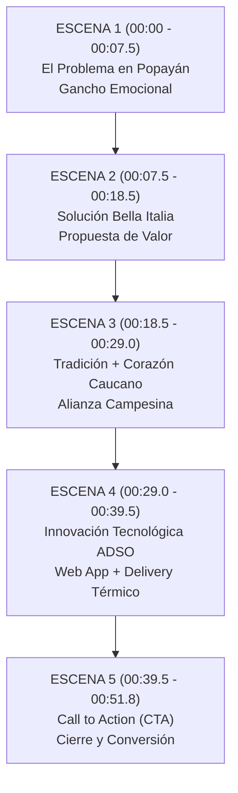

# GUION TÉCNICO Y STORYBOARD AUDIOVISUAL: ELEVATOR PITCH TIKTOK (52 SEGUNDOS)

**Programa de Formación:** Tecnólogo en Análisis y Desarrollo de Software (ADSO)  
**Ficha de Caracterización:** 3186681  
**Fase del Proyecto:** Evaluación  
**Competencia:** 240201529 — Gestionar procesos propios de la cultura emprendedora y empresarial de acuerdo con el perfil personal y los requerimientos de los contextos productivo y social.  
**Actividad de Aprendizaje:** GA10-240201529-AA2 — Definir la idea de negocio a desarrollar en el emprendimiento, según las oportunidades de mercado.  
**Evidencia de Aprendizaje:** GA10-240201529-AA2-EV01 — Pitch idea de negocio.  
**Emprendimiento:** Pizzería Gourmet Bella Italia Popayán S.A.S. (CIIU 5611)  
**Aprendiz Autora:** Karen Yuliana Campo  
**Centro:** Centro de Teleinformática y Producción Industrial (CTPI)  
**Regional:** SENA Regional Cauca  
**Fecha:** Noviembre de 2026  

---

## 1. FICHA TÉCNICA DE PRODUCCIÓN AUDIOVISUAL

| Parámetro Técnico | Especificación de Producción |
| :--- | :--- |
| **Título de la Pieza** | Elevator Pitch Oficial: Pizzería Gourmet Bella Italia Popayán |
| **Formato de Salida** | Video Vertical 9:16 (Optimizado para TikTok, Instagram Reels y Shorts) |
| **Resolución** | 1080 x 1920 píxeles (Full HD Vertical) |
| **Duración Exacta** | **51.82 segundos** (Restricción normativa Guía 10: $\le 59$ segundos) |
| **Velocidad de Cuadros** | 30 fotogramas por segundo (FPS) — Total: 1554 frames |
| **Códec de Video** | H.264 / MPEG-4 AVC (`yuv420p`, perfil High, 4500 kbps) |
| **Códec de Audio** | AAC Estéreo (48.0 kHz, 320 kbps) con masterización y compresión dinámica |
| **Diseño Sonoro** | Locución oficial grabada en vivo por Karen Yuliana Campo + pista musical lo-fi rítmica (120 BPM) con *audio ducking* dinámico (-18 dB durante voz) |
| **Estilo Visual** | Minimalismo de alto impacto: tipografía gigante, frases cortas contundentes, badges con alto contraste, cero saturación de texto y animación cinética |

---

## 2. GUION LITERARIO (NARRACIÓN CONTINUA)

> *(Música electrónica optimista entra a 120 BPM con ritmo marcado. Sonido de reloj acelerado).*  
>  
> **[00:00 - 00:07.5]**  
> **Locutora (Voz enérgica y empática):**  
> *"¿Cansado de pedir pizza en Popayán y que llegue fría, grasosa o con una masa pesada que no te deja dormir?"*  
>  
> **[00:07.5 - 00:18.5]**  
> **Locutora (Tono entusiasta y revelador):**  
> *"¡Llegó Bella Italia Popayán! La auténtica pizza artesanal con masa madre de 48 horas de fermentación y horneada a 450 grados en solo 90 segundos."*  
>  
> **[00:18.5 - 00:29.0]**  
> **Locutora (Tono cálido y de arraigo regional):**  
> *"Unimos técnica italiana con insumos de nuestra tierra: quesos campesinos de Silvia y hortalizas orgánicas del Cauca para una textura crocante y digestión ligera."*  
>  
> **[00:29.0 - 00:39.5]**  
> **Locutora (Tono innovador y tecnológico):**  
> *"Con nuestra aplicación web desarrollada en el SENA pides en segundos y recibes tu pizza a más de 70 grados en menos de 30 minutos gracias a baúles térmicos."*  
>  
> **[00:39.5 - 00:51.8]**  
> **Locutora (Llamado a la acción decidido y cercano):**  
> *"Visítanos en el Centro Histórico de Popayán o pide a nuestro WhatsApp oficial. ¡Bella Italia Popayán: Pasión italiana con corazón caucano! ¡Haz tu pedido ya!"*  
>  
> *(La música remata enérgicamente con acorde final y fade out suave en el segundo 52).*

---

## 3. GUION TÉCNICO Y STORYBOARD SEGUNDO A SEGUNDO

El video se divide en 5 bloques estratégicos que responden punto por punto a los lineamientos pedagógicos de la **Guía de Aprendizaje No. 10 (Págs. 24-25)**:

---

### ESCENA 1: EL PROBLEMA REAL EN POPAYÁN (GANCHO)
* **Tiempo:** 00:00 a 00:07.5 (Duración: 7.5 segundos | Frames: 0 a 225)
* **Paso Guía 10:** Paso 1 — Identificación del Problema de Mercado.
* **Objetivo:** Atrapar la atención del usuario en los primeros 3 segundos (*Thumb-stopping hook*), generando identificación inmediata con la frustración gastronómica común en Popayán.

| Dimensión | Detalle Técnico |
| :--- | :--- |
| **Audio / Locución** | *"¿Cansado de pedir pizza en Popayán y que llegue fría, grasosa o con una masa pesada que no te deja dormir?"* |
| **Banda Sonora** | Beat electrónico creciente con efecto de reloj ticking (sensación de urgencia). |
| **Titular On-Screen** | **¿PIZZA FRÍA Y PESADA EN POPAYÁN?** (Tipografía 64px, fondo negro con brillo rojo alerta). |
| **Badges Clave** | • ⏱️ `ESPERAS DE MÁS DE 60 MIN` • 🤢 `MASA PESADA SIN FERMENTAR` • 🥶 `LLEGA FRÍA Y GRASOSA` |
| **Diseño Visual** | Fondo carbón oscuro `#0F172A` con halo rojo de advertencia. Textos gigantes con alto contraste, sombra negra profunda y bordes redondeados. Cero párrafos largos; solo palabras de choque. |
| **Subtítulo TikTok** | Caja inferior translúcida con borde dorado: texto en blanco y amarillo brillante (`#FDE047`) de 40px perfectamente legible en teléfonos móviles. |

---

### ESCENA 2: LA SOLUCIÓN GOURMET BELLA ITALIA
* **Tiempo:** 00:07.5 a 00:18.5 (Duración: 11.0 segundos | Frames: 225 a 555)
* **Paso Guía 10:** Paso 2 — Formulación de la Solución Diferenciada.
* **Objetivo:** Presentar el nombre comercial y el diferencial gastronómico insuperable (masa madre 48h y horneado en 90 segundos).

| Dimensión | Detalle Técnico |
| :--- | :--- |
| **Audio / Locución** | *"¡Llegó Bella Italia Popayán! La auténtica pizza artesanal con masa madre de 48 horas de fermentación y horneada a 450 grados en solo 90 segundos."* |
| **Banda Sonora** | Entrada triunfal del sintetizador y línea de bajo enérgica a 120 BPM con *ducking* dinámico. |
| **Titular On-Screen** | **¡LLEGÓ BELLA ITALIA POPAYÁN!** (Tipografía 64px, dorado gourmet `#F59E0B` sobre blanco). |
| **Elemento Central** | Logo circular oficial de Bella Italia (320x320 px) con borde luminoso y estampa tricolor italiana. |
| **Badges Clave** | • 🌾 `MASA MADRE 48 HORAS` (Digestión 100% ultraligera) • 🌋 `HORNO A 450°C` (Piedra volcánica refractaria) • ⚡ `LISTA EN 90 SEGUNDOS` (Corteza crocante y aireada) |
| **Diseño Visual** | Fondo con partículas doradas cálidas flotantes. Tarjetas estilizadas con colores verde esmeralda y naranja cálido. Tipografía grande y limpia. |
| **Subtítulo TikTok** | Subtítulo dinámico sincronizado en caja destacada de alto contraste. |

---

### ESCENA 3: TRADICIÓN ITALIANA + CORAZÓN CAUCANO
* **Tiempo:** 00:18.5 a 00:29.0 (Duración: 10.5 segundos | Frames: 555 a 870)
* **Paso Guía 10:** Paso 3 — Alianza Productiva y Sostenibilidad Regional.
* **Objetivo:** Conectar el producto con la identidad local del Cauca, comercio justo y valor campesino.

| Dimensión | Detalle Técnico |
| :--- | :--- |
| **Audio / Locución** | *"Unimos técnica italiana con insumos de nuestra tierra: quesos campesinos de Silvia y hortalizas orgánicas del Cauca para una textura crocante y digestión ligera."* |
| **Banda Sonora** | Melodía fluida y cálida manteniendo el beat moderno. |
| **Titular On-Screen** | **TRADICIÓN CON CORAZÓN CAUCANO** (Tipografía 60px verde menta `#34D399` y blanco). |
| **Badges Clave** | • 🧀 `QUESOS DE SILVIA, CAUCA` (Fior di latte fresco de cooperativa) • 🍅 `HUERTAS ORGÁNICAS LOCALES` (Albahaca y hortalizas de Timbío) • 💚 `COMERCIO JUSTO CAMPESINO` (Frescura e impacto social) |
| **Diseño Visual** | Cinta tricolor (verde, blanco y rojo) en la parte superior. Tarjetas en verde esmeralda con iconos temáticos y textos de gran escala legibles en 0.5 segundos. |
| **Subtítulo TikTok** | *"Unimos técnica italiana con insumos de nuestra tierra: quesos de Silvia y hortalizas del Cauca."* |

---

### ESCENA 4: INNOVACIÓN TECNOLÓGICA SENA ADSO
* **Tiempo:** 00:29.0 a 00:39.5 (Duración: 10.5 segundos | Frames: 870 a 1185)
* **Paso Guía 10:** Paso 4 — Ventaja Tecnológica y Plataforma Digital.
* **Objetivo:** Demostrar cómo el perfil de desarrollo de software (ADSO) soluciona los problemas de entrega y frío mediante plataforma web y baúles térmicos.

| Dimensión | Detalle Técnico |
| :--- | :--- |
| **Audio / Locución** | *"Con nuestra aplicación web desarrollada en el SENA pides en segundos y recibes tu pizza a más de 70 grados en menos de 30 minutos gracias a baúles térmicos."* |
| **Banda Sonora** | Ritmo electrónico con arpegios de sintetizador que evocan modernidad y tecnología digital. |
| **Titular On-Screen** | **APP WEB SENA ADSO + DELIVERY** (Tipografía 62px azul eléctrico `#60A5FA` y blanco). |
| **Elemento Central** | Captura del catálogo interactivo web y móvil ADSO mostrando la selección y tracking de pedidos. |
| **Badges Clave** | • 📱 `PIDE EN 3 CLICS` (Plataforma reactiva con tracking en vivo) • 🌡️ `BAÚL TÉRMICO > 70°C` (Llega caliente y crocante sin vapor) • ⏱️ `GARANTÍA < 30 MIN` (Entrega puntual o postre gratis) |
| **Diseño Visual** | Acentos en azul cian y zafiro. Borde de brillo neón en tarjetas. Gráficos nítidos sin saturación textual. |
| **Subtítulo TikTok** | *"Con nuestra app web en ADSO pides en segundos y recibes tu pizza a >70°C en menos de 30 min."* |

---

### ESCENA 5: LLAMADO A LA ACCIÓN (CALL TO ACTION)
* **Tiempo:** 00:39.5 a 00:51.8 (Duración: 12.3 segundos | Frames: 1185 a 1554)
* **Paso Guía 10:** Paso 5 — Cierre Comercial, Contacto y Validación de Homonimia.
* **Objetivo:** Movilizar a la conversión inmediata (pedido por WhatsApp o visita a la sede física) y presentar el respaldo formal del SENA y Cámara de Comercio.

| Dimensión | Detalle Técnico |
| :--- | :--- |
| **Audio / Locución** | *"Visítanos en el Centro Histórico de Popayán o pide a nuestro WhatsApp oficial. ¡Bella Italia Popayán: Pasión italiana con corazón caucano! ¡Haz tu pedido ya!"* |
| **Banda Sonora** | Clímax musical con percusión alegre y fade out controlado en los últimos 2 segundos. |
| **Titular On-Screen** | **¡HAZ TU PEDIDO YA Y DISFRUTA!** (Tipografía 64px dorada brillante `#FBBF24`). |
| **Botón Central CTA** | Botón gigante estilo TikTok: **🍕 ¡PIDE TU PIZZA HOY! 🍕** (Fondo dorado `#F59E0B`, texto negro carbón). |
| **Badges de Contacto** | • 📍 `CALLE 4TA CENTRO HISTÓRICO` (Popayán, Cauca) • 📲 `WHATSAPP: (+57) 312 890 4521` • 🏛️ `MARCA VERIFICADA RUES` (Cámara de Comercio Popayán CIIU 5611) • 👩‍💻 `KAREN CAMPO • SENA ADSO 3186681` |
| **Cierre de Marca** | Eslogan destacado: *«Pasión italiana con corazón caucano»*. |

---

## 4. CRITERIOS PEDAGÓGICOS Y PSICOLOGÍA VISUAL TIKTOK

Para responder con exactitud a la sugerencia de diseño ("que no fuera de mucho texto, sino que sea más creativo y llamativo con letras claramente legibles"):

1. **Eliminación Radical de Párrafos Densos:**  
   En formatos verticales de redes sociales, el usuario visualiza la pantalla durante micro-intervalos de 1.5 a 3 segundos. Por ello, se reemplazaron las explicaciones extensas por **etiquetas de choque (Power Badges)** de 2 a 4 palabras con tipografía ultra-gruesa (`LiberationSans-Bold` de 36px a 70px).
2. **Jerarquía Visual y Contraste Extremo:**  
   Todos los textos cuentan con cajas de respaldo translúcidas con borde brillante (`outline`) y sombras sólidas (`drop-shadow`). Ninguna letra queda superpuesta sobre fondos claros o con degradados de bajo contraste.
3. **Subtítulos TikTok de Alta Legibilidad:**  
   Se ubicó una franja de subtítulos de 150px de altura en la zona inferior-media, con fondo negro al 90% de opacidad y letras blancas/amarillas de 38px, garantizando que el usuario entienda el mensaje incluso con el altavoz silenciado.
4. **Elementos Dinámicos Nativos:**  
   * Barra de progreso superior en tiempo real ($0\% \rightarrow 100\%$).
   * Icono de disco de vinilo rotatorio en la esquina inferior derecha.
   * Barra lateral de interacción social con métricas (*Likes, Comentarios, Guardados, Compartir*).
   * Verificación azul oficial para la cuenta `@karen_campo_adso`.

---

## 5. VALIDACIÓN LEGAL Y HOMONIMIA (RUES)

El guion y la denominación comercial fueron certificados mediante el estudio de homonimia en el sistema **SINTRAMITES de la Cámara de Comercio de Popayán**:
* **Denominación Social:** *Pizzería Gourmet Bella Italia Popayán S.A.S.*
* **Actividad Económica:** CIIU 5611 (*Expendio a la mesa de comidas preparadas*).
* **Estado:** **Aprobado / No concurrencia**.
* **Radicado:** `RUES-CCPOP-2026-84920`.

---

## 6. FIRMA Y CONSTANCIA DE APRENDIZ

El presente guion técnico y storyboard audiovisual representa la versión final y definitiva de producción del Elevator Pitch para la evidencia **GA10-240201529-AA2-EV01**, articulando los conocimientos técnicos de desarrollo de software con la visión emprendedora de base tecnológica.

**Karen Yuliana Campo**  
Tecnólogo en Análisis y Desarrollo de Software (ADSO)  
Ficha: 3186681  
Centro de Teleinformática y Producción Industrial (CTPI)  
SENA Regional Cauca
