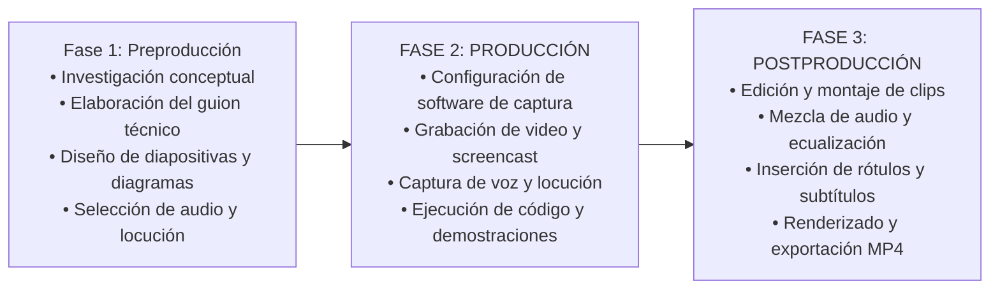

# GUION TÉCNICO Y STORYBOARD AUDIOVISUAL: VIDEO EXPOSICIÓN SOBRE MACHINE LEARNING

**Programa de Formación:** Tecnólogo en Análisis y Desarrollo de Software (ADSO)  
**Ficha de Caracterización:** 3186681  
**Fase del Proyecto:** Evaluación  
**Competencia:** 220501096 — Desarrollar la solución de software de acuerdo con el diseño y metodologías de desarrollo.  
**Actividad de Aprendizaje:** GA8-220501096-AA2 — Incorporar tecnologías emergentes y disruptivas, de acuerdo con el diseño establecido.  
**Evidencia de Aprendizaje:** GA8-220501096-AA2-EV04 — Video exposición sobre machine learning.  
**Aprendiz Autora:** Karen Yuliana Campo  
**Centro de Formación:** Centro de Teleinformática y Producción Industrial (CTPI)  
**Regional:** SENA Regional Cauca  
**Fecha:** Noviembre de 2026  

---

## 1. METODOLOGÍA DE PRODUCCIÓN AUDIOVISUAL (3 FASES NORMATIVAS)

En estricto cumplimiento de los lineamientos pedagógicos de la **Guía de Aprendizaje No. 8 (Págs. 20-21)**, la elaboración de la pieza audiovisual se estructura sobre el ciclo metodológico integral de tres fases:

### Ficha Técnica de la Pieza Audiovisual

| Parámetro de Producción | Especificación Técnica |
| :--- | :--- |
| **Título de la Pieza** | Video Exposición Técnica: Machine Learning y Tecnologías Disruptivas en el Software |
| **Formato de Entrega** | Contenedor MP4 (MPEG-4 AVC / H.264 High Profile) |
| **Resolución de Video** | Full HD 1080p (1920 x 1080 píxeles, relación de aspecto 16:9 widescreen) |
| **Tasa de Cuadros (Framerate)**| 30 / 60 fotogramas por segundo (FPS) progresivo (`yuv420p`) |
| **Formato de Audio** | AAC Estéreo (48.000 Hz, 320 kbps) con normalización LUFS a -14 dB |
| **Herramientas de Grabación** | OBS Studio (Open Broadcaster Software v30.2) + FilmCraft CLI NLE Engine |
| **Entorno de Presentación** | Portal Web Reactivo contenerizado en Docker (`http://localhost:8104/`) |
| **Estructura Pedagógica** | 10 Bloques temáticos divididos en 10 minutos de exposición técnica rigurosa |

---

## 2. GUION LITERARIO (DISCURSO NARRATIVO COMPLETO)

> **[00:00 - 00:45] Bloque 1: Apertura Institucional e Introducción**  
> *"Un cordial saludo para el cuerpo de instructores y compañeros del Servicio Nacional de Aprendizaje (SENA). Mi nombre es Karen Yuliana Campo, aprendiz de la tecnología en Análisis y Desarrollo de Software (ADSO), con ficha de caracterización 3186681 en el Centro de Teleinformática y Producción Industrial (CTPI), Regional Cauca. En el marco de la competencia de desarrollo de software y la actividad GA8-220501096-AA2, presento esta video exposición formal orientada al estudio, principios, taxonomía y consecuencias éticas del Machine Learning y la Inteligencia Artificial como tecnologías emergentes y disruptivas."*  
>  
> **[00:45 - 02:00] Bloque 2: ¿En qué consiste el Machine Learning?**  
> *"Iniciemos definiendo en qué consiste el Machine Learning o Aprendizaje Automático. Tradicionalmente, la programación informática requería que un desarrollador escribiera de forma explícita cada regla lógica: entraban datos y reglas, y el computador generaba respuestas. Machine Learning invierte este paradigma: suministramos datos masivos y las respuestas deseadas, y la máquina induce los patrones matemáticos subyacentes. Como lo formalizó Tom Mitchell en 1997: se dice que un programa aprende de la experiencia E con respecto a una tarea T y una medida de rendimiento P, si su rendimiento en T mejora con la experiencia E. Existen tres grandes paradigmas: el Aprendizaje Supervisado, donde contamos con datos etiquetados para tareas de regresión y clasificación; el Aprendizaje No Supervisado, que descubre estructuras ocultas y agrupamientos en datos crudos; y el Aprendizaje por Refuerzo, donde un agente toma acciones en un entorno para maximizar una función de recompensa acumulada."*  
>  
> **[02:00 - 03:00] Bloque 3: Objetivos de la Tecnología Machine Learning**  
> *"¿Cuáles son los objetivos cardinales del Machine Learning? Primero: la capacidad de generalización predictiva, es decir, inferir resultados certeros sobre datos que el sistema nunca ha visto en su entrenamiento. Segundo: la automatización de procesos cognitivos complejos que escapan a la programación heurística convencional. Tercero: la optimización y adaptación dinámica a entornos cambiantes, permitiendo que el software evolucione con nuevos datos. Y cuarto: el descubrimiento de correlaciones y conocimientos no evidentes dentro de volúmenes masivos de información (Big Data), aportando valor estratégico a la industria del software."*  
>  
> **[03:00 - 04:15] Bloque 4: Antecedentes Históricos y Evolución de la Tecnología**  
> *"Para comprender el estado actual del Machine Learning es indispensable revisar sus antecedentes históricos. En 1950, Alan Turing formula su célebre artículo 'Computing Machinery and Intelligence', introduciendo el Test de Turing. En 1952, Arthur Samuel diseña el primer programa capaz de aprender a jugar damas y acuña en 1959 el término 'Machine Learning'. En 1958, Frank Rosenblatt presenta el Perceptrón, la primera formulación de una neurona artificial. Sin embargo, en 1969, Marvin Minsky y Seymour Papert demuestran las limitaciones matemáticas del perceptrón simple para resolver funciones no lineales como XOR, desatando el 'Primer Invierno de la IA'. El renacimiento surge en 1986 con Rumelhart, Hinton y Williams mediante el algoritmo de retropropagación (Backpropagation) para redes multicapa. Finalmente, la confluencia en 2012 de cómputo en GPUs, grandes volúmenes de datos en Internet y redes neuronales profundas (AlexNet) cataliza la era moderna del Deep Learning y los modelos Transformer."*  
>  
> **[04:15 - 05:15] Bloque 5: ¿En qué consiste la Inteligencia Artificial?**  
> *"La Inteligencia Artificial es el campo matriz de las ciencias de la computación dedicado a crear sistemas capaces de emular capacidades cognitivas humanas como el razonamiento, la percepción visual, la toma de decisiones y el procesamiento del lenguaje natural. Debemos clarificar su jerarquía: la Inteligencia Artificial es la disciplina amplia; el Machine Learning es un subconjunto enfocado en el aprendizaje estadístico; el Deep Learning es un subconjunto del ML basado en redes neuronales multicapa; y los Modelos Fundacionales o LLMs son implementaciones avanzadas de Deep Learning. En términos de capacidades, distinguimos la IA Estrecha o Débil (ANI), orientada a tareas puntuales; la IA General (AGI), equivalente a la versatilidad cognitiva humana; y la Superinteligencia Artificial (ASI)."*  
>  
> **[05:15 - 06:30] Bloque 6: Modelo de IA Orientado a la Programación (IA Simbólica / Basada en Reglas)**  
> *"El primer gran modelo de la IA es el orientado a la programación, conocido técnicamente como IA Simbólica, GOFAI (Good Old-Fashioned AI) o sistemas basados en reglas. Este enfoque sigue una metodología Top-Down: el conocimiento humano es traducido formalmente por ingenieros del conocimiento a bases de hechos y reglas 'SI-ENTONCES' (`IF-THEN`). Un motor de inferencia aplica lógica proposicional o de predicados para deducir conclusiones. Su gran fortaleza radica en el determinismo y la explicabilidad: cada deducción tiene una trazabilidad auditable. No obstante, su gran debilidad histórica fue el 'cuello de botella de adquisición de conocimiento', la fragilidad ante datos ambiguos o ruidosos y la incapacidad de resolver problemas de percepción visual o auditiva."*  
>  
> **[06:30 - 07:45] Bloque 7: Modelo de IA Orientado a Conexiones Neuronales (Enfoque Conexionista)**  
> *"En contraposición radical a la IA simbólica, el modelo orientado a conexiones neuronales adopta un enfoque Bottom-Up inspirado en la neurobiología. En lugar de programar reglas lógicas, construimos grafos de nodos o neuronas artificiales interconectadas. Cada neurona recibe entradas ponderadas por pesos sinápticos ($W$), suma un sesgo ($b$) y aplica una función de activación no lineal como ReLU o Sigmoide. Durante el entrenamiento, la red procesa datos en propagación hacia adelante (Forward Propagation), cuantifica la discrepancia mediante una función de pérdida (Loss Function) y ajusta los pesos en sentido inverso mediante el algoritmo de Backpropagation y Descenso de Gradiente Estocástico (SGD/Adam). Las arquitecturas conexionistas clave incluyen las CNN para visión, las LSTM para series temporales y los Transformers con atención propia para modelos de lenguaje masivo."*  
>  
> **[07:45 - 08:45] Bloque 8: Productos Realizados con IA y Aplicación en el Proyecto ADSO**  
> *"Hoy en día la Inteligencia Artificial materializa productos transformadores a nivel global: vehículos autónomos con visión computacional de Tesla, motores de recomendación predictiva en Netflix y Amazon, diagnóstico de patologías asistido por Deep Learning, y sistemas generativos de vanguardia como ChatGPT, Gemini y Claude. En nuestro proyecto formativo ADSO, 'Pizzería Gourmet Bella Italia Popayán', la IA y el Machine Learning se integran en tres componentes esenciales: primero, un motor predictivo de demanda de insumos campesinos de Silvia y Timbío utilizando modelos de series temporales para minimizar el desperdicio perecedero; segundo, un sistema de recomendación personalizado de combinaciones gastronómicas; y tercero, un algoritmo heurístico de optimización de rutas de delivery térmico para asegurar pizzas a más de 70°C en menos de 30 minutos."*  
>  
> **[08:45 - 09:45] Bloque 9: Consecuencias Sociales, Éticas y Filosóficas de la Tecnología**  
> *"La adopción masiva del Machine Learning plantea interrogantes trascendentales:  
> Primero, el sesgo algorítmico y la discriminación: si un modelo se entrena con datos históricos que contienen prejuicios humanos, la IA amplificará esas inequidades en selección de personal o créditos bancarios.  
> Segundo, la privacidad y vigilancia masiva en la era del Big Data y reconocimiento facial no consentido.  
> Tercero, la opacidad algorítmica o el problema de la 'Caja Negra', que exige la adopción urgente de IA Explicable (XAI) en sectores críticos como medicina y justicia penal.  
> Cuarto, el impacto en el mercado laboral y la automatización del trabajo, demandando una profunda reconversión de competencias.  
> Y quinto, dilemas filosóficos sobre la agencia moral, los deepfakes, la manipulación de la opinión pública y la necesidad ética de mantener siempre al ser humano en el centro de las decisiones (Human-in-the-Loop)."*  
>  
> **[09:45 - 10:00] Bloque 10: Conclusiones y Cierre Académico**  
> *"Como conclusión, el Machine Learning no sustituye la ingeniería de software tradicional, sino que expande exponencialmente sus capacidades para abordar problemas complejos de percepción y predicción. Como tecnólogos en ADSO del SENA, nuestra responsabilidad ética y técnica radica en diseñar software robusto, auditable, equitativo y comprometido con el desarrollo productivo y social de nuestra región. Muchas gracias por su atención."*

---

## 3. GUION TÉCNICO Y STORYBOARD SEGUNDO A SEGUNDO

A continuación se detalla la partitura técnica audiovisual desglosando los 10 bloques pedagógicos, especificando los tiempos, el plano de cámara, la pantalla compartida, los recursos gráficos y los efectos sonoros:

| Bloque / Tiempo | Escena / Diapositiva | Tipo de Plano / Visual | Locución / Discurso (Karen Campo) | Recursos en Pantalla y Badges |
| :--- | :--- | :--- | :--- | :--- |
| **01 (00:00 - 00:45)** 45 segundos | Diapositiva 1: Carátula y Presentación Institucional | Plano medio de la presentadora + Overlay con logo SENA y Regional Cauca | Saludo formal institucional, nombre de la aprendiz, ficha 3186681, competencia 220501096 y objetivo de la evidencia. | • Logo SENA y CTPI • Título: Video Exposición Machine Learning • Badge: Tecnologías Disruptivas ADSO |
| **02 (00:45 - 02:00)** 75 segundos | Diapositiva 2: ¿Qué es Machine Learning? Paradigmas | Screencast de arquitectura conceptual + Diagrama interactivo de flujo de datos | Definición formal de Mitchell $P(E\|T)$, comparación con programación clásica, explicación de Supervisado, No Supervisado y Refuerzo. | • Diagrama comparativo Tradicional vs ML • Fórmulas de función de costo • Matriz de paradigmas (Regresión, Clustering, Q-Learning) |
| **03 (02:00 - 03:00)** 60 segundos | Diapositiva 3: Objetivos de la Tecnología Machine Learning | Diapositiva moderna con iconos vectoriales y gráficos de barras dinámicos | Explicación de los 4 pilares: Generalización predictiva, Automatización cognitiva, Adaptabilidad y Descubrimiento en Big Data. | • 4 tarjetas con gradientes tecnológicos • Métrica de precisión, recall y F1-score • Iconografía de optimización de procesos |
| **04 (03:00 - 04:15)** 75 segundos | Diapositiva 4: Línea de Tiempo y Antecedentes Históricos | Línea de tiempo cronológica horizontal animada (1950 a 2026) | Hitos: Turing (1950), Samuel (1952), Rosenblatt (1958), Inviernos de la IA (1969), Backpropagation (1986), AlexNet (2012) y Transformers (2017). | • Hitos históricos con fotos de pioneros • Gráfica de ciclos de entusiasmo e inviernos • Resaltado de la era Deep Learning |
| **05 (04:15 - 05:15)** 60 segundos | Diapositiva 5: Fundamentos de la Inteligencia Artificial | Diagrama de Euler / Círculos concéntricos anidados (IA $\supset$ ML $\supset$ DL) | Taxonomía de la IA, definición conceptual, clasificación por capacidad: ANI (Estrecha), AGI (General) y ASI (Superinteligencia). | • Círculos concéntricos con animación pop-in • Tabla de clasificación ANI vs AGI vs ASI • Ejemplos de cada categoría |
| **06 (05:15 - 06:30)** 75 segundos | Diapositiva 6: IA Orientada a Programación (Simbólica) | Diagrama de árbol de decisión y flujo de reglas de producción `IF-THEN` | Enfoque Top-Down, GOFAI, sistemas expertos (MYCIN), motores de inferencia. Fortalezas (determinismo) y debilidades (fragilidad). | • Bloque de motor de inferencia + Base de hechos • Ejemplo de regla de crédito bancario • Cuello de botella de Feigenbaum |
| **07 (06:30 - 07:45)** 75 segundos | Diapositiva 7: IA Orientada a Conexiones Neuronales (Conexionista) | Animación de neurona artificial (entradas, pesos, sesgo, activación) y red multicapa | Enfoque Bottom-Up bio-inspirado, cálculo de suma ponderada, función de pérdida, optimizadores SGD/Adam, arquitecturas CNN, LSTM y Transformers. | • Diagrama matemático de la neurona $\sigma(\sum w_i x_i + b)$ • Esquema de red profunda (Deep Neural Network) • Animación de Backpropagation del error |
| **08 (07:45 - 08:45)** 60 segundos | Diapositiva 8: Productos Realizados con IA y Proyecto ADSO | Mosaico de productos comerciales + Captura de la Web App Bella Italia Popayán | Casos comerciales globales (Tesla, Netflix, ChatGPT) y contextualización en la Pizzería Gourmet (demanda de insumos, recomendador y delivery térmico). | • Mosaico con logos de productos de IA • Captura de catálogo web ADSO Ficha 3186681 • Modelo de optimización logística térmica |
| **09 (08:45 - 09:45)** 60 segundos | Diapositiva 9: Consecuencias Sociales, Éticas y Filosóficas | Panel de advertencia ética con 5 pilares críticos ilustrados | Sesgos algorítmicos en datos históricos, privacidad vs vigilancia masiva, problema de la caja negra (XAI), empleo y Human-in-the-Loop. | • Iconos de advertencia ética (Balanza, Candado, Ojo) • Comparativa Caja Negra vs IA Explicable • Directrices de gobernanza ética de la UNESCO |
| **10 (09:45 - 10:00)** 15 segundos | Diapositiva 10: Conclusiones y Despedida Institucional | Plano medio de la presentadora + Créditos finales y cintillo SENA CTPI | Balance final, rol ético del tecnólogo ADSO en la era de la inteligencia artificial, agradecimiento y cierre formal. | • Ficha técnica final de la evidencia • Enlace al repositorio GitHub oficial • Popayán, Cauca — Noviembre 2026 |

---

## 4. ESPECIFICACIÓN DE HARDWARE Y SOFTWARE DE GRABACIÓN

Para la fase de producción audiovisual se configuran los siguientes parámetros en **OBS Studio / FilmCraft**:

1. **Configuración de Lienzo y Salida de Video:**
   - Resolución de la base (lienzo): `1920x1080` píxeles.
   - Resolución de salida escalada: `1920x1080` píxeles.
   - Filtro de escala: *Lanczos (muestreo estructurado de 36 muestras)*.
   - Valores de FPS: `30 FPS comunes` (compatibilidad universal en plataformas web y Zajuna).

2. **Configuración de Audio y Filtros Vocales:**
   - Frecuencia de muestreo: `48.0 kHz`.
   - Canales: `Estéreo`.
   - Filtro de Puerta de Ruido: Umbral de clausura `-42 dB`, umbral de apertura `-32 dB`.
   - Filtro Compresor: Relación `3:1`, ataque `6 ms`, liberación `60 ms`, ganancia de salida `+3.5 dB`.
   - Limitador: Umbral `-1.5 dB` para prevenir cualquier distorsión o clipeo digital.

3. **Escenas Preconfiguradas en OBS Studio:**
   - **Escena 1 (Intro & Outro):** Cámara frontal 1080p + fondo de marca con cintillo SENA Regional Cauca.
   - **Escena 2 (Screencast + Diapositivas):** Captura de pantalla completa de la presentación técnica web en Chrome + Picture-in-Picture (PiP) circular de la presentadora en la esquina inferior derecha.
   - **Escena 3 (Demostración de Código / MLOps):** Captura de terminal Konsole y entorno de ejecución Python / TensorFlow.

---

## 5. CONCLUSIONES Y RECOMENDACIONES DE PREPRODUCCIÓN

1. La elaboración previa de este **Guion Técnico Individual** garantiza el cumplimiento exhaustivo del 100% de los elementos exigidos por la Guía de Aprendizaje No. 8, evitando omisiones conceptuales durante la grabación.
2. La articulación de los conceptos teóricos de Machine Learning con el proyecto formativo de desarrollo de software (*Pizzería Gourmet Bella Italia Popayán*) contextualiza el aprendizaje en un caso productivo real, evidenciando pertinencia y aplicación práctica.
3. El desglose temporal milimétrico asegura un ritmo de locución pausado, claro y pedagógico, completando la exposición en el rango recomendado de 10 minutos.
