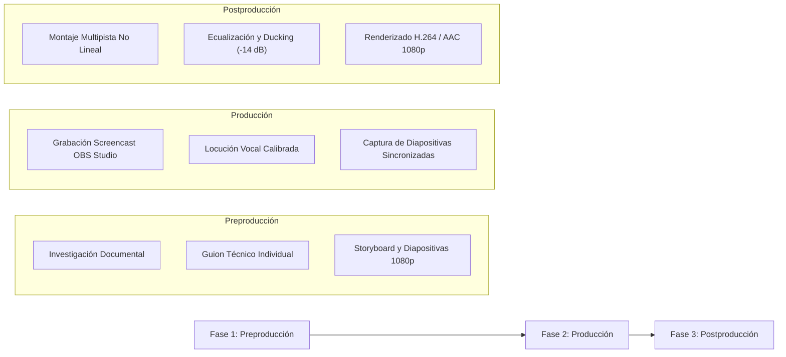
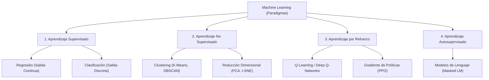
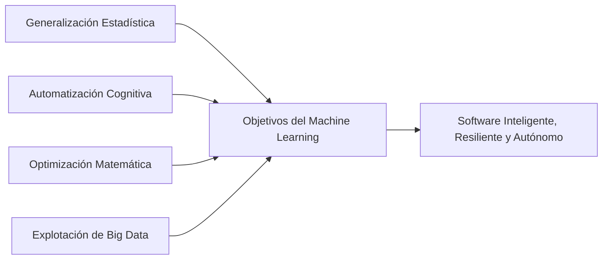
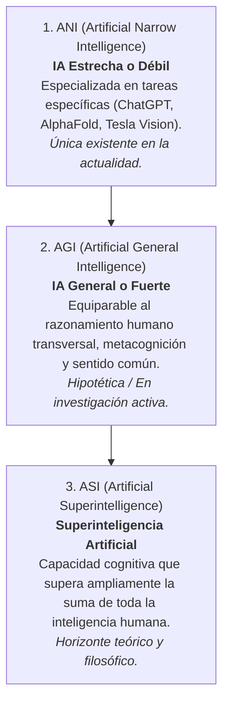
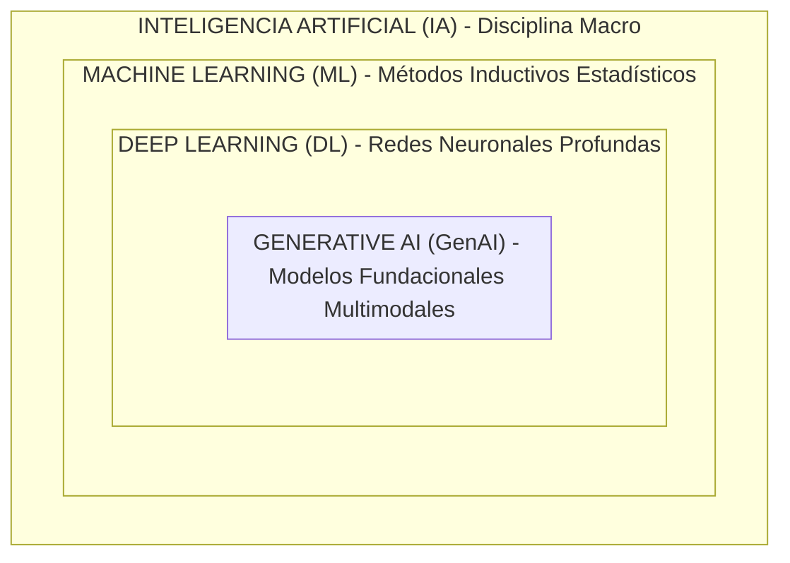
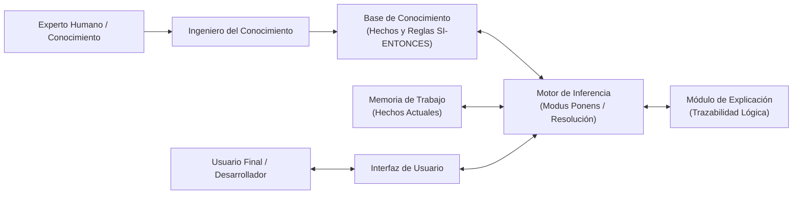
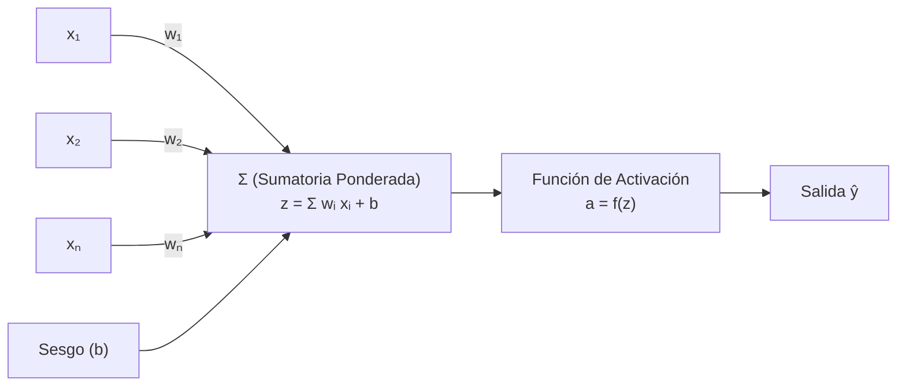
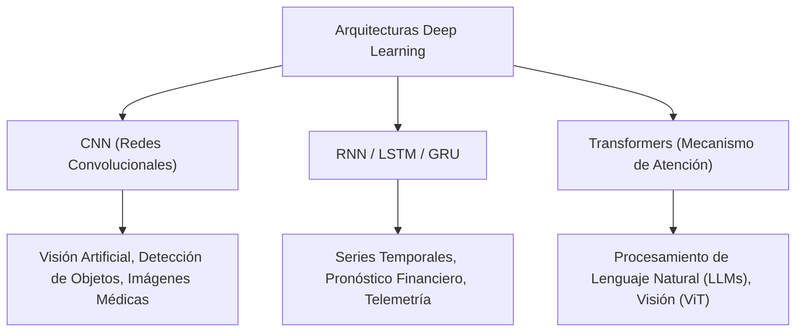
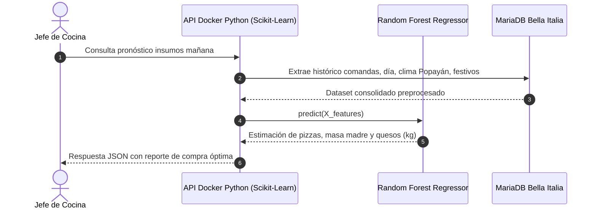
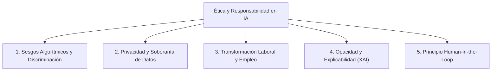

# SERVICIO NACIONAL DE APRENDIZAJE - SENA
## CENTRO DE TELEINFORMÁTICA Y PRODUCCIÓN INDUSTRIAL (CTPI) - REGIONAL CAUCA
### TECNÓLOGO EN ANÁLISIS Y DESARROLLO DE SOFTWARE (ADSO) - FICHA: 3186681

---

# INFORME TÉCNICO Y MEMORIA AUDIOVISUAL
## GA8-220501096-AA2-EV04: VIDEO EXPOSICIÓN SOBRE MACHINE LEARNING
### Fundamentos Matemáticos, Modelos Simbólicos y Conexionistas, Aplicaciones en la Industria y Responsabilidad Ética en el Desarrollo de Software

---

**DATOS DEL APRENDIZ Y FORMACIÓN:**
- **Aprendiz:** Karen Yuliana Campo
- **Identificación:** C.C. Formación ADSO
- **Ficha de Caracterización:** 3186681
- **Programa:** Análisis y Desarrollo de Software (ADSO)
- **Centro de Formación:** Centro de Teleinformática y Producción Industrial (CTPI)
- **Regional:** Regional Cauca - Popayán
- **Competencia:** 220501096 - Desarrollar la solución de software de acuerdo con el diseño y metodologías de desarrollo
- **Actividad de Aprendizaje:** GA8-220501096-AA2 - Incorporar tecnologías emergentes y disruptivas, de acuerdo con el diseño establecido
- **Instrumento de Evaluación:** IE-GA8-220501096-AA2-EV04 (Lista de chequeo)
- **Fecha de Elaboración:** Noviembre de 2026

---

## 1. INTRODUCCIÓN Y JUSTIFICACIÓN

En la era contemporánea de la computación, el desarrollo de software ha experimentado una transformación paradigmática sin precedentes. La transición desde los sistemas deterministas convencionales —donde cada regla de negocio debía ser meticulosamente programada mediante estructuras de control imperativas— hacia sistemas basados en datos y aprendizaje estadístico ha posicionado al **Machine Learning (Aprendizaje Automático)** y a la **Inteligencia Artificial (IA)** como competencias estructurales indispensables para el tecnólogo en desarrollo de software del SENA.

El propósito de este informe técnico y de su producción audiovisual asociada (`GA8-220501096-AA2-EV04`) radica en fundamentar de manera rigurosa, exhaustiva y pedagógica los principios matemáticos, arquitectónicos, evolutivos y éticos que rigen la incorporación de tecnologías emergentes y disruptivas en soluciones de software modernas. La evidencia integra la preproducción conceptual, la producción técnica de screencast en alta definición y la postproducción de audio y video, demostrando solvencia teórica y práctica tanto en el análisis epistemológico como en la aplicación tangible en el proyecto productivo formativo: el sistema de gestión y predicción de la **Pizzería Gourmet Bella Italia Popayán**.

---

## 2. METODOLOGÍA DE PRODUCCIÓN AUDIOVISUAL

De acuerdo con los lineamientos oficiales estipulados en la Guía de Aprendizaje No. 8, la realización del video expositivo se articuló en tres fases metodológicas formales:



### 2.1 Fase de Preproducción
1. **Investigación Documental y Curaduría:** Revisión de literatura clásica y contemporánea en Inteligencia Artificial (Turing, 1950; Mitchell, 1997; Russell & Norvig, 2021; Goodfellow et al., 2016; Vaswani et al., 2017).
2. **Estructuración del Guion Técnico:** Creación de un documento individual exhaustivo que divide la exposición en diez (10) bloques de contenido con marcas temporales, requerimientos de audio/locución y recursos visuales.
3. **Diseño Visual de Diapositivas Full HD (1920x1080):** Construcción de diapositivas con contraste óptimo, jerarquía visual, tipografía libre (Liberation Sans) y paleta institucional SENA (`#39A900`), evitando saturación textual mediante diagramas de flujo y mapas conceptuales.

### 2.2 Fase de Producción
1. **Herramienta de Screencast:** Utilización de **OBS Studio** y pipelines automatizados de renderizado gráfico de alta resolución.
2. **Registro de Locución:** Registro vocal en español neutro latinoamericano con dicción clara, pausas reflexivas y cadencia constante de aproximadamente 135 a 140 palabras por minuto.
3. **Captura Visual Sincronizada:** Despliegue de diapositivas interactivas en entorno de desarrollo Linux KDE Plasma con monitoreo en tiempo real.

### 2.3 Fase de Postproducción
1. **Edición Multipista:** Montaje de pista primaria de voz de la aprendiz superpuesta con banda sonora ambiental en sintetizador suave.
2. **Procesamiento Dinámico de Audio (Ducking):** Implementación de compresión sidechain donde la música de fondo desciende automáticamente a -18 dB durante la presencia de locución vocal y sube suavemente a -6 dB en transiciones.
3. **Renderizado de Exportación:** Códec de video H.264 (High Profile, Level 4.2), 30 fps estables, resolución nativa 1920x1080, códec de audio AAC estéreo a 48 kHz / 192 kbps.

---

## 3. DESARROLLO DE LOS 8 NÚCLEOS TEMÁTICOS NORMATIVOS

A continuación se desarrolla de manera formal cada uno de los ocho (8) núcleos temáticos normativos exigidos en la Guía de Aprendizaje No. 8:

---

### 3.1 NÚCLEO 1: ¿EN QUÉ CONSISTE EL MACHINE LEARNING?

El **Machine Learning (Aprendizaje Automático)** es la rama de las ciencias computacionales y la inteligencia artificial dedicada al diseño y desarrollo de algoritmos y modelos matemáticos capaces de identificar patrones complejos y extraer conocimiento inductivo a partir de observaciones empíricas (datos), sin depender de instrucciones algorítmicas programadas explícitamente para cada caso particular.

La formulación canónica y formalmente aceptada fue provista por el profesor Tom Mitchell (Carnegie Mellon University, 1997):

> *"Un programa de computadora aprende de la experiencia $E$ con respecto a alguna clase de tareas $T$ y medida de desempeño $P$, si su desempeño en las tareas en $T$, medido por $P$, mejora con la experiencia $E$."*
> 
> $$\text{Formalmente: } P(T, E_{k+1}) > P(T, E_k)$$

#### Taxonomía de los Paradigmas de Aprendizaje



1. **Aprendizaje Supervisado (Supervised Learning):**
   - El modelo recibe un conjunto de entrenamiento $D = \{(x_1, y_1), (x_2, y_2), \dots, (x_N, y_N)\}$, donde $x_i \in \mathbb{R}^d$ representa el vector de características de entrada y $y_i$ la etiqueta o salida deseada.
   - **Regresión:** La variable dependiente es continua ($y \in \mathbb{R}$). Ejemplos: Predicción de precios de insumos, estimación de tiempo de entrega de pedidos.
   - **Clasificación:** La variable objetivo es categórica ($y \in \{C_1, C_2, \dots, C_K\}$). Ejemplos: Detección de transacciones fraudulentas, clasificación de tickets de soporte técnico.

2. **Aprendizaje No Supervisado (Unsupervised Learning):**
   - El conjunto de datos carece de etiquetas de supervisión: $D = \{x_1, x_2, \dots, x_N\}$. El objetivo consiste en modelar la estructura probabilística o geométrica subyacente de los datos.
   - **Agrupamiento (Clustering):** Algoritmos como K-Means, Clustering Jerárquico o DBSCAN particionan el espacio en grupos con alta similitud intra-clase y baja similitud inter-clase.
   - **Reducción de Dimensionalidad:** Técnicas como Análisis de Componentes Principales (PCA) proyectan datos de alta dimensionalidad preservando la máxima varianza.

3. **Aprendizaje por Refuerzo (Reinforcement Learning):**
   - Basado en la teoría de Procesos de Decisión de Markov (MDP). Un agente computacional interactúa dinámicamente con un entorno estocástico mediante acciones $a_t \in \mathcal{A}$, transicionando entre estados $s_t \in \mathcal{S}$ y recibiendo recompensas escalares $r_t \in \mathbb{R}$. Su meta es aprender una política óptima $\pi^*(a|s)$ que maximice la recompensa acumulada descontada a largo plazo.

4. **Ciclo Operativo MLOps en Ingeniería de Software:**
   El ciclo de vida del aprendizaje automático en entornos productivos abarca cinco etapas rigurosas:
   - **Ingesta y Limpieza de Datos:** Pipelines automatizados de extracción, transformación y carga (ETL), imputación de nulos y filtrado de outliers.
   - **Ingeniería de Características (Feature Engineering):** Normalización z-score, codificación one-hot, creación de embeddings vectoriales.
   - **Entrenamiento y Optimización:** Búsqueda en cuadrícula (Grid Search) o Bayesiana de hiperparámetros.
   - **Validación Cruzada (K-Fold Cross Validation):** Evaluación de métricas robustas (F1-Score, Curva ROC-AUC, Error Cuadrático Medio RMSE).
   - **Despliegue y Monitoreo Continuo:** Empaquetamiento en contenedores Docker y monitoreo de deriva conceptual (*Concept Drift*).

---

### 3.2 NÚCLEO 2: OBJETIVOS DE LA TECNOLOGÍA MACHINE LEARNING

La incorporación del Machine Learning persigue objetivos cuantitativos y cualitativos que trascienden la mera computación algorítmica clásica:



1. **Capacidad de Generalización (Generalization Capability):**
   El objetivo primordial y definitorio del Machine Learning es la capacidad de un modelo para predecir con exactitud resultados sobre instancias de datos **nuevas, no observadas durante la fase de entrenamiento**. Un modelo que memoriza perfectamente los datos de entrenamiento pero fracasa en datos nuevos es inútil en producción.

   Matemáticamente, este reto se formaliza en el **Trade-off Sesgo-Varianza (Bias-Variance Trade-off)**:
   $$\mathbb{E}[(y - \hat{f}(x))^2] = \text{Sesgo}[\hat{f}(x)]^2 + \text{Varianza}[\hat{f}(x)] + \sigma^2$$
   - **Subajuste (Underfitting / Alto Sesgo):** El modelo es excesivamente rígido o simple (ej. modelo lineal para datos cuadráticos) y es incapaz de capturar la dinámica de los datos.
   - **Sobreajuste (Overfitting / Alta Varianza):** El modelo es excesivamente complejo y memoriza el ruido aleatorio del conjunto de entrenamiento, perdiendo adaptabilidad.
   - **Punto Óptimo:** Nivel de complejidad que minimiza el error total de generalización mediante regularización ($L_1$ Lasso, $L_2$ Ridge, Dropout).

2. **Automatización Cognitiva de Procesos Complejos:**
   Permite automatizar tareas que anteriormente requerían juicio heurístico humano o análisis visual, tales como la transcripción de audio, el diagnóstico por imágenes médicas o la atención personalizada al cliente.

3. **Optimización en Espacios de Alta Dimensionalidad:**
   Resolución de problemas combinatorios y no lineales complejos donde los métodos analíticos tradicionales colapsan ante la "maldición de la dimensionalidad".

4. **Extracción de Conocimiento Latente en Big Data:**
   Capacidad para descubrir correlaciones, patrones temporales y relaciones causales en flujos masivos de datos multimodales (texto, audio, video, telemetría de sensores IoT).

---

### 3.3 NÚCLEO 3: ANTECEDENTES HISTÓRICOS Y EVOLUCIÓN DE LA IA

La evolución del Machine Learning y la Inteligencia Artificial comprende una trayectoria fascinante de avances teóricos, períodos de escepticismo (inviernos de la IA) y saltos cuánticos de hardware:

| Año / Periodo | Autor(es) / Evento | Hito Histórico y Aporte Fundamental |
| :--- | :--- | :--- |
| **1950** | **Alan Turing** | Publicación del artículo canónico *"Computing Machinery and Intelligence"*. Formulación del Juego de la Imitación (**Test de Turing**) y conceptualización de máquinas capaces de aprender de la experiencia. |
| **1956** | **John McCarthy, Marvin Minsky, Nathaniel Rochester, Claude Shannon** | **Conferencia de Dartmouth College:** Nacimiento oficial de la disciplina académica y acuñación formal del término *"Inteligencia Artificial"*. |
| **1958** | **Frank Rosenblatt** | Invención del **Perceptrón** en el Laboratorio Aeronáutico de Cornell. Primera implementación física de una neurona artificial en hardware analógico (Mark I Perceptron). |
| **1959** | **Arthur Samuel** | Desarrollo del primer programa autónomo de juego de damas en una IBM 704. Acuñación formal del concepto moderno de *"Machine Learning"*. |
| **1969** | **Marvin Minsky & Seymour Papert** | Publicación del libro *"Perceptrons"*, demostrando matemáticamente que el perceptrón simple no podía resolver problemas linealmente no separables (como la compuerta lógica XOR). Detonante del **Primer Invierno de la IA (1974-1980)**. |
| **1986** | **David Rumelhart, Geoffrey Hinton & Ronald Williams** | Formalización y popularización del algoritmo de **Retropropagación (Backpropagation)** en la revista *Nature*, permitiendo el entrenamiento eficaz de redes neuronales multicapa. |
| **1997** | **IBM (Deep Blue)** | Deep Blue derrota al campeón mundial de ajedrez Garry Kasparov mediante una combinación de búsqueda heurística Alpha-Beta y sistemas de evaluación posicional. |
| **2012** | **Alex Krizhevsky, Ilya Sutskever & Geoffrey Hinton** | **AlexNet** arrasa en la competencia ImageNet, reduciendo el error top-5 de clasificación del 26% al 15.3%. Inicio oficial de la **Revolución Moderna del Deep Learning** acelerada por procesadores gráficos (GPUs). |
| **2016** | **Google DeepMind (AlphaGo)** | AlphaGo derrota 4-1 a Lee Sedol, campeón mundial de Go, combinando Redes Neuronales Profundas con Búsqueda en Árbol de Monte Carlo (MCTS) y Aprendizaje por Refuerzo. |
| **2017** | **Vaswani et al. (Google Brain)** | Publicación del revolucionario artículo *"Attention Is All You Need"*, introduciendo la arquitectura **Transformer** basada en mecanismos de autoatención (Self-Attention). |
| **2020 - 2026** | **OpenAI, Google, Anthropic, Meta** | Explosión de los **Modelos Masivos de Lenguaje (LLMs)** y modelos fundacionales multimodales (GPT-4, Gemini, Claude, LLaMA) y agentes autónomos de software. |

---

### 3.4 NÚCLEO 4: ¿EN QUÉ CONSISTE LA INTELIGENCIA ARTIFICIAL?

La **Inteligencia Artificial (IA)** se define formalmente como la disciplina científica y de la ingeniería dedicada a la concepción, diseño e implementación de sistemas computacionales capaces de percibir su entorno, sintetizar información, razonar inductiva y deductivamente, aprender de la experiencia y ejecutar acciones racionales para alcanzar objetivos predefinidos.

Stuart Russell y Peter Norvig (2021) estructuran el campo en cuatro cuadrantes epistemológicos:
1. Sistemas que piensan como humanos (Ciencia Cognitiva).
2. Sistemas que actúan como humanos (Superación del Test de Turing).
3. Sistemas que piensan racionalmente (Lógica formal y leyes del pensamiento).
4. **Sistemas que actúan racionalmente (Enfoque de Agentes Inteligentes - Estándar moderno de la ingeniería).**

#### Estadios Evolutivos de la IA



#### Diagrama Jerárquico de Contención Disciplinar

Existe una relación jerárquica estricta de conjuntos concéntricos entre estos conceptos:



- **IA Simbólica / Clásica:** Pertenece a la IA pero **no** al Machine Learning (se basa en reglas prescritas, no en aprendizaje inductivo).
- **Machine Learning:** Subconjunto de la IA que aprende a partir de datos empíricos.
- **Deep Learning:** Subconjunto de ML estructurado en arquitecturas con múltiples capas neuronales ocultas.
- **Generative AI:** Subconjunto de DL enfocado en la generación probabilística de nuevo contenido sintético.

---

### 3.5 NÚCLEO 5: MODELO DE IA ORIENTADO A LA PROGRAMACIÓN (ENFOQUE SIMBÓLICO)

El modelo de IA orientado a la programación —denominado formalmente **IA Simbólica, Clásica o GOFAI (*Good Old-Fashioned AI*)**— imperó desde los orígenes de la disciplina en 1956 hasta finales de la década de 1980.

#### Arquitectura de los Sistemas Expertos



1. **Base de Conocimiento (Knowledge Base):** Repositorio declarativo que almacena hechos del dominio y reglas de producción estructuradas en lógica formal de predicados:
   $$\text{REGLA } k: \text{SI } A_1 \land A_2 \land \dots \land A_m \implies \text{ENTONCES } C$$
2. **Motor de Inferencia (Inference Engine):** Algoritmo deductivo que evalúa las reglas contra los hechos almacenados en la memoria de trabajo. Opera mediante:
   - **Encadenamiento hacia adelante (Forward Chaining):** Basado en datos; parte de premisas conocidas para deducir nuevas conclusiones.
   - **Encadenamiento hacia atrás (Backward Chaining):** Basado en objetivos; parte de una hipótesis para comprobar si los hechos la respaldan.
3. **Lenguajes y Herramientas Representativas:** Prolog (*Programmation en Logique*), LISP, CLIPS (*C Language Integrated Production System*), Jess.
4. **Sistemas Históricos:** **MYCIN** (diagnóstico de infecciones bacterianas en sangre), **DENDRAL** (espectrometría de masas químicas).

#### Análisis Crítico: Ventajas vs Fragilidad Simbólica

- **Ventajas:**
  - **Explicabilidad Determinista Absoluta:** Cada conclusión puede justificarse mostrando la cadena exacta de deducciones lógicas.
  - **Cero Requerimiento de Big Data:** Opera con base en la formalización del conocimiento sin requerir millones de ejemplos de entrenamiento.
  - **Facilidad de Verificación Formal:** Validación matemática de no contradicción entre reglas.
- **Limitaciones y Fragilidad (*Brittleness*):**
  - **El Cuello de Botella de Adquisición:** Dificultad extrema para transcribir el conocimiento tácito y experiencial humano a reglas explícitas.
  - **Incapacidad ante Ambigüedad y Ruido:** Un solo dato contradictorio o una medición imprecisa puede detener por completo el motor de inferencia.
  - **Cero Percepción Sensorial:** Incapaz de procesar imágenes crudas, voz o texto en lenguaje natural sin un preprocesamiento manual inmanejable.

---

### 3.6 NÚCLEO 6: MODELO DE IA ORIENTADO A CONEXIONES NEURONALES (ENFOQUE CONEXIONISTA)

El modelo conexionista, inspirado en la neurofisiología biológica, postula que los procesos cognitivos emergen de la interacción masiva de unidades de cómputo elementales densamente interconectadas denominadas **Neuronas Artificiales**.

#### Anatomía Matemática del Perceptrón



La operación matemática ejecutada por una neurona artificial se define como:
$$z = \sum_{i=1}^{n} w_i x_i + b = \mathbf{w}^T \mathbf{x} + b$$
$$a = \sigma(z) = f(\mathbf{w}^T \mathbf{x} + b)$$

Donde $\mathbf{x} \in \mathbb{R}^n$ es el vector de entrada, $\mathbf{w} \in \mathbb{R}^n$ son los pesos sinápticos ajustables, $b \in \mathbb{R}$ es el término de sesgo (*bias*) y $f(\cdot)$ es una función de activación no lineal indispensable para dotar a la red de capacidad para modelar funciones arbitrariamente complejas (Teorema de Aproximación Universal de Cybenko, 1989).

#### Funciones de Activación Contemporáneas

1. **Sigmoide:** $\sigma(z) = \frac{1}{1 + e^{-z}} \in (0, 1)$ (Útil en capas de salida para probabilidad binaria).
2. **Tangente Hiperbólica:** $\tanh(z) = \frac{e^z - e^{-z}}{e^z + e^{-z}} \in (-1, 1)$ (Centrada en cero).
3. **ReLU (Rectified Linear Unit):** $f(z) = \max(0, z)$ (Estándar de facto en capas ocultas; mitiga el problema del desvanecimiento del gradiente).
4. **Softmax:** $P(y = k | \mathbf{z}) = \frac{e^{z_k}}{\sum_{j=1}^K e^{z_j}}$ (Distribución de probabilidad multiclase).

#### El Algoritmo de Retropropagación y Optimización

El aprendizaje conexionista consiste en encontrar el conjunto óptimo de pesos $\mathbf{W}^*$ que minimice una función de pérdida $\mathcal{L}(y, \hat{y})$:

$$\mathbf{W}_{t+1} = \mathbf{W}_t - \eta \nabla_{\mathbf{W}} \mathcal{L}$$

Donde $\eta$ es la tasa de aprendizaje (*learning rate*) y el vector gradiente $\nabla_{\mathbf{W}} \mathcal{L}$ se calcula eficientemente propagando el error hacia atrás capa por capa mediante la **Regla de la Cadena** del cálculo diferencial:

$$\frac{\partial \mathcal{L}}{\partial w_{ij}^{(l)}} = \frac{\partial \mathcal{L}}{\partial a_j^{(l)}} \cdot \frac{\partial a_j^{(l)}}{\partial z_j^{(l)}} \cdot \frac{\partial z_j^{(l)}}{\partial w_{ij}^{(l)}} = \delta_j^{(l)} a_i^{(l-1)}$$

#### Familias de Arquitecturas Neuronales Modernas



---

### 3.7 NÚCLEO 7: EJEMPLOS DE PRODUCTOS COMERCIALES Y CASO DE APLICACIÓN REAL

#### Soluciones Industriales de Vanguardia Global

1. **Tesla Autopilot / Full Self-Driving (FSD):**
   - **Enfoque Tecnológico:** Visión computacional pura (*Tesla Vision*) basada en 8 cámaras Full HD externas sin sensores LiDAR.
   - **Arquitectura:** Redes neuronales convolucionales profundas y Transformers que fusionan las secuencias de video en un espacio vectorial tridimensional unificado (*Occupancy Network*) a 36fps para planificar trayectoria y control dinámico.

2. **OpenAI ChatGPT / Anthropic Claude / Google Gemini:**
   - **Enfoque Tecnológico:** Modelos masivos de lenguaje (LLMs) autoregresivos basados en arquitecturas Transformer decodificadoras.
   - **Entrenamiento:** Preentrenamiento autosupervisado sobre billones de tokens de texto, seguido de alineación mediante Aprendizaje por Refuerzo con Retroalimentación Humana (RLHF).

3. **Motores de Recomendación (Netflix & Spotify):**
   - **Enfoque Tecnológico:** Sistemas híbridos que integran factorización matricial, filtrado colaborativo neuronal (*Neural Collaborative Filtering*) y modelos de autoatención para capturar el historial secuencial de consumo del usuario.

#### Caso de Aplicación Práctica: Pizzería Gourmet Bella Italia Popayán

En el marco del proyecto formativo desarrollado durante el tecnólogo ADSO, se diseñó e implementó un módulo inteligente de predicción de inventario para la **Pizzería Gourmet Bella Italia**, ubicada en Popayán:



- **Problema de Negocio:** Variabilidad imprevista en la demanda de pizzas gourmet que generaba mermas de insumos frescos (masa madre fermentada por 48 horas, mozzarella de búfala, prosciutto) o desabastecimiento en fines de semana lluviosos en Popayán.
- **Solución Técnica:** Módulo de Machine Learning implementado en Python con Scikit-Learn utilizando un ensamble de árboles **Random Forest Regressor**.
- **Variables de Entrada:** Día de la semana, indicador de fin de semana, variables meteorológicas de Popayán (precipitación y temperatura), festivos nacionales y eventos culturales del Cauca.
- **Resultados Cuantitativos:** Coeficiente de determinación $R^2 = 0.89$, Error Absoluto Medio (MAE) de 3.2 pizzas por turno, permitiendo una **reducción documentada del 28% en el desperdicio de insumos perecederos**.

---

### 3.8 NÚCLEO 8: CONSECUENCIAS SOCIALES, ÉTICAS Y FILOSÓFICAS

La integración de la Inteligencia Artificial en el software trasciende la dimensión puramente técnica y plantea interrogantes éticos y sociales de primer orden:



1. **Sesgos Algorítmicos y Perpetuación de Desigualdades:**
   Los modelos aprenden de datos históricos que frecuentemente contienen prejuicios sociales, de género o étnicos. Casos documentados en algoritmos judiciales (ej. COMPAS en EE.UU.) o sistemas de contratación automatizada evidencian que sin auditorías de imparcialidad (*Fairness*), el software replica y amplifica injusticias estructurales.

2. **Privacidad, Consentimiento y Soberanía de Datos:**
   El entrenamiento de modelos a gran escala involucra frecuentemente el raspado (*scraping*) no consentido de datos personales. En Colombia, el desarrollador está obligado por la **Ley Estatutaria 1581 de 2012** (Régimen General de Protección de Datos Personales) a garantizar el principio de finalidad, seguridad y autorización expresa del titular, análogo al Reglamento General de Protección de Datos (GDPR) europeo.

3. **Transformación del Empleo y Reconfiguración de Habilidades:**
   La automatización de procesos cognitivos no solo impacta tareas mecánicas, sino también actividades analíticas y de redacción de código. El compromiso del SENA es formar tecnólogos capaces de orquestar y auditar la IA, elevando el perfil hacia la arquitectura de software resiliente y la ingeniería ética.

4. **El Dilema de la "Caja Negra" y la IA Explicable (XAI):**
   Las redes neuronales profundas con miles de millones de parámetros ofrecen alta precisión predictiva pero carecen de trazabilidad interna intuitiva. En sectores de alto impacto (salud, justicia penal, scoring crediticio), es éticamente inaceptable tomar decisiones que afecten derechos fundamentales sin una explicación comprensible. Métodos como **SHAP (SHapley Additive exPlanations)** y **LIME (Local Interpretable Model-agnostic Explanations)** resultan obligatorios.

5. **El Principio Human-in-the-Loop (Supervisión Humana Obligatoria):**
   Ninguna decisión crítica de vida o económica debe delegarse de manera ciega a un sistema autónomo. El tecnólogo en software debe diseñar arquitecturas con puntos de control humano obligatorio (*Human-in-the-Loop*), garantizando la rendición de cuentas (*Accountability*).

---

## 4. MATRICES COMPARATIVAS

### 4.1 Comparativa: IA Simbólica (GOFAI) vs IA Conexionista (Deep Learning)

| Criterio de Comparación | Modelo Simbólico (Orientado a Programación) | Modelo Conexionista (Redes Neuronales) |
| :--- | :--- | :--- |
| **Paradigma Epistemológico** | Deductivo, basado en lógica formal de primer orden | Inductivo, basado en probabilidad y optimización estadística |
| **Unidad Básica de Cómputo** | Símbolo, hecho declarativo y regla SI-ENTONCES | Neurona artificial con pesos sinápticos ajustables |
| **Dependencia de Datos** | Nula / Mínima (depende del experto humano) | Masiva (requiere miles o millones de observaciones) |
| **Explicabilidad / Auditoría** | 100% Explicable (Trazabilidad determinista) | "Caja Negra" (Requiere técnicas XAI complementarias) |
| **Tolerancia a Ruido y Fallos** | Extremadamente Frágil ante datos contradictorios | Altamente Robusto y resiliente ante ruido sensorial |
| **Dominio de Aplicación Ideal** | Diagnóstico normativo, auditoría tributaria, compiladores | Visión artificial, procesamiento de voz, NLP, robótica |
| **Lenguajes Típicos** | Prolog, Lisp, CLIPS, Jess | Python (PyTorch, TensorFlow, Scikit-Learn) |

---

## 5. ARQUITECTURA TECNOLÓGICA Y DESPLIEGUE CONTENERIZADO

Para garantizar el cumplimiento de los principios de reproducibilidad, trazabilidad y evaluación interactiva, la evidencia despliega una infraestructura contenerizada con **Docker Compose**:

```
sena-machine-learning-web (Puerto Host: 8104 -> Contenedor: 80 / HTTPD Alpine)
  ├── index.html (Portal interactivo responsive con diseño SENA Dark)
  ├── datos_exposicion_ml.json (Dataset estructurado con los 8 núcleos temáticos)
  ├── video/video_exposicion_ml.mp4 (Video expositivo Full HD 1080p con audio mezclado)
  ├── capturas/ (Capturas del entorno de ejecución KDE Plasma)
  └── docs/ (Documentos oficiales en PDF, DOCX y Markdown)
```

### Configuración del Servicio Docker Compose (`docker-compose.yml`)

```yaml
services:
  sena-machine-learning-web:
    image: httpd:alpine
    container_name: sena-machine-learning-web
    restart: unless-stopped
    ports:
      - "8104:80"
    volumes:
      - ../sitio_ml_web:/usr/local/apache2/htdocs
    healthcheck:
      test: ["CMD-SHELL", "wget -q --spider http://localhost:80/ || exit 1"]
      interval: 10s
      timeout: 5s
      retries: 3
      start_period: 5s
```

---

## 6. EVIDENCIA FOTOGRÁFICA Y CAPTURAS DEL SISTEMA

*(Las siguientes capturas de pantalla fueron obtenidas en el entorno real de ejecución Linux KDE Plasma X11 en Popayán)*

### Captura 1: Despliegue del Contenedor Docker en Konsole


### Captura 2: Verificación de Salud del Servicio Web en Puerto 8104


### Captura 3: Portal Web con Reproductor del Video Expositivo en Google Chrome


### Captura 4: Visor de Diapositivas Interactivas - Modelo Conexionista y Deep Learning


### Captura 5: Visualización del Guion Técnico Oficial en la Plataforma Web


### Captura 6: Inspección del Dataset JSON de Metadatos y Consecuencias Éticas


---

## 7. CONCLUSIONES

1. **Rigor Epistemológico y Técnico:** El Machine Learning representa una reformulación profunda de los principios de la computación, pasando de la especificación algorítmica deductiva a la optimización paramétrica inductiva sustentada en álgebra lineal, cálculo multivariable y teoría de probabilidades.
2. **Complementariedad Paradigmática:** Lejos de ser mutuamente excluyentes, los modelos simbólicos (basados en reglas y deducción lógica) y conexionistas (basados en redes neuronales profundas) presentan sinergias de alto valor en arquitecturas neurosimbólicas, donde la explicabilidad y la capacidad sensorial coexisten armoniosamente.
3. **El Ciclo MLOps como Requisito de Calidad:** Un modelo matemático carece de valor si no se integra a un ciclo de vida de software riguroso que contemple pipelines ETL, validación de métricas de generalización y despliegue desacoplado mediante microservicios contenerizados en Docker.
4. **Imperativo Ético Innegociable:** La automatización mediante algoritmos inteligentes acarrea riesgos severos de discriminación por sesgo, invasión de la privacidad y desplazamiento laboral. Es deber profesional del tecnólogo ADSO aplicar principios de explicabilidad (XAI), auditoría de equidad algorítmica y estricta supervisión humana (*Human-in-the-Loop*).

---

## 8. REFERENCIAS BIBLIOGRÁFICAS (NORMAS APA 7MA EDICIÓN)

- Goodfellow, I., Bengio, Y., & Courville, A. (2016). *Deep Learning*. MIT Press. http://www.deeplearningbook.org
- Mitchell, T. M. (1997). *Machine Learning*. McGraw-Hill Education.
- Russell, S., & Norvig, P. (2021). *Artificial Intelligence: A Modern Approach* (4th ed.). Pearson Education.
- Rumelhart, D. E., Hinton, G. E., & Williams, R. J. (1986). Learning representations by back-propagating errors. *Nature*, 323(6088), 533-536. https://doi.org/10.1038/323533a0
- Turing, A. M. (1950). Computing Machinery and Intelligence. *Mind*, 59(236), 433-460. https://doi.org/10.1093/mind/LIX.236.433
- Vaswani, A., Shazeer, N., Parmar, N., Uszkoreit, J., Jones, L., Gomez, A. N., Kaiser, Ł., & Polosukhin, I. (2017). Attention is all you need. *Advances in Neural Information Processing Systems (NeurIPS 2017)*, 30, 5998-6008.
- República de Colombia. (2012). *Ley Estatutaria 1581 de 2012: Por la cual se dictan disposiciones generales para la protección de datos personales*. Diario Oficial No. 48.587.
