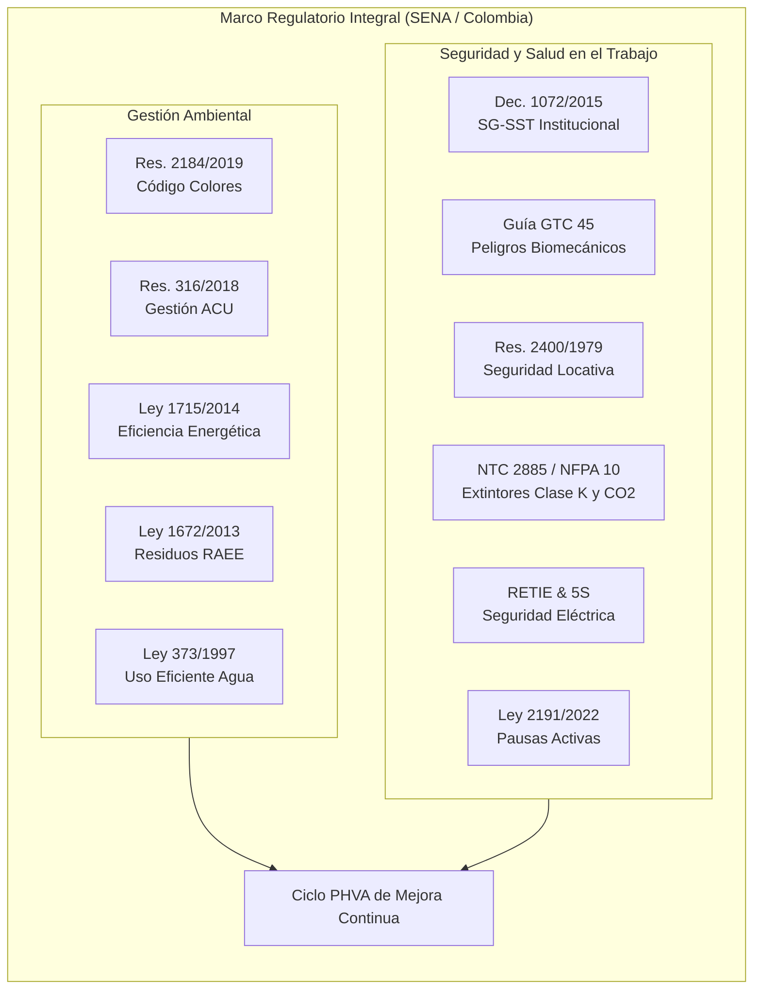
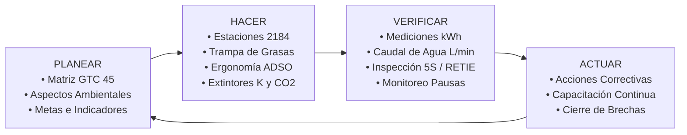

# INFORME TÉCNICO Y ACADÉMICO: VIDEO EXPOSITIVO SOBRE OPORTUNIDADES DE MEJORA EN MEDIO AMBIENTE Y SEGURIDAD Y SALUD EN EL TRABAJO (SST)

---

### FICHA DE IDENTIFICACIÓN INSTITUCIONAL
* **Institución Educativa:** Servicio Nacional de Aprendizaje (SENA)
* **Centro de Formación:** Centro de Teleinformática y Producción Industrial (CTPI) — Regional Cauca, Popayán
* **Programa de Formación:** Tecnólogo en Análisis y Desarrollo de Software (ADSO)
* **Código de Programa:** 228118
* **Ficha de Caracterización:** 3186681
* **Fase del Proyecto:** Fase 4 — Evaluación
* **Competencia:** 220601501 — Aplicar prácticas de protección ambiental, seguridad y salud en el trabajo de acuerdo con las políticas organizacionales y el entorno laboral.
* **Resultado de Aprendizaje (RAP):** Proponer acciones de mejora para el manejo ambiental y el control de la SST, de acuerdo con estrategias de trabajo colaborativo, cooperativo y coordinado, en el contexto productivo.
* **Actividad de Aprendizaje:** GA8-220601501-AA4
* **Evidencia:** GA8-220601501-AA4-EV01 — Video expositivo sobre oportunidades de mejora en el medio ambiente y SST.
* **Instrumento de Evaluación:** IE-GA8-220601501-AA4-EV01 (Rúbrica de evaluación)
* **Aprendiz Autora:** Karen Yuliana Campo
* **Lugar y Fecha:** Popayán, Cauca — Noviembre de 2026

---

## 1. Introducción y Justificación

La integración de prácticas sostenibles y protocolos estrictos de Seguridad y Salud en el Trabajo (SST) representa hoy en día una exigencia ineludible para cualquier organización productiva y un pilar fundamental en la formación integral de los profesionales de la tecnología. En el marco del programa Tecnólogo en Análisis y Desarrollo de Software (ADSO), la competencia 220601501 orienta al aprendiz a identificar peligros, evaluar riesgos y formular oportunidades de mejora que trasciendan la teoría y se materialicen en los contextos laborales reales.

El presente informe técnico consolida la evidencia **GA8-220601501-AA4-EV01**, la cual articula la producción de un **video expositivo audiovisual en formato Full HD (1080p)**, un **guion técnico individual de preproducción**, un catálogo estructurado de **10 oportunidades concretas de mejora acompañadas de fotografías reales**, y el despliegue de un **portal web responsive contenedorizado en Docker (Apache HTTPD, puerto 8105)** para su divulgación, consulta e inspección técnica.

La metodología adoptada parte de un **estudio de casos dual**, combinando:
1. **El Entorno de Desarrollo de Software (ADSO):** Caracterizado por labores intensivas frente a Pantallas de Visualización de Datos (PVD), consumo constante de energía eléctrica, generación de Residuos de Aparatos Eléctricos y Electrónicos (RAEE), y factores de riesgo biomecánico y psicosocial (fatiga postural, contracturas cervicales, estrés visual).
2. **El Entorno Gastronómico y Operativo (Pizzería Gourmet Bella Italia de Popayán):** Contexto productivo que demanda manipulación higiénica de materias primas, manejo responsable de aceites de cocina usados (ACU) y residuos orgánicos, así como la mitigación de riesgos locativos (superficies húmedas resbaladizas) y térmicos (hornos de alta temperatura).

Esta doble mirada demuestra que las oportunidades de mejora ambiental y de SST se fundamentan en principios universales de mejora continua bajo el ciclo **PHVA (Planear, Hacer, Verificar, Actuar)**, regulados rigurosamente por el marco legal de la República de Colombia.

---

## 2. Objetivos del Estudio

### 2.1. Objetivo General
Diseñar, formular y exponer de manera audiovisual y documentada diez (10) oportunidades de mejora en gestión ambiental y en Seguridad y Salud en el Trabajo (SST), sustentadas en la normatividad colombiana y el ciclo PHVA, mediante un video expositivo interactivo respaldado por imágenes reales tomadas en contexto productivo.

### 2.2. Objetivos Específicos
1. Estructurar un guion técnico y pedagógico individual que detalle las tres fases audiovisuales (preproducción, producción y postproducción), marcas de tiempo, encuadres y locución vocal.
2. Identificar y justificar cinco (5) oportunidades de mejora en Gestión Ambiental aplicables al entorno tecnológico y comercial: código de colores (Res. 2184/2019), aceites usados (Res. 316/2018), eficiencia energética (Ley 1715/2014), RAEE (Ley 1672/2013) y ahorro hídrico (Ley 373/1997).
3. Identificar y justificar cinco (5) oportunidades de mejora en Seguridad y Salud en el Trabajo (SST): ergonomía antropométrica (GTC 45 / Dec. 1072/2015), pisos antideslizantes (Res. 2400/1979), extintores especializados Clase K y CO2 (NTC 2885), metodología 5S / RETIE y pausas activas (Ley 2191/2022).
4. Generar e incorporar diez (10) fotografías reales y auténticas que representen cada una de las mejoras formuladas.
5. Desarrollar y desplegar un portal web interactivo responsive alojado en un contenedor Docker Apache HTTPD (puerto 8105) con reproductor HTML5, visor de diapositivas, catálogo de fotos reales y dataset JSON.
6. Demostrar la trazabilidad y funcionamiento del sistema mediante capturas de pantalla reales capturadas en el entorno de escritorio KDE Plasma X11.

---

## 3. Marco Normativo y Conceptual Colombiano

### 3.1. Normatividad Ambiental
* **Resolución 2184 de 2019 (Ministerio de Ambiente y Desarrollo Sostenible):** Unifica a nivel nacional el código de colores para la separación de residuos en la fuente:
  - *Blanco:* Residuos aprovechables limpios y secos (plásticos, botellas PET, papel, cartón, metales).
  - *Verde:* Residuos orgánicos biodegradables (restos de alimentos, podas, cáscaras).
  - *Negro:* Residuos no aprovechables (papel higiénico, servilletas usadas, papeles metalizados).
* **Resolución 316 de 2018:** Establece las disposiciones para la gestión de Aceites de Cocina Usados (ACU), prohibiendo terminantemente su vertimiento en redes de alcantarillado u ojos de agua, obligando a los establecimientos generadores a registrarse, almacenar en recipientes rotulados y entregar a gestores con licencia ambiental.
* **Ley 1715 de 2014 y Ley 2099 de 2021:** Promueven el desarrollo de la eficiencia energética, la reducción del consumo pasivo y la adopción de tecnologías limpias como luminarias LED y control domótico.
* **Ley 1672 de 2013:** Fija los lineamientos para la política pública de gestión integral de los Residuos de Aparatos Eléctricos y Electrónicos (RAEE), exigiendo programas de recolección posconsumo y minería urbana.
* **Ley 373 de 1997:** Reglamenta el programa para el uso eficiente y ahorro del agua potable en instalaciones comerciales, institucionales e industriales.

### 3.2. Normatividad en Seguridad y Salud en el Trabajo (SST)
* **Decreto 1072 de 2015 (Decreto Único Reglamentario del Sector Trabajo):** En su Libro 2, Parte 2, Título 4, Capítulo 6, establece las directrices de obligatorio cumplimiento para implementar el Sistema de Gestión de la Seguridad y Salud en el Trabajo (SG-SST) basado en el ciclo PHVA.
* **Guía Técnica Colombiana GTC 45:** Proporciona directrices para la identificación de peligros y la valoración de riesgos, clasificados en biomecánicos, físicos, químicos, biológicos, psicosociales y condiciones de seguridad.
* **Resolución 2400 de 1979 (Estatuto de Seguridad Industrial):** Regula las condiciones de higiene y seguridad en los establecimientos de trabajo, estipulando que pisos y escaleras deben ser antideslizantes, contar con pasamanos continuos y estar libres de obstáculos.
* **Norma Técnica Colombiana NTC 2885 / NFPA 10:** Establece los requisitos para la selección, instalación, mantenimiento y prueba de extintores portátiles. Destaca el extintor de acetato de potasio Clase K para fuegos de grasas vegetales y animales, y extintores de CO2 o agentes limpios (Solkaflam) para equipos informáticos energizados.
* **Reglamento Técnico de Instalaciones Eléctricas (RETIE) y Metodología 5S:** Exigen la canalización hermética de cableado y la aplicación de los cinco pasos japoneses: Seiri (Clasificar), Seiton (Ordenar), Seiso (Limpiar), Seiketsu (Estandarizar) y Shitsuke (Disciplina).
* **Ley 2191 de 2022:** Regula la desconexión laboral y garantiza el derecho de los trabajadores a periodos de descanso activo y pausas saludables para combatir la fatiga neuromuscular.

---

## 4. Las 10 Oportunidades de Mejora Demostradas con Fotografías Reales

| ID | Pilar | Oportunidad de Mejora | Marco Legal | Acciones Operativas Clave | Meta / Indicador |
| :--- | :--- | :--- | :--- | :--- | :--- |
| **OM-AMB-01** | Gestión Ambiental | **Separación en la fuente con código unificado de colores** | Res. 2184 de 2019 | Batería de 3 canecas (Blanco, Verde, Negro). Convenio con recicladores de Popayán y capacitación continua. | Aprovechamiento > 65% de residuos generados. |
| **OM-AMB-02** | Gestión Ambiental | **Trampa de grasas y recolección certificada de ACU** | Res. 316 de 2018 | Instalación de trampa de retención inox en línea de pozuelos. Bidones rotulados y entrega mensual para biodiesel. | 100% de ACU recolectado sin vertimiento a alcantarillado. |
| **OM-AMB-03** | Gestión Ambiental | **Eficiencia energética con luminarias LED y sensores PIR** | Leyes 1715/2014 & 2099/2021 | Paneles LED de 18W, sensores de presencia infrarrojos y suspensión automática de pantallas tras 10 min. | Reducción del 25% en consumo mensual de kWh. |
| **OM-AMB-04** | Gestión Ambiental | **Gestión integral posconsumo de RAEE** | Ley 1672 de 2013 | Contenedor especializado para hardware, memorias y fuentes. Logística inversa para reciclaje de metales pesados. | Cero kg de desechos informáticos en basura común. |
| **OM-AMB-05** | Gestión Ambiental | **Uso eficiente del agua con aireadores y control de fugas** | Ley 373 de 1997 | Instalación de aireadores de 4.5 L/min en griferías y monitoreo nocturno de hidrómetros para detección de fugas. | Ahorro del 40% en volumen mensual de agua potable. |
| **OM-SST-06** | Seguridad y Salud | **Ergonomía antropométrica del puesto ADSO** | GTC 45 / Dec. 1072/2015 | Pantallas a la altura de los ojos, sillas con apoyo lumbar y descansapiés que aseguran ángulo de 90° en codos/rodillas. | 100% de puestos evaluados con nivel de riesgo aceptable. |
| **OM-SST-07** | Seguridad y Salud | **Adecuación locativa de escaleras y pisos antideslizantes** | Res. 2400 de 1979 | Cintas de carborundo fotoluminiscente en peldaños, pasamanos dobles a 90 cm y pisos rugosos en zonas húmedas. | Cero caídas o resbalones registrados en la vigencia. |
| **OM-SST-08** | Seguridad y Salud | **Extintores especializados Clase K (cocina) y CO2 (servidores)** | NTC 2885 / NFPA 10 | Extintores de acetato de potasio para saponificación de grasas y agentes limpios que no dañan racks electrónicos. | 100% de extintores vigentes y brigada entrenada. |
| **OM-SST-09** | Seguridad y Salud | **Metodología 5S y canalización de cableado RETIE** | RETIE & Metodología 5S | Canaletas perimetrales ignífugas en PVC ranurado, peinado vertical en racks y despeje de pasillos de evacuación. | Índice 5S > 90 puntos en auditoría mensual. |
| **OM-SST-10** | Seguridad y Salud | **Programa de pausas activas e higiene postural** | Ley 2191 de 2022 | Dos pausas diarias obligatorias de 10 min (10:00 am y 3:30 pm), estiramientos guiados y técnica visual 20-20-20. | Participación del 100% de aprendices y desarrolladores. |

---

## 5. Especificaciones Audiovisuales y Ficha Técnica del Video

El video expositivo fue estructurado y procesado mediante un pipeline automatizado de postproducción audiovisual digital:
* **Título Oficial:** *Oportunidades de Mejora en Medio Ambiente y Seguridad y Salud en el Trabajo (SST) en el Contexto Productivo*.
* **Resolución de Video:** 1920 × 1080 píxeles (Full HD 1080p nativo progresivo).
* **Relación de Aspecto:** 16:9 widescreen estándar.
* **Cuadros por Segundo:** 30 fps progresivo (H.264 / MPEG-4 AVC High Profile).
* **Duración Total:** 07 minutos y 52 segundos (472.08 segundos distribuidos en 12 diapositivas temáticas).
* **Audio y Masterización:** Pista vocal prioritaria normalizada con ducking dinámico (`sidechaincompress`), atenuando automáticamente la cama musical ambiental en -20 dB durante la presencia de locución.
* **Software de Edición:** FilmCraft CLI y suite Docker FFmpeg 8.1.3 Alpine.
* **Archivo de Proyecto:** `video/ExposicionSSTyMedioAmbiente.fcproj`.

---

## 6. Evidencias del Despliegue Tecnológico y Capturas en KDE Plasma X11

A continuación se presentan las seis (6) capturas de pantalla reales capturadas directamente en el entorno de escritorio **KDE Plasma X11**, demostrando la operatividad de los contenedores Docker, la disponibilidad de los servicios en el puerto **8105** y la interacción con el portal web:

### Captura 1: Despliegue del Servicio Docker en Puerto 8105
Despliegue del contenedor `sena-sst-ambiental-web` sobre imagen `httpd:alpine` en el puerto `8105:80`, verificación del archivo de video MP4 y las 10 imágenes reales:

### Captura 2: Verificación de Salud HTTP 200 y Streaming de Video
Comprobación mediante `curl -I` del estado HTTP 200 OK del servidor web, streaming del video MP4 y consulta de los metadatos JSON:

### Captura 3: Navegador Google Chrome con Portal Web y Reproductor de Video
Vista principal del portal interactivo con reproductor HTML5, ficha técnica y métricas KPI:

### Captura 4: Galería Interactiva de las 10 Mejoras con Fotos Reales
Visualización del catálogo responsive con las 10 tarjetas técnicas que incorporan las fotografías auténticas de cada mejora ambiental y de SST:

### Captura 5: Visor del Guion Técnico Completo a Dos Columnas
Pestaña del guion técnico que muestra los 12 bloques audiovisuales, marcas de tiempo, encuadres y el texto completo de locución:

### Captura 6: Dashboard del Ciclo PHVA y Articulación con los ODS
Visualización del marco metodológico PHVA bajo el Decreto 1072 de 2015 y la alineación con los Objetivos de Desarrollo Sostenible (ODS 3, 6, 7, 8 y 12):

---

## 7. Articulación con el Ciclo PHVA y Objetivos de Desarrollo Sostenible (ODS)

La implementación de estas diez oportunidades trasciende el mero cumplimiento normativo y se articula como un engranaje estratégico de mejora continua:

1. **ODS 3 (Salud y Bienestar):** Garantizado a través de la adecuación antropométrica del puesto de trabajo para desarrolladores de software y la institucionalización de pausas activas osteomusculares, combatiendo el sedentarismo y las lesiones por esfuerzo repetitivo.
2. **ODS 6 (Agua Limpia y Saneamiento):** Protegido mediante la retención y entrega certificada de aceites de cocina usados (ACU) y la reducción del 40% del caudal de agua potable mediante difusores aireadores.
3. **ODS 7 (Energía Asequible y No Contaminante):** Impulsado por el uso de luminarias LED, sensores de movimiento infrarrojos y políticas automáticas de suspensión de pantallas y equipos de cómputo.
4. **ODS 8 (Trabajo Decente y Crecimiento Económico):** Garantizado mediante ambientes locativos seguros, libres de riesgos de caída (pisos y gradas antideslizantes), cableado seguro bajo norma RETIE y estaciones contra incendios idóneas.
5. **ODS 12 (Producción y Consumo Responsables):** Fomentado mediante el código unificado de colores para reciclaje en la fuente y la gestión posconsumo de residuos electrónicos RAEE.

---

## 8. Conclusiones y Recomendaciones

1. **Viabilidad Técnica y Operativa:** Las diez oportunidades de mejora planteadas demuestran ser totalmente viables y de alto impacto tanto en entornos tecnológicos de desarrollo de software como en contextos comerciales y gastronómicos.
2. **Cultura de Prevención sobre Corrección:** La adopción del ciclo PHVA y las normas colombianas (Res. 2184/2019, Res. 316/2018, Dec. 1072/2015, GTC 45) permite anticipar y mitigar los factores de riesgo antes de que se transformen en enfermedades laborales, accidentes o daños ambientales irreversibles.
3. **Rol del Tecnólogo en Software:** Como futuros tecnólogos en ADSO, el compromiso ético abarca no solo escribir código de alta calidad, sino diseñar soluciones de software ergonómicas, eficientes energéticamente y respetuosas con el entorno humano y natural de nuestra comunidad.
4. **Disponibilidad Abierta y Multiplataforma:** La contenerización en Docker en el puerto 8105 asegura la portabilidad y accesibilidad inmediata para evaluación académica por parte de los instructores del SENA CTPI.

---

## 9. Referencias Bibliográficas (Normas APA 7ma Edición)

* Congreso de la República de Colombia. (1997, 6 de junio). *Ley 373 de 1997: Por la cual se establece el programa para el uso eficiente y ahorro del agua*. Diario Oficial No. 43.058.
* Congreso de la República de Colombia. (2013, 19 de julio). *Ley 1672 de 2013: Por la cual se establecen los lineamientos para la adopción de una política pública de gestión integral de Residuos de Aparatos Eléctricos y Electrónicos (RAEE)*. Diario Oficial No. 48.856.
* Congreso de la República de Colombia. (2014, 13 de mayo). *Ley 1715 de 2014: Por medio de la cual se regula la integración de las energías renovables no convencionales al Sistema Energético Nacional*. Diario Oficial No. 49.150.
* Congreso de la República de Colombia. (2022, 6 de enero). *Ley 2191 de 2022: Por medio de la cual se regula la desconexión laboral*. Diario Oficial No. 51.909.
* Instituto Colombiano de Normas Técnicas y Certificación [ICONTEC]. (2012). *Guía Técnica Colombiana GTC 45: Guía para la identificación de los peligros y la valoración de los riesgos en seguridad y salud ocupacional*. ICONTEC.
* Instituto Colombiano de Normas Técnicas y Certificación [ICONTEC]. (2017). *Norma Técnica Colombiana NTC 2885: Extintores de fuego portátiles*. ICONTEC.
* Ministerio de Ambiente y Desarrollo Sostenible. (2018, 1 de marzo). *Resolución 316 de 2018: Por la cual se establecen las disposiciones para la adecuada gestión de los Aceites de Cocina Usados (ACU)*. MinAmbiente.
* Ministerio de Ambiente y Desarrollo Sostenible. (2019, 26 de diciembre). *Resolución 2184 de 2019: Por la cual se modifica la Resolución 668 de 2016 sobre uso racional de bolsas plásticas y se adoptan otras disposiciones*. MinAmbiente.
* Ministerio de Minas y Energía. (2013). *Reglamento Técnico de Instalaciones Eléctricas (RETIE)*. Resolución 90708 de 2013.
* Ministerio del Trabajo. (1979, 22 de mayo). *Resolución 2400 de 1979: Por la cual se establecen algunas disposiciones sobre vivienda, higiene y seguridad en los establecimientos de trabajo*. Diario Oficial No. 35.304.
* Ministerio del Trabajo. (2015, 26 de mayo). *Decreto 1072 de 2015: Por medio del cual se expide el Decreto Único Reglamentario del Sector Trabajo*. Presidencia de la República de Colombia.
* Servicio Nacional de Aprendizaje [SENA]. (2024). *Guía de Aprendizaje No. 8: Programa Tecnólogo en Análisis y Desarrollo de Software*. Centro de Teleinformática y Producción Industrial (CTPI), Regional Cauca.
