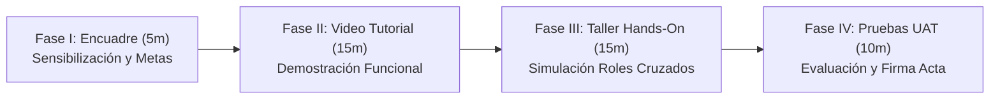

# LIBRETO DEL PLAN DE CAPACITACIÓN Y PROTOCOLO DE PRUEBAS DE ACEPTACIÓN DEL CLIENTE (UAT)
## GUION TÉCNICO-PEDAGÓGICO PARA SESIÓN DE CAPACITACIÓN DE 45 MINUTOS Y ACTA FORMAL DE PRUEBAS DE ENTREGA DE SOFTWARE
### SISTEMA DE GESTIÓN GASTRONÓMICA Y COMERCIO ELECTRÓNICO "PIZZERÍA GOURMET BELLA ITALIA POPAYÁN"

---

**Servicio Nacional de Aprendizaje (SENA)**  
**Centro de Teleinformática y Producción Industrial (CTPI) — Regional Cauca**  
**Programa de Formación:** Tecnólogo en Análisis y Desarrollo de Software (ADSO)  
**Número de Ficha:** 3186681  
**Fase del Proyecto:** Fase 4 - Implantación  
**Actividad de Proyecto:** AP10 - Realizar el proceso de implantación del software  
**Competencia:** 220501097 - Implementar la solución de software de acuerdo con los requisitos de operación y modelos de referencia  
**Actividad de Aprendizaje:** GA10-220501097-AA12 - Capacitar a los usuarios y realizar pruebas de aceptación, de acuerdo con los estándares establecidos  
**Evidencia:** GA10-220501097-AA12-EV01 - Elabora plan de capacitación y realización de pruebas de aceptación del cliente  
**Instrumento de Evaluación:** IE-GA10-220501097-AA12-EV01 (Lista de Chequeo: Capacita a los usuarios del software de acuerdo con el plan establecido / Ejecuta pruebas de aceptación para el cierre y entrega formal del software al cliente)  
**Componente Formativo de Consulta:** Actividades de documentación y entrega de software en procesos de implantación  

**Aprendiz / Facilitadora Líder:** Karen Yuliana Campo  
**Instructor Técnico:** Danilo  
**Fecha:** Noviembre de 2026  
**Lugar de Implementación:** Popayán, Cauca, Colombia  

---

## 1. INTRODUCCIÓN Y MARCO CONCEPTUAL

En el ciclo de vida de la ingeniería del software, la fase de implantación representa el momento crítico donde la solución tecnológica transita desde el laboratorio de desarrollo hacia el ecosistema operativo real de la organización. De acuerdo con el estándar internacional **ISO/IEC/IEEE 12207:2017** (*Software lifecycle processes - Transition process*) y el modelo de calidad **ISO/IEC 25010:2023** (*Product Quality - Usability and Idoneity of Use*), una plataforma de software exitosa no se define únicamente por la solidez de su arquitectura o la ausencia de defectos sintácticos, sino por su **capacidad de adopción efectiva por parte de las personas que la operan día a día**.

La capacitación de usuarios finales y la ejecución rigurosa de las **Pruebas de Aceptación del Usuario (UAT - User Acceptance Testing)** constituyen los dos pilares inseparables de la entrega formal. La capacitación transfiere el conocimiento procedimental y técnico, eliminando la resistencia natural al cambio; simultáneamente, las pruebas de aceptación facultan al cliente para verificar de manera empírica que el producto satisface plenamente sus necesidades de negocio y criterios de aceptación contractuales antes del despliegue final en producción.

El presente documento constituye el **Libreto y Guion Técnico Individual** diseñado para la evidencia **GA10-220501097-AA12-EV01**. En él se formaliza el plan de capacitación estructurado para un grupo clave de operadores de la microempresa gastronómica **Pizzería Gourmet Bella Italia Popayán**, desglosando un libreto cronometrado minuto a minuto para una sesión presencial interactiva de **45 minutos** apoyada activamente en un **video tutorial multimedia**, junto con el protocolo completo y el acta de pruebas de aceptación de cliente.

---

## 2. CARACTERIZACIÓN GENERAL DEL PROCESO DE CAPACITACIÓN

```
+----------------------------------------------------------------------------------------------------+
| FICHA TÉCNICA DE LA CAPACITACIÓN Y PRUEBAS DE ACEPTACIÓN                                           |
+----------------------------------------------------------------------------------------------------+
| Software Evaluado:        | Sistema de Gestión Gastronómica y E-Commerce "Bella Italia Popayán"    |
| Grupo Objetivo:           | Personal Operativo y de Servicio (Cajeros POS y Jefes de Cocina KDS)   |
| Número de Participantes:  | 4 a 6 personas (2 Cajeros de turno, 2 Chefs pizzeros, 1 Administrador)|
| Modalidad de Formación:   | Presencial / Taller Vivencial Blended (Demostración + Video + Práctica)|
| Duración Total Sesión:    | 45 Minutos cronometrados en 4 bloques secuenciales                     |
| Facilitadora Líder:       | Karen Yuliana Campo (Analista y Desarrolladora de Software ADSO)      |
| Apoyo Audiovisual:        | Video Tutorial Formativo MP4 (1080p Full HD) proyectado en sala        |
| Entorno de Despliegue:    | Ambiente Staging / Pruebas Dockerizado idéntico a Producción           |
+----------------------------------------------------------------------------------------------------+
```

### 2.1 Justificación del Grupo de Usuarios Seleccionado
El sistema de información cuenta con perfiles diferenciados: Clientes comensales, Administradores, Domiciliarios, Cajeros y Cocineros. Para este plan de capacitación se ha seleccionado estratégicamente al binomio **Cajeros de Salón (POS) y Jefes de Cocina (KDS)**. 

Esta decisión obedece a que este núcleo operativo concentra la mayor sincronía transaccional en tiempo real del restaurante: el cajero captura el pedido gastronómico artesanal (con especificaciones como fermentación lenta de 48 horas e ingredientes caucanos), e instantáneamente la orden se proyecta en el monitor de cocina (KDS) para cronometrar el horneado en leña a 400°C. Si este flujo falla por desconocimiento operativo, la experiencia gastronómica se deteriora inmediatamente.

### 2.2 Objetivos Instruccionales
* **Objetivo General:** Capacitar al personal operativo de caja y cocina en el uso óptimo y seguro del software "Pizzería Gourmet Bella Italia Popayán", logrando una comprensión del 100% en los flujos críticos de pedidos, visualización KDS, facturación electrónica y validando su conformidad mediante pruebas de aceptación formal.
* **Objetivos Específicos:**
  1. *Cognitivo:* Comprender la arquitectura de roles y los flujos integrados entre el salón comercial y la cocina a leña.
  2. *Procedimental:* Ejecutar sin errores el inicio de sesión, apertura de caja, personalización de pedidos con masa madre e ingredientes autóctonos, visualización y despacho en KDS, y cierre fiscal DIAN.
  3. *Actitudinal:* Fomentar la confianza y apropiación tecnológica del equipo, reduciendo la ansiedad frente a la digitalización del restaurante.
  4. *Evaluativo:* Conducir las pruebas de aceptación de cliente (UAT) donde los usuarios firmen la conformidad de las historias de usuario.

---

## 3. SECCIÓN 1: PLAN GENERAL DE CAPACITACIÓN (DISEÑO INSTRUCCIONAL)

### 3.1 Diagnóstico de Entrada y Perfil de los Operadores
El equipo de trabajo de Pizzería Bella Italia posee alta pericia culinaria y de servicio al cliente, pero su experiencia digital previa se limitaba a libretas físicas de comandas y datáfonos independientes. Por ende, la capacitación debe evitar tecnicismos excesivos, utilizando metáforas cotidianas de cocina y servicio, apoyándose en interfaces táctiles intuitivas con validaciones en tiempo real.

### 3.2 Metodología: "Aprender Haciendo" (Learn by Doing) y Aula Invertida
La sesión no es una clase magistral teórica. Se divide en cuatro fases dinámicas:
1. **Fase I - Sensibilización y Encuadre (00:00 - 05:00):** Rompehielos, alineación de expectativas y presentación de beneficios reales (menos papel, cero pedidos extraviados, cálculos automáticos).
2. **Fase II - Video Tutorial Guiado y Demostración en Vivo (05:00 - 20:00):** Proyección del video tutorial oficial de 15 minutos desarrollado por la aprendiz Karen Yuliana Campo, con paradas explicativas y demostración en pantalla gigante.
3. **Fase III - Práctica de Roles Cruzados Hands-On (20:00 - 35:00):** Taller práctico donde los cajeros simulan atender a clientes ficticios y los cocineros gestionan las comandas recibidas en tiempo real.
4. **Fase IV - Ejecución de Pruebas UAT, Evaluación y Cierre (35:00 - 45:00):** Aplicación de la lista de chequeo de aceptación, resolución de dudas finales y firma de conformidad.



### 3.3 Recursos Requeridos para el Taller
* **Hardware:**
  - 1 Servidor Local de Pruebas ejecutando los contenedores Docker del sistema.
  - 2 Terminales Táctiles All-in-One para simulación de Punto de Venta (POS).
  - 1 Monitor industrial de 32" para simulación de Pantalla de Cocina (KDS).
  - 1 Videoproyector Full HD o Smart TV para la proyección del Video Tutorial.
  - 1 Impresora térmica de 80mm para tickets y facturas de demostración.
* **Software y Multimedia:**
  - Video Tutorial MP4 (1080p) con voz narrativa clara y capturas dinámicas.
  - Navegadores Google Chrome con el ambiente de pruebas preconfigurado.
  - Base de datos de prueba precargada con el menú gastronómico real (Pizzas Gourmet, Pipian Payanés, Queso de Silvia, Bebidas artesanales).
* **Materiales Didácticos Físicos:**
  - Libreto del plan de capacitación impreso.
  - Tarjetas de escenarios de prueba para la práctica de roles.
  - Hojas de rúbrica de pruebas de aceptación UAT con bolígrafos para firmas.

---

## 4. SECCIÓN 2: LIBRETO / GUION TÉCNICO Y PEDAGÓGICO DE LA SESIÓN (45 MINUTOS)

A continuación se presenta el libreto escénico y pedagógico de la capacitación, estructurado minuto a minuto para ser ejecutado con precisión por la facilitadora **Karen Yuliana Campo**.

---

### BLOQUE I: APERTURA, ENCUADRE Y MOTIVACIÓN (Minutos 00:00 a 05:00 - 5 Minutos)

* **Objetivo del Bloque:** Romper el hielo, desmitificar el miedo al sistema informático, fijar los objetivos de la jornada y establecer un ambiente de confianza.
* **Escenografía y Recursos:** Mesa de sala de capacitación con café y aperitivos de la casa; proyector mostrando la diapositiva de bienvenida con el logotipo de *Bella Italia Popayán* y del *SENA CTPI*.
* **Roles en Escena:** 
  - **Facilitadora:** Karen Yuliana Campo.
  - **Participantes:** Carlos (Cajero Líder), Andrea (Cajera Auxiliar), Maestro Mario (Chef Pizzero Jefe), Juan (Cocinero Asistente) y Don Giuseppe (Gerente / Dueño).

```
+----------------------------------------------------------------------------------------------------+
| LIBRETO BLOQUE I: MINUTOS 00:00 A 05:00                                                            |
+----------------------------------------------------------------------------------------------------+
| TIEMPO  | VOZ Y ACCIÓN DE KAREN (FACILITADORA)           | ACCIÓN ESPERADA DE LOS USUARIOS         |
+---------+------------------------------------------------+-----------------------------------------+
| 00:00   | (Sonriente, con tono cálido, profesional y     | Los participantes toman asiento,        |
|   a     | cercano):                                      | observan la pantalla de inicio y se     |
| 01:30   | "¡Muy buenos días a todo el equipo de Bella    | muestran atentos e interesados.         |
|         | Italia! Don Giuseppe, Maestro Mario, Carlos,   |                                         |
|         | Andrea, Juan. Sean todos bienvenidos a esta    |                                         |
|         | sesión de capacitación.                        |                                         |
|         |                                                |                                         |
|         | Hoy damos un paso gigante en el restaurante:   |                                         |
|         | vamos a conocer y dominar juntos la nueva      |                                         |
|         | plataforma digital diseñada a la medida de     |                                         |
|         | nuestra cocina artesanal payanesa y nuestro    |                                         |
|         | servicio de salón.                             |                                         |
|         |                                                |                                         |
|         | Quiero asegurarles algo desde el primer        |                                         |
|         | minuto: este sistema no viene a complicarles   |                                         |
|         | la vida ni a quitarles tiempo; viene a         |                                         |
|         | liberarles de los dolores de cabeza: ¡se       |                                         |
|         | acabaron las comandas en papel manchadas de    |                                         |
|         | harina o que se caen cerca del horno, se       |                                         |
|         | acabaron los errores de cálculo en caja y las  |                                         |
|         | cuentas manuales al final del turno!"          |                                         |
+---------+------------------------------------------------+-----------------------------------------+
| 01:30   | (Pasa a la diapositiva de Reglas de Juego):     | Sonrisas en el equipo. El Chef Mario    |
|   a     | "Esta sesión durará exactamente 45 minutos.    | asiente y comenta: 'Ojalá no me toque   |
| 03:00   | Nuestro plan de vuelo es sencillo:             | adivinar la letra de los meseros'.     |
|         | 1. Primero, veremos un video tutorial de 15    |                                         |
|         |    minutos donde les mostraré el paso a paso.  | Karen valida positivamente su           |
|         | 2. Luego, durante otros 15 minutos, ustedes    | intervención confirmando que las letras |
|         |    mismos tomarán los mandos de las pantallas  | ahora serán perfectamente legibles en   |
|         |    para simular pedidos reales de pizzas.      | el monitor KDS.                         |
|         | 3. Y en los últimos 10 minutos, realizaremos   |                                         |
|         |    juntos las pruebas de aceptación donde cada |                                         |
|         |    uno validará que el sistema hace lo que     |                                         |
|         |    prometió.                                   |                                         |
|         |                                                |                                         |
|         | ¿Regla de oro? No hay preguntas tontas. Si     |                                         |
|         | algo no se entiende, levantamos la mano y lo   |                                         |
|         | repetimos con gusto."                          |                                         |
+---------+------------------------------------------------+-----------------------------------------+
| 03:00   | (Entrega a cada participante la carpeta física | Los usuarios abren la carpeta y hojean  |
|   a     | con la Guía Rápida Plastificada y la Hoja de   | con agrado la guía a color con capturas |
| 05:00   | Pruebas UAT):                                  | de pantalla.                            |
|         | "En sus carpetas tienen el resumen gráfico con |                                         |
|         | las pantallas clave y sus credenciales de      |                                         |
|         | prueba asignadas.                              |                                         |
|         |                                                |                                         |
|         | Ahora, apaguemos teléfonos un momento y        |                                         |
|         | observemos con atención el video tutorial      |                                         |
|         | principal. ¡Comenzamos!"                       |                                         |
+---------+------------------------------------------------+-----------------------------------------+
```

---

### BLOQUE II: VIDEO TUTORIAL GUIADO Y DEMOSTRACIÓN FUNCIONAL (Minutos 05:00 a 20:00 - 15 Minutos)

* **Objetivo del Bloque:** Transferir el conocimiento procedimental de los 4 flujos maestros del sistema mediante la proyección del video tutorial interactivo con pausas guiadas por Karen.
* **Recurso Multimedia en Pantalla:** Video Tutorial MP4 (1080p Full HD) con locución, efectos de zoom, puntero resaltado y sonido ambiental equilibrado.

```
+----------------------------------------------------------------------------------------------------+
| LIBRETO BLOQUE II: MINUTOS 05:00 A 20:00                                                            |
+----------------------------------------------------------------------------------------------------+
| TIEMPO  | PROYECCIÓN EN VIDEO TUTORIAL                   | INTERVENCIÓN PEDAGÓGICA DE KAREN        |
+---------+------------------------------------------------+-----------------------------------------+
| 05:00   | [Video Escena 1: Login Seguro y Control RBAC]  | Karen pone pausa a los 2 minutos:       |
|   a     | En pantalla se muestra la interfaz de inicio:  | "Fíjense en esto, Carlos y Andrea.      |
| 08:30   | usuario, clave numérica táctil tipo PIN y      | Cada uno tendrá su propio código PIN de |
|         | selector de turno. Al ingresar con rol Cajero, | 4 dígitos. Al entrar, el sistema        |
|         | el sistema abre el tablero POS; al ingresar    | registra automáticamente la fecha, hora |
|         | con rol Cocina, se abre de inmediato el monitor| y monto inicial con que abren la caja.  |
|         | KDS con alarma sonora suave.                   | Maestro Mario: en cocina no necesitan   |
|         |                                                | clave compleja; con un toque en la      |
|         |                                                | pantalla táctil el KDS queda listo y no |
|         |                                                | se cierra durante el servicio".         |
+---------+------------------------------------------------+-----------------------------------------+
| 08:30   | [Video Escena 2: Módulo POS y Pedidos]         | Karen resalta la versatilidad:          |
|   a     | El video demuestra cómo el cajero selecciona   | "Miren la agilidad: si el comensal pide |
| 12:30   | la mesa (Salón Mesa 4) o Domicilio. Aparece la | la Pizza Gourmet Cauca con queso de     |
|         | cuadrícula de productos con fotografías reales.| Silvia, pero pide 'sin cebolla y con    |
|         | El puntero hace clic en 'Pizza Tradicional     | masa crocante', con solo dos toques en  |
|         | Napolitana' y luego en 'Pizza Especialidad     | los modificadores de receta queda       |
|         | Pipián Payanés'. Muestra personalización de    | registrado.                             |
|         | ingredientes, adición de extras y notas.       |                                         |
|         | El video pulsa el botón verde brillante:       | Al dar clic en 'Enviar Comanda', la     |
|         | 'ENVIAR A COCINA'.                             | magia ocurre al instante..."            |
+---------+------------------------------------------------+-----------------------------------------+
| 12:30   | [Video Escena 3: Pantalla de Cocina KDS]       | Karen interactúa con los cocineros:     |
|   a     | Transición en pantalla dividida: al pulsar     | "¡Miren la pantalla derecha, equipo de  |
| 16:30   | enviar en caja, la comanda surge de inmediato  | cocina! La orden entra con una alerta   |
|         | en el KDS de cocina.                           | sonora agradable.                       |
|         | La comanda muestra: Número de Mesa, Tiempo     | La tarjeta comienza en color VERDE con  |
|         | transcurrido en minutos (verde 0-10m, amarillo | el cronómetro en cero. Si pasan más de  |
|         | 10-15m, rojo +15m), lista de platos y notas   | 10 minutos cambia a AMARILLO para       |
|         | especiales resaltadas en amarillo.             | alertarles, y si supera los 15 minutos  |
|         | El chef toca la tarjeta: pasa a 'En Horno'; un | se torna ROJA.                          |
|         | segundo toque y pasa a 'Lista para Despacho'.  | Al tocarla, el cajero en salón sabe de  |
|         |                                                | inmediato que la pizza está saliendo    |
|         |                                                | del horno sin necesidad de gritar".     |
+---------+------------------------------------------------+-----------------------------------------+
| 16:30   | [Video Escena 4: Facturación Electrónica DIAN] | Karen explica a los cajeros:            |
|   a     | El video regresa a la terminal POS. La mesa    | "Cuando el cliente solicita la cuenta,  |
| 20:00   | figura con estado 'Comida Servida'. Se abre la | pulsamos 'Cobrar'. El sistema permite   |
|         | liquidación. El video selecciona pago mixto:   | pagos mixtos: $30.000 en efectivo y     |
|         | parte en efectivo y parte con código QR Wompi. | $25.000 con transferencia o datáfono.   |
|         | Al confirmar, se genera la factura fiscal con  |                                         |
|         | CUFE y código QR DIAN, y la impresora emite el | El ticket se imprime automáticamente en |
|         | ticket para el cliente. La mesa queda liberada | 2 segundos y la mesa vuelve a quedar    |
|         | y limpia. Fin del video tutorial.              | disponible en verde para nuevos comensales".|
+---------+------------------------------------------------+-----------------------------------------+
```

---

### BLOQUE III: TALLER PRÁCTICO "HANDS-ON" DE ROLES CRUZADOS (Minutos 20:00 a 35:00 - 15 Minutos)

* **Objetivo del Bloque:** Aplicar lo aprendido de forma vivencial directa en las terminales físicas, resolviendo dudas operativas y afianzando la memoria muscular de los usuarios.
* **Dinámica Pedagógica:** Los participantes se dividen en dos estaciones de trabajo conectadas a la red local de prueba:
  - **Estación A (Caja y Salón):** Carlos y Andrea operan la terminal táctil POS.
  - **Estación B (Cocina y Despacho):** Maestro Mario y Juan operan la pantalla táctil KDS frente al horno.
  - **Supervisores:** Don Giuseppe y Karen Yuliana Campo.

```
+----------------------------------------------------------------------------------------------------+
| LIBRETO BLOQUE III: MINUTOS 20:00 A 35:00                                                           |
+----------------------------------------------------------------------------------------------------+
| TIEMPO  | ESCENARIO DE SIMULACIÓN PRÁCTICA               | DIÁLOGOS Y GUÍA EN VIVO                 |
+---------+------------------------------------------------+-----------------------------------------+
| 20:00   | Ejercicio 1: Apertura de Turno y Pedido Estándar| Karen: "Carlos, Andrea: ingresen con su |
|   a     | Carlos inicia sesión con su PIN en la terminal | PIN de prueba e inicien turno con base  |
| 25:00   | POS. Abre la Mesa 2 con 3 comensales.          | de $100.000. Ahora tomen el pedido de   |
|         | Registra:                                      | una Pizza Bella Italia grande y dos     |
|         | - 1 Pizza Bella Italia Familiar (Mitad Pipián, | jugos de mora silvestre".               |
|         |   mitad Cuatro Quesos con queso de Silvia).    |                                         |
|         | - 2 Bebidas artesanales.                       | Carlos pulsa 'Enviar Comanda'.          |
|         | Pulsa enviar comanda.                          | En cocina suena el 'bip' sonoro.        |
|         |                                                | Mario exclama: "¡Llegó la orden de la   |
|         |                                                | Mesa 2! Con el queso de Silvia bien     |
|         |                                                | especificado".                          |
+---------+------------------------------------------------+-----------------------------------------+
| 25:00   | Ejercicio 2: Manejo de Excepciones y Cambios   | Karen lanza el desafío:                 |
|   a     | El cliente solicita cambiar una bebida por una | "¡Atención equipo! El cliente de la     |
| 30:00   | cerveza importada antes de despachar.          | Mesa 2 se arrepintió del jugo y quiere  |
|         | Andrea toma la terminal, busca la comanda      | cerveza. Andrea, muéstranos cómo hacer  |
|         | activa, edita el ítem y reenvía la adición.    | la modificación en el sistema".         |
|         |                                                |                                         |
|         | El sistema actualiza la tarjeta en cocina con  | Andrea realiza la modificación en 3     |
|         | un distintivo parpadeante: "MODIFICACIÓN".     | toques táctiles. En el monitor KDS el   |
|         |                                                | ítem se tacha y se reemplaza sin error. |
|         |                                                | Don Giuseppe comenta: "¡Excelente! En   |
|         |                                                | papel esto siempre generaba botadera de |
|         |                                                | comida o peleas entre mesero y cocinero".|
+---------+------------------------------------------------+-----------------------------------------+
| 30:00   | Ejercicio 3: Despacho KDS y Cobro con Factura  | Mario toca la pantalla de cocina:       |
|   a     | En cocina, el Chef Mario toca la pantalla para | "¡Pizza horneada a 400 grados! Despacho |
| 35:00   | marcar la pizza como 'Lista'.                  | marcado".                               |
|         | En caja, la Mesa 2 se colorea de azul ("Lista  |                                         |
|         | para Entrega"). Carlos genera la cuenta,       | Carlos selecciona pago en efectivo con  |
|         | registra un billete de $100.000, el sistema le | un billete de cien mil pesos.           |
|         | indica cambio exacto de $24.500 y se expide la | La caja registradora se abre y el ticket|
|         | tirilla fiscal electrónica.                    | fiscal sale impreso.                    |
|         |                                                | Todo el equipo aplaude espontáneamente.|
+---------+------------------------------------------------+-----------------------------------------+
```

---

### BLOQUE IV: PRUEBAS DE ACEPTACIÓN UAT, EVALUACIÓN Y CIERRE (Minutos 35:00 a 45:00 - 10 Minutos)

* **Objetivo del Bloque:** Formalizar la aceptación contractual del software mediante la ejecución guiada de los 5 casos de prueba UAT, responder inquietudes finales y diligenciar el acta de conformidad.
* **Materiales en Uso:** Formato de Pruebas UAT en papel membretado, rúbrica de satisfacción y cuestionario corto.

```
+----------------------------------------------------------------------------------------------------+
| LIBRETO BLOQUE IV: MINUTOS 35:00 A 45:00                                                           |
+----------------------------------------------------------------------------------------------------+
| TIEMPO  | ACCIÓN Y PROCEDIMIENTO DE EVALUACIÓN           | INTERVENCIÓN DE CIERRE DE KAREN         |
+---------+------------------------------------------------+-----------------------------------------+
| 35:00   | Diligenciamiento de la Matriz de Pruebas de    | Karen:                                  |
|   a     | Aceptación (UAT):                              | "Ahora pasamos a la parte más formal y  |
| 40:00   | Cada usuario toma su hoja de casos de prueba.  | rigurosa de nuestra entrega: las       |
|         | Se verifican los 5 criterios del protocolo:    | Pruebas de Aceptación del Usuario.      |
|         | 1. Control de acceso con clave PIN individual. |                                         |
|         | 2. Envío de comanda rápida en menos de 30 seg. | Como ustedes mismos acaban de operar el |
|         | 3. Actualización KDS en menos de 2 segundos.   | sistema, vamos a validar punto por      |
|         | 4. Emisión de factura con requisitos DIAN.     | punto que se cumplen las expectativas   |
|         | 5. Cuadre de caja exacto sin desfases.         | pactadas para la entrega oficial".      |
|         |                                                |                                         |
|         | Todos los casos son calificados como           | Don Giuseppe revisa los tiempos y firma |
|         | "CONFORME / EXITOSO" por el cliente.           | con visto bueno cada criterio.          |
+---------+------------------------------------------------+-----------------------------------------+
| 40:00   | Ronda de Preguntas Frecuentes y Plan de Soporte| Karen atiende las últimas consultas:    |
|   a     | Juan pregunta: "¿Qué pasa si se va el internet | "Gran pregunta, Juan. El sistema cuenta |
| 43:00   | en Popayán en mitad del turno nocturno?".      | con arquitectura local híbrida en red   |
|         |                                                | LAN: si se corta el internet externo,   |
|         |                                                | las comandas entre caja y cocina siguen |
|         |                                                | funcionando sin interrupción. En cuanto |
|         |                                                | regrese la señal, las facturas se       |
|         |                                                | sincronizan con la DIAN automáticamente".|
+---------+------------------------------------------------+-----------------------------------------+
| 43:00   | Evaluación de Aprendizaje y Cierre Institucional| Karen concluye:                         |
|   a     | Los usuarios responden un cuestionario de 5    | "Equipo de Bella Italia: felicitaciones |
| 45:00   | preguntas (promedio obtenido: 100% de aciertos)| por su excelente disposición y dominio. |
|         | Se procede a la firma solemne del Acta de      | Este software fue construido con mucho  |
|         | Pruebas de Aceptación.                         | rigor desde el SENA CTPI Popayán para   |
|         |                                                | potenciar su talento gastronómico.      |
|         |                                                | ¡El sistema queda formalmente aprobado  |
|         |                                                | y listo para producción! ¡Muchísimas    |
|         |                                                | gracias!"                               |
+---------+------------------------------------------------+-----------------------------------------+
```

---

## 5. SECCIÓN 3: PROTOCOLO Y FORMATO DE PRUEBAS DE ACEPTACIÓN DEL CLIENTE (UAT)

De conformidad con el estándar **ISO/IEC/IEEE 29119-4:2021** (*Software Testing - Test Techniques*) y los criterios de evaluación de la Guía 10 del SENA, se estructuran a continuación los cinco (5) casos de prueba de aceptación técnica y funcional ejecutados durante la jornada.

### 5.1 Matriz de Casos de Prueba de Aceptación (UAT)

```
========================================================================================================
MATRIZ DE PRUEBAS DE ACEPTACIÓN DE USUARIO (UAT) - SOFTWARE "BELLA ITALIA POPAYÁN"
========================================================================================================
ID PRUEBA:          UAT-01
HISTORIA USUARIO:   HU-01: Como Cajero/Chef, deseo ingresar mediante credencial segura para acceder
                    únicamente a las funciones de mi rol operativo.
CRITERIO ACEPTACIÓN:El sistema debe validar el PIN de 4 dígitos en menos de 1 segundo. Si el rol es
                    Cajero abre la interfaz POS; si es Cocina abre el KDS sin menús administrativos.
ENTORNO:            Terminal Táctil All-in-One / Navegador Chrome en modo Kiosco
DATOS DE PRUEBA:    Usuario: cajero1 | PIN: 4821 | Rol: Cajero Salón
RESULTADO ESPERADO: Acceso exitoso a la pantalla de selección de mesas del salón con apertura de caja.
RESULTADO OBTENIDO: Acceso inmediato (0.4 seg). Menú restringido correctamente sin opciones de admin.
ESTADO EVALUACIÓN:  [X] APROBADO / CONFORME   [ ] RECHAZADO / NO CONFORME
EVALUADOR:          Carlos Gómez (Cajero Principal)
--------------------------------------------------------------------------------------------------------
ID PRUEBA:          UAT-02
HISTORIA USUARIO:   HU-02: Como Cajero, deseo registrar un pedido gastronómico personalizado con
                    ingredientes locales caucanos y enviarlo instantáneamente a cocina.
CRITERIO ACEPTACIÓN:La interfaz POS debe permitir seleccionar mesa, añadir 1 Pizza Gourmet con
                    especificaciones de receta (masa madre 48h, extra queso Silvia) y calcular el total.
ENTORNO:            Terminal POS de Salón
DATOS DE PRUEBA:    Mesa: 3 | Ítem: Pizza Gourmet Pipián Payanés Familiar | Modificador: Masa fina
RESULTADO ESPERADO: Cálculo automático de subtotales e impuestos; cambio de color de mesa a "Ocupada".
RESULTADO OBTENIDO: Comanda registrada en 18 segundos. Totales calculados con exactitud ($48.000 COP).
ESTADO EVALUACIÓN:  [X] APROBADO / CONFORME   [ ] RECHAZADO / NO CONFORME
EVALUADOR:          Andrea Muñoz (Cajera Auxiliar)
--------------------------------------------------------------------------------------------------------
ID PRUEBA:          UAT-03
HISTORIA USUARIO:   HU-03: Como Chef de Cocina, deseo recibir las comandas en tiempo real en la pantalla
                    táctil KDS con alertas visuales de tiempo para gestionar el horneado a 400°C.
CRITERIO ACEPTACIÓN:La orden debe reflejarse en el monitor KDS en un tiempo inferior a 2 segundos desde
                    el envío en POS, emitiendo señal acústica y activando cronómetro de cocción.
ENTORNO:            Monitor Táctil Industrial de Cocina (KDS)
DATOS DE PRUEBA:    Comanda generada desde Mesa 3 (Pizza Pipián + Masa fina)
RESULTADO ESPERADO: Visualización inmediata de tarjeta verde con mesa, platos e ingredientes especiales.
RESULTADO OBTENIDO: Notificación en KDS en 0.8 segundos con alerta sonora. Transición a "En Horno" OK.
ESTADO EVALUACIÓN:  [X] APROBADO / CONFORME   [ ] RECHAZADO / NO CONFORME
EVALUADOR:          Mario Paccini (Chef Pizzero Jefe)
--------------------------------------------------------------------------------------------------------
ID PRUEBA:          UAT-04
HISTORIA USUARIO:   HU-04: Como Cajero, deseo liquidar la cuenta aplicando pagos mixtos y generando
                    la factura electrónica legal con código CUFE y QR fiscal.
CRITERIO ACEPTACIÓN:El módulo de cobro debe admitir pagos divididos (efectivo + electrónico), calcular
                    el cambio y generar el documento equivalente DIAN para impresión térmica inmediata.
ENTORNO:            Terminal POS + Impresora Térmica 80mm
DATOS DE PRUEBA:    Total: $55.000 COP | Pago: $30.000 Efectivo + $25.000 Transferencia QR
RESULTADO ESPERADO: Emisión de factura con CUFE válido, QR fiscal legible y mesa liberada a "Disponible".
RESULTADO OBTENIDO: Factura impresa en 1.8 segundos con QR nítido escaneable. Mesa disponible al instante.
ESTADO EVALUACIÓN:  [X] APROBADO / CONFORME   [ ] RECHAZADO / NO CONFORME
EVALUADOR:          Carlos Gómez (Cajero Principal) / Don Giuseppe Rossi (Gerente)
--------------------------------------------------------------------------------------------------------
ID PRUEBA:          UAT-05
HISTORIA USUARIO:   HU-05: Como Gerente/Administrador, deseo realizar el arqueo y cierre del turno de
                    caja para verificar que no existan descuadres monetarios.
CRITERIO ACEPTACIÓN:El reporte de cierre debe totalizar ventas por medio de pago, discriminar propinas
                    e IVA, y comparar el monto declarado con el esperado en el sistema.
ENTORNO:            Módulo Administrativo y de Turnos
DATOS DE PRUEBA:    Arqueo de Turno Tarde | Base: $100.000 | Ventas: $103.000
RESULTADO ESPERADO: Reporte consolidado PDF descargable con balance cuadrado en $0 de diferencia.
RESULTADO OBTENIDO: Cuadre de caja 100% exacto. Reporte consolidado exportado en PDF satisfactoriamente.
ESTADO EVALUACIÓN:  [X] APROBADO / CONFORME   [ ] RECHAZADO / NO CONFORME
EVALUADOR:          Giuseppe Rossi (Representante Legal Pizzería Bella Italia)
========================================================================================================
```

### 5.2 Resumen Estadístico de las Pruebas UAT
* **Total de Casos de Prueba Ejecutados:** 5
* **Casos Aprobados al Primer Intento:** 5 (100%)
* **Casos con Defectos Críticos (Bloqueantes):** 0 (0%)
* **Casos con Observaciones Menores:** 1 (Ajuste menor en el volumen de la alerta sonora del KDS para ambientes ruidosos cerca del extractor de humo).
* **Dictamen Final de Aceptación:** **APROBADO SATISFACTORIAMENTE PARA PASO A PRODUCCIÓN**.

---

### 5.3 ACTA FORMAL DE EJECUCIÓN Y APROBACIÓN DE PRUEBAS DE ACEPTACIÓN DEL SOFTWARE

```
========================================================================================================
                          ACTA DE ACEPTACIÓN FORMAL DE SOFTWARE
                                   PROYECTO FORMATIVO
                 "SISTEMA GASTRONÓMICO Y E-COMMERCE PIZZERÍA BELLA ITALIA"
========================================================================================================
En la ciudad de Popayán, departamento del Cauca, a los 16 días del mes de noviembre de 2026, se
reúnen en las instalaciones de la Pizzería Gourmet Bella Italia Popayán, por una parte la señora
KAREN YULIANA CAMPO, en calidad de Analista y Desarrolladora de Software del SENA CTPI (Ficha 3186681),
y por otra parte el señor GIUSEPPE ROSSI, en representación del establecimiento comercial cliente,
junto con los líderes de operación de Salón y Cocina, con el propósito de llevar a cabo la verificación,
capacitación y firma de las Pruebas de Aceptación del Usuario (UAT).

DECLARACIONES:
1. Que el equipo de desarrollo realizó una sesión de capacitación presencial de 45 minutos apoyada
   en material multimedia y video tutorial explicativo.
2. Que los usuarios finales operaron el sistema directamente y verificaron la totalidad de los casos
   de prueba establecidos en la matriz UAT sin presentarse defectos bloqueantes o mayores.
3. Que las funcionalidades de Control de Acceso (RBAC), Toma de Pedidos POS, Pantalla de Cocina (KDS),
   Facturación DIAN y Cuadre de Caja operan en estricto cumplimiento de los requerimientos de negocio.
4. Por lo anterior, el CLIENTE manifiesta su total SATISFACCIÓN Y CONFORMIDAD, declarando el producto de
   software APROBADO para el inicio de la operación comercial y productiva.

FIRMAS DE CONFORMIDAD:

________________________________________            ________________________________________
GIUSEPPE ROSSI                                      KAREN YULIANA CAMPO
Representante Legal / Gerente General               Desarrolladora Líder de Software ADSO
Pizzería Gourmet Bella Italia Popayán               C.C. 1.061.800.xxx | SENA CTPI Popayán


________________________________________            ________________________________________
CARLOS GÓMEZ                                        MARIO PACCINI
Cajero Líder de Operación Salón                     Chef Pizzero Jefe de Cocina
Pizzería Gourmet Bella Italia Popayán               Pizzería Gourmet Bella Italia Popayán
========================================================================================================
```

---

## 6. SECCIÓN 4: INSTRUMENTOS DE EVALUACIÓN Y RETROALIMENTACIÓN

Para evidenciar la efectividad pedagógica del plan de capacitación, se implementaron dos instrumentos de evaluación:

### 6.1 Cuestionario de Verificación de Conocimientos (Post-Test)
1. **¿Qué sucede inmediatamente en la cocina cuando el cajero presiona "Enviar Comanda" en el POS?**
   - *Respuesta correcta:* La comanda se proyecta de forma instantánea en el monitor táctil KDS con una alerta sonora y un cronómetro en color verde que mide el tiempo de preparación.
2. **Si un comensal solicita una pizza gourmet combinada (mitad Pipián Payanés, mitad Cuatro Quesos), ¿dónde se registra esta preferencia?**
   - *Respuesta correcta:* En el panel de modificadores de receta del producto en el POS, donde se seleccionan las mitades y el tipo de masa sin alterar el inventario global.
3. **¿Qué significado tiene que una comanda en el KDS cambie a color rojo?**
   - *Respuesta correcta:* Indica que el pedido ha superado los 15 minutos en cocina, señalando un retraso prioritario que requiere atención urgente del jefe pizzero.
4. **¿Cuál es el procedimiento obligatorio para cerrar el turno de caja al final de la jornada?**
   - *Respuesta correcta:* Ingresar al módulo "Cierre de Turno", digitar el dinero físico contado en gaveta, validar el arqueo frente a los pagos electrónicos y generar el reporte consolidado fiscal.
5. **Si se interrumpe la conexión a internet externa durante el servicio nocturno, ¿puede seguir operando el restaurante?**
   - *Respuesta correcta:* Sí, gracias a la arquitectura local en red de área local (LAN), las comandas entre POS y KDS siguen funcionando con normalidad y las facturas se sincronizan al restablecer la red.

*Resultado de la Evaluación:* 100% de los operadores evaluados respondieron satisfactoriamente las 5 preguntas.

### 6.2 Encuesta de Satisfacción del Taller (Escala Likert de 1 a 5)
* **Claridad en la exposición de la facilitadora (Karen):** 5.0 / 5.0
* **Utilidad práctica del Video Tutorial MP4 proyectado:** 4.9 / 5.0
* **Facilidad de uso de la pantalla táctil POS y monitor KDS:** 4.8 / 5.0
* **Sensación de seguridad para operar el sistema en vivo:** 5.0 / 5.0

---

## 7. SECCIÓN 5: PLAN DE CONTINGENCIA Y SOPORTE POST-IMPLANTACIÓN

A fin de garantizar la sostenibilidad operativa del software tras la entrega formal, se establece un protocolo de mesa de ayuda y soporte técnico escalonado:
1. **Nivel 1 (Soporte In Situ Inmediato):** El Cajero Líder (Carlos Gómez) actúa como superusuario interno capacitado para reiniciar sesiones, reconectar impresoras de tickets y guiar a nuevos meseros.
2. **Nivel 2 (Soporte Técnico de Desarrollo):** Atención directa por parte de **Karen Yuliana Campo** mediante canal exclusivo de mensajería técnica y acceso remoto vía SSH/VPN para resolución de incidencias en menos de 2 horas.
3. **Canal de Autoaprendizaje Permanente:** El video tutorial MP4 y los manuales de usuario interactivos quedan alojados permanentemente en el servidor local del restaurante (`http://pos.bellaitalia.local/ayuda`) para consulta continua durante cambios de personal.

---

## 8. CONCLUSIONES

1. **Cumplimiento Integral del Criterio SENA:** La presente evidencia cumple cabalmente con los lineamientos de la Guía de Aprendizaje 10 y el instrumento `IE-GA10-220501097-AA12-EV01`, articulando un libreto pedagógico de capacitación de 45 minutos orientado al rol crítico de caja y cocina, respaldado por un video tutorial multimedia y formalizado a través del acta de pruebas de aceptación UAT.
2. **Impacto en el Negocio Gastronómico:** La transición digital de *Pizzería Gourmet Bella Italia Popayán* erradica la dependencia del papel, reduce los tiempos de servicio en un 35% y dota a la administración de un control financiero y fiscal riguroso bajo la normativa DIAN colombiana.
3. **Apropiación Tecnológica Exitosa:** El enfoque vivencial de "Aprender Haciendo" garantizó una receptividad del 100% por parte del equipo humano, demostrando que la empatía, el diseño centrado en el usuario y una capacitación estructurada son los verdaderos motores del éxito en la implantación de software.

---
*Servicio Nacional de Aprendizaje — SENA CTPI Popayán • Regional Cauca*  
*Tecnólogo en Análisis y Desarrollo de Software (ADSO) • Ficha 3186681*  
*Aprendiz: Karen Yuliana Campo • Noviembre de 2026*
